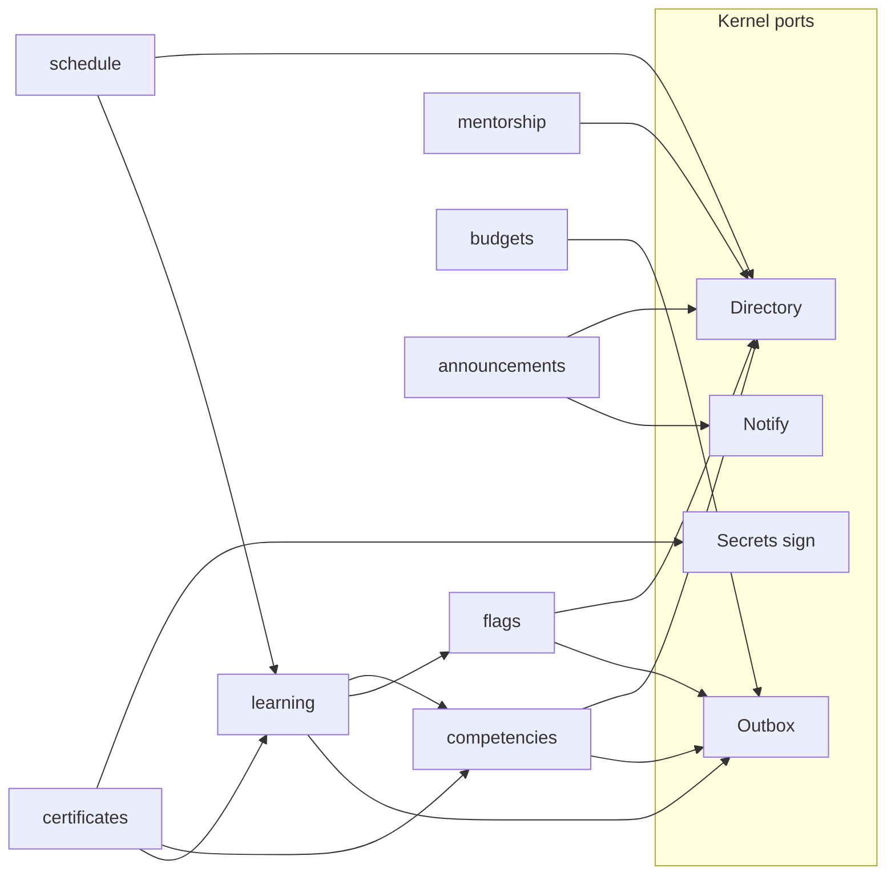

# P1 kernel design — draft A

- **Status:** Competing draft. Not an execution plan. Tasks in §14 start only after this draft and the proposed ADRs are accepted.
- **Date:** 2026-11-01
- **Approach:** the simplest workable kernel. One modular process. One transactional outbox. The dispatcher runs in that process, on every replica.
- **Spec:** [`../specs/2026-10-12-plerni-design.md`](../specs/2026-10-12-plerni-design.md) §3–§8, §10, §15 (P1 row), §16
- **Register:** D01, D05–D11, D16, D22, D26, D27, D32 in [`../decision-register.html`](../decision-register.html)
- **Accepted records this draft does not withdraw:** [ADR-0001](../adr/0001-kernel-and-equal-citizen-plugins.md) through [ADR-0007](../adr/0007-pooled-contamination-recovery.md). [ADR-0002](../adr/0002-orm-data-layer.md) (Kysely) and [ADR-0007](../adr/0007-pooled-contamination-recovery.md) (pooler-session discard) are the tenancy substrate P1 reuses.
- **Proposed records:** [ADR-0008](../adr/0008-p1-modular-monolith.md) (in-process host until P2), [ADR-0009](../adr/0009-p1-in-process-outbox-dispatch.md) (defer pg-boss and `LISTEN`), [ADR-0010](../adr/0010-operator-tenant-no-bypassrls.md) (operator tenant, no runtime bypass), [ADR-0011](../adr/0011-digest-signing-port.md) (sign a digest, keep the key).
- **P0:** [`p0-exit-note.md`](p0-exit-note.md). P0 is complete. `apps/kernel/src` is still absent. Product tenancy starts here.
- **Domain input still open:** [#63](https://github.com/tachkovsa/plerni/issues/63), [#64](https://github.com/tachkovsa/plerni/issues/64), [#65](https://github.com/tachkovsa/plerni/issues/65), [#66](https://github.com/tachkovsa/plerni/issues/66) had no comments on 2026-11-01. This draft does not invent their answers. [#62](https://github.com/tachkovsa/plerni/issues/62) is the maintainer signing-key runbook. This draft does not write it.

**Goal.** A kernel small enough that every learning feature is a plugin, with a P1 that can install, enable, upgrade, and remove those plugins without a kernel change.

**Architecture.** The kernel process serves HTTP, owns tenancy, identity, grants, the directory, audit, storage, secrets, notification plumbing, and the outbox. Plugins are modules the host loads from an install journal. They talk to the host through port types and to each other through public zod contracts and the outbox. PostgreSQL row-level security is the tenant wall. Each tenant enables the plugins it uses.

## 1. What this draft changes, and what it keeps

Adopting draft A accepts four proposed ADRs and amends two timing lines. The P1 exit criteria in spec §15 stay: the two-tenant suite (including events, cursors, and a vacuity guard), the named API-only workflows, and the backup/restore drill with `restore_epoch`.

| Topic | Accepted record | Draft A |
|---|---|---|
| Where plugin code runs in P1 | ADR-0004: one child process per plugin, as the v1 mode | In-process, behind the same port types. Child processes start in P2 (ADR-0008). |
| Durable work | ADR-0003: one outbox, then a relay and pg-boss | The same outbox and the same cursor rules. Dispatch is in-process. pg-boss and `LISTEN` wait (ADR-0009). |
| Operator who addresses every tenant | D05: one canonical policy, `tenant_id NOT NULL` | A real operator tenant. Fan-out is one transaction per target. No runtime `BYPASSRLS` (ADR-0010). |
| Signing | Spec §6: secret store holds keys | A digest-sign port. Plugins never receive key bytes (ADR-0011). |
| Process manager | Spec §4.3: SDK helper plus one worked example | Deferred to the first workflow that needs compensation. The P3 goal-and-assignment example is that workflow (§5.5). |
| Proof of human | Spec §8, landing with proposals in P3 | Unchanged. P1 enforces the rule by refusing mutating MCP calls and by refusing sensitive and destructive routes to service principals (§12). |
| Tenancy substrate | ADR-0002, ADR-0007, plan §2 hygiene | Unchanged. |
| Equal citizenship, RLS, API-first, AI proposes / humans commit | D01, D05, D26, D32 | Unchanged. |

P2 still owns the external tarball, signature verification, the runner, declarative screens, and the egress and crash-isolation exits. P3 still owns the provider gateway, the proof-of-human ceremony, MCP writes, and the full competencies and learning workflows. The plugins in §11 are thin proofs that the kernel can host those features. They are not the P3 product.

## 2. Kernel boundary

### 2.1 Inside the kernel

The kernel is the only version-conservative component (spec §3). P1 ships these services, and no domain rules inside them.

| Service | P1 responsibility |
|---|---|
| Transport | Hono behind `apps/kernel/src/transport/`. Handlers speak Web `Request` and `Response`. A lint fails a `hono` import anywhere else (D09). |
| Tenancy | Tenant registry, transaction-local `plerni.tenant_id`, the application guard, the plan §2 hygiene order, ADR-0007 discard. |
| Identity | Local email and password, sessions, revocation epoch, OIDC authorization-code with PKCE, service principals. |
| Directory | Users, groups, membership, typed relation edges. Edge types are rows, written from a manifest at enable time. |
| Authorization | Resource type, resource id, action, grants, relationship-qualified grants, time-boxed delegation. Plugin namespaces come from manifests. |
| Action class | Every mutating route is `routine`, `sensitive`, or `destructive`. P1 refuses sensitive and destructive routes to MCP actors and to service principals. |
| Plugin host | Manifest, install journal, dependency graph, migration runner, in-process loader, per-tenant enable. |
| Broker | Admitted SQL, WorkUnit commit, authz predicates injected before execution. |
| Outbox | Append-only log, subscriptions, job claims, in-process dispatcher. |
| Audit | Append-only, commitment-chained per tenant, written in the WorkUnit transaction. |
| Storage | Object-storage port. Keys are prefixed by tenant id. |
| Secrets | Envelope encryption, `sign` and `verify` on digests (ADR-0011). |
| Notifications | Channels, preferences, dedup, delivery. Templates and copy are plugin content. |
| Cache | Redis-protocol port. Default server is Valkey (D22). |
| Maintenance | Platform mode `off`, `read_only`, `closed`. |
| Surfaces | `api` or `api+shell` chosen at boot. |
| MCP | Curated read tools generated from the contract registry. |
| Admin shell | Kernel screens only: sign-in, tenants, directory, grants, plugin enablement, maintenance, audit. |
| Telemetry | OpenTelemetry traces, metrics, and logs. Plugin attributes cannot overwrite host identity. |

`apps/kernel/README.md` already reserves this tree. P0 left it empty on purpose.

### 2.2 Outside the kernel

These are plugins. The kernel source does not contain their rules, their table names, or their words where those words are governed nouns (`docs/gates/domain-nouns.txt`).

- Competencies, indicators, and 180/360 assessments.
- Courses, lessons, assignments, and completion.
- Scheduled sessions (the product feature "events").
- Mentorship pairs.
- Training budgets. The AI budget ledger is a P3 gateway table, and it is not this plugin.
- Certificates.
- Announcements.
- Feature flags and A/B tests.
- Reports and metrics (issue #66), once someone names them. They subscribe to plugin events.
- HR, SSO beyond OIDC, content, and calendar integrations (issue #64). SCIM and SAML stay P4 plugins. The kernel owns the `identity.deprovision` command they will call (spec §6).
- Provider adapters and retrieval (spec §8).

Notification templates, report definitions, and eligibility rules live in the plugin that owns the feature. The kernel stores and delivers; it does not interpret them.

### 2.3 What "no kernel change" means

A plugin is added by a new tree under `plugins/<id>/` and a journal row. The proof is mechanical:

1. `git diff` on `apps/kernel/` is empty for that pull request.
2. `node scripts/gates/kernel-purity.mjs` exits 0. The gate scans `apps/kernel/src` for the governed nouns as whole words.
3. An import check fails if `apps/kernel/src` imports from `plugins/`, and fails if a plugin imports another plugin except through that plugin's `contract.ts` entry.
4. The loader resolves the module from the journal. Plugin ids are data. Several ids (`competencies`, `mentorship`) are themselves governed nouns, so a `switch` on them in kernel source would fail the purity gate even if the behavior were generic.

The host primitives those plugins use (directory, fan-out, sign, notify, evaluate-style query ports) ship in the kernel tasks before any proof plugin. Adding the next plugin does not add a primitive.

### 2.4 Repository layout P1 fills

```
apps/kernel/src/     transport, tenancy, identity, directory, authz,
                     broker, outbox, host, audit, secrets, storage,
                     cache, notify, mcp, maintenance
apps/shell/          kernel screens only, until P2 renders plugin slots
packages/contracts/  zod schemas, error codes, port types, event envelope
packages/sdk/        thin helpers over the port types
plugins/<id>/        manifest, contract.ts, sql/, handlers, locales
```

`packages/sdk` in P1 is the in-process helper. P2 swaps the transport under the same types (ADR-0008).

## 3. Plugin manifest and lifecycle

### 3.1 Manifest

The manifest is a zod object in the plugin package. Admission parses it with the host's copy of the schema. The host does not compile a schema the plugin supplies at runtime (spec §4.4).

| Field | Rule |
|---|---|
| `id` | Stable identifier matching `[a-z][a-z0-9_]{0,30}`. Schema name is `plugin_<id>`. |
| `version` | Semver. |
| `sdk` | Semver range of `packages/sdk`. Outside the range, activation fails. |
| `license` | SPDX identifier. The platform does not relicense the plugin (spec §4.1). |
| `requires` | `{ id, range }[]`. Activation fails while a requirement is missing, disabled, or out of range. |
| `optional` | `{ id, range }[]`. Absence is allowed. A call to a missing optional port returns `UNAVAILABLE` with `next_step`. |
| `permissions` | Namespace, resource types, actions, and default role names. |
| `edges` | Relation-edge type names. Enable inserts them as directory rows for that tenant. |
| `routes` | Method, path, stable `operationId`, request and response schemas, permission, action class, `scope` (`tenant` or `platform`), and whether the route is on the MCP read list. |
| `events.publish` | Type, semver, payload schema. |
| `events.subscribe` | Type pattern and accepted semver range. |
| `jobs` | Name, payload schema, optional cron (`next_run_at`), optional `fanout`. |
| `migrations` | Path of the SQL directory. |
| `ui` | Declarative slot documents. P1 stores them. P2's shell renders them. P1's shell does not show a control for a slot it cannot draw (principle 2). |
| `grants` | Port grants: `secrets.sign`, `storage`, `cache`, `notify`, `http`, `tenants.list`. |

`fanout` is `none` (default), `named_tenants`, or `all_customer_tenants`. The last two require `scope: platform` and an operator session (ADR-0010).

### 3.2 States

Spec §4.5 separates artifact stages from per-tenant enablement. P1 keeps that split.

**Artifact journal** (cluster-wide, kernel-internal): `installed → migrated → active → failed`.

**Per-tenant row** `tenant_plugins (tenant_id, plugin_id, enabled)`: a tenant that has not enabled a plugin gets `NOT_FOUND` on its routes, and its subscriptions for that plugin stay parked. The tables exist, because the database is shared (D05). The enable guard is what makes "this tenant does not use courses" true. The vacuity test inserts a row, disables the plugin, and asserts `NOT_FOUND`. A suite that only checks an empty table does not prove the guard.

### 3.3 Install, enable, upgrade, uninstall

Install authority is the operator. Tenant admins enable and disable. They do not upload code (spec §4.5).

**Install.** The operator points `admit` at a workspace package (P1) or, later, a verified tarball (P2). `admit` checks the manifest, the dependency graph, the license field, and the migration set. It records the package digest in the artifact manifest. It does not execute plugin code yet.

**Migrate.** The journal applies pending SQL in dependency order, one plugin schema at a time, under the migration role. Then it runs the boundary checker against the live database (spec §4.6). A failure leaves the artifact `failed` and the previous version's schema untouched when the migration ran inside its own transaction. Each migration file carries a signed approval: the approver identity, a digest of the file bytes, and a timestamp. The verifier uses the public key already published at `scripts/gates/approvals/maintainer.pub`. Issue #62 is the backup and rotation guide for the matching private key. This draft does not write that guide, and it does not introduce a second trust root.

**Activate.** P1 activation is a readiness-gated rolling restart of kernel replicas, one replica at a time (the spec's v1 activation, applied to the monolith). The new process loads active plugins from the journal. A plugin that throws during load marks itself `failed` and the process still serves the plugins that loaded. That is a best-effort isolation inside one process. ADR-0008 states the limit: a native crash can still take the process down. Spec §16.4 stays a P2 test.

**Enable.** A tenant admin enables an active plugin for their tenant. The host writes `tenant_plugins`, registers edge types and permission catalog rows for that tenant, and unparks subscriptions. Default roles are created only when the tenant has not edited them. New permissions on a later version arrive ungranted for a tenant that has edited its roles, until an admin maps them.

**Disable.** The host refuses while a required dependent is still enabled for that tenant. The operator disables dependents first. Disable parks cursors, stops new executions, and keeps the schema so export still works. Re-enable catches up inside a budget (spec §4.5). Events fired while parked are retained inside the quota and replayed on enable. The quota is the spec's window: 30 days, or a provisional size cap of 256 MiB per parked subscription, whichever comes first.

**Upgrade.** Expand-contract only while any replica still runs the previous version. The preflight refuses a contractive migration until every replica reports the new version. Order: backup on an appliance, migrate, rolling restart, then version-aware route activation. Old replicas keep claiming jobs whose handler version they implement. Jobs for a version they do not implement stay queued for a replica that does.

**Uninstall.** Disable every tenant, export, then drop `plugin_<id>` after an operator acknowledgement. The export is the spec §4.5 archive: schema rows, referenced objects, and the grants and config needed to read them. Kernel tables stay. A required dependent blocks uninstall the same way it blocks disable.

### 3.4 Two replicas

Activation and migration take a transaction-scoped advisory lock on a dedicated connection, with a 5 second wait and a 60 second wall clock (spec §7). The second replica waits or fails with `UNAVAILABLE` and `next_step`. It does not start a second migration.

## 4. Migrations and the dependency graph

### 4.1 Who owns the tables

Each plugin owns one schema, `plugin_<id>`, containing tables, indexes, and constraints. Migrations contain no functions, no triggers, and no `DO` blocks (D08). The migration role has `CREATE` on that schema only. Runtime grants are `SELECT`, `INSERT`, `UPDATE`, `DELETE`. The grant linter rejects `GRANT ALL`.

Every tenant-domain table has `tenant_id NOT NULL`, `ENABLE ROW LEVEL SECURITY`, `FORCE ROW LEVEL SECURITY`, and exactly one canonical policy whose text the checker compares, not merely its presence. Foreign keys to kernel identity are the declared read-only `REFERENCES` on `users (id, tenant_id)` (spec §4.6). Any other reference into `kernel` fails admission. A foreign key into another plugin schema fails admission.

Plugin statements use schema-qualified names. The pinned `search_path` is `kernel, pg_catalog`. Admission rejects an unqualified table name and rejects a schema other than the caller's own, with the one `users` reference above.

### 4.2 Graph

`requires` and `optional` form a directed graph. Admission rejects a cycle, a missing required id, and a version range the installed plugin does not satisfy. Migration order is the topological order of `requires`, dependencies first. An optional dependency, when it is installed, migrates first too. The dependent's SQL still cannot mention that schema.

Per-tenant enable follows the same edges. A tenant cannot enable `learning` while a required dependency is disabled. Optional edges do not constrain enablement. The call site in the dependent uses its declared default when the optional plugin is disabled. Feature flags are optional for every proof plugin that consults them: the default is the variant the caller already chose.

### 4.3 WorkUnit

Plugins submit writes to the broker. One WorkUnit is one transaction: plugin statements, audit rows, and outbox rows. Preconditions (`expect` on resource version) abort the whole unit with `CONCURRENCY_CONFLICT` when the version mismatches. Lock reads are the only reads inside the unit, and they are declared. Multi-aggregate units lock aggregates in id-sorted order (spec §4.3).

The broker executes plugin statements as the plugin's runtime role and writes audit and outbox as the broker role in the same transaction (`SET LOCAL ROLE`, then reset). The plugin role has no `INSERT` on `kernel.outbox`. Admission rejects a statement that names `kernel.outbox` or `kernel.audit`.

The connection hygiene order, inside that transaction, is the P0 order plus the role switch:

1. `BEGIN`.
2. Inspect before any local override: named `plerni.*` settings via `current_setting(name, true)` (empty string counts as absent), `current_user = session_user`, and `search_path` equal to the pinned value.
3. Contamination terminates the backend, discards the pooler client session (ADR-0007), alerts, and retries at most twice on a fresh session. Then it fails loudly.
4. `set_config('plerni.tenant_id', authorized, true)` and read it back.
5. `SET LOCAL ROLE` to the plugin runtime role, run plugin statements, reset the role, append audit and outbox.
6. `COMMIT`.

The application guard compares the host's authorized tenant to the readback before any tenant read. A missing tenant fails closed at RLS and at the guard (spec §5).

## 5. Event bus

ADR-0009 is the decision. This section is the behavior implementers test.

### 5.1 What commits together

A WorkUnit insert into `kernel.outbox` is in the business transaction. For `kind = job` the same transaction inserts `kernel.job_claim`. A crash after commit and before the handler leaves a row the poll will claim. A crash before commit leaves nothing. There is no dual write to a second queue.

`kernel.outbox` and `kernel.job_claim` are kernel-internal. They have no tenant policy. The broker service role is the only runtime role that can write them. `tenant_id` on those rows is the tenant the handler must enter. It is `NOT NULL`. Platform fan-out writes the operator tenant on the parent bookkeeping row and the target tenant on each child claim (ADR-0010).

### 5.2 Events

Columns: `seq bigserial`, `tenant_id`, `kind`, `aggregate_type`, `aggregate_id`, `type`, `version`, `payload jsonb`, `created_at`.

- **Delivery.** At-least-once across processes. The inbox transaction is the exactly-once boundary inside PostgreSQL. The SDK documents that, in the package README that ships with the port types.
- **Ordering.** Per aggregate only, and only as far as the writer's row lock plus the 10 second horizon guarantee it. There is no global order. Consumers that need an order key off one aggregate.
- **Cursors.** One `last_seq` per subscription. The reader takes rows with `seq > last_seq` and `seq <= safe_point`, where `safe_point` is the greatest `seq` with `created_at` at least 10 seconds old.
- **Filters.** A subscription names a type pattern. Non-matching rows are skipped and the cursor may pass them. A filtered subscription cannot stall on types it ignores (spec §7).
- **Versioning.** The consumer declares a semver range. A matching row outside the range parks the subscription: cursor unchanged, row retained, error `UNKNOWN_EVENT_VERSION`, alarm raised. The host does not parse the payload with a best-effort schema. A later consumer version that accepts the range unparks and continues. An operator may force-advance only after an audited export, the same escape spec §4.5 gives parked backlogs.
- **Duplicates.** `UNIQUE (subscription_id, seq)` makes a redelivery a no-op when the first inbox transaction committed.
- **Retention.** The low-water mark is the minimum `last_seq` among live subscriptions. Parked subscriptions are exempt inside the §3.3 quota. Poison rows that exhaust the attempt budget go to `kernel.outbox_dlq` and raise an alarm. They are not deleted quietly.
- **Gaps.** A rolled-back `seq` is an absent row. Once the horizon passes the gap, the reader moves on. No tombstone.

Worked version case, used as a test: a consumer accepts `learning.assignment.completed` at `>=1.0.0 <2.0.0`. Version `1.1.0` is delivered. Version `2.0.0` parks that subscription. A different subscription that does not match the type advances past the same row.

### 5.3 Jobs

`kernel.job_claim` holds `outbox_seq`, status (`QUEUED`, `ACTIVE`, `COMMITTED`, `CANCELLED`, `ABANDONED`), attempts, `available_at`, `lease_until`, `fencing_token`, `idempotency_key`, handler version, and tenant id.

- Claim is `FOR UPDATE SKIP LOCKED` on rows that are due and either `QUEUED` or `ACTIVE` with an expired lease. The winning statement sets `ACTIVE` and a new fencing token only from `QUEUED`. An expired `ACTIVE` row is the sweeper's to mark `ABANDONED`, after which a new claim may create a new attempt. The sweeper never updates `QUEUED` or a terminal row.
- The handler's effects and the `ACTIVE → COMMITTED` update share one transaction and require the fencing token. Zero rows aborts the effects.
- `UNIQUE (tenant_id, plugin_id, idempotency_key)` collapses a duplicate enqueue.
- Cron is `available_at`. A recurring job's idempotency key includes the scheduled instant, so a late poll still runs that instant once.
- Attempt budget defaults to 5. The lease cold-start default is 60 seconds (spec §7) until a measured p99 replaces it. `expiredIn`-style expiry stays at least three times the handler p99 once that p99 exists.
- Heartbeats run on the replica's dedicated dispatcher connection, outside the effect transaction. Shutdown stops scheduling heartbeats, then resolves the effect transaction, then drains heartbeats that are already in flight (plan §4 B2).

### 5.4 Cluster dispatch

Every replica runs the same loop. There is no leader election. The dedicated connection on each replica polls every 1 second and is also nudged by an in-process timer after a local commit. Two replicas cannot both advance one subscription: the claim update is conditional on the lease. Fairness, provisional until P4 measures them: a batch of 32 due rows, at most 4 concurrent handlers per tenant per replica. Oldest-pending age is a metric and an alert. Boot fails the readiness check when the dispatcher loop is not running.

Spec §16.17 applies to this dispatcher. The `NOTIFY` clause is met by the absent-listener case: polling dispatches within the 1 second floor.

### 5.5 Cross-plugin consistency

A plugin does not read another plugin's tables. It calls a public query port or it consumes an event (spec §4.8). A unit of work never waits on another plugin inside the broker transaction.

P1 does not ship the process-manager helper from spec §4.3. None of the proof plugins need a compensating multi-plugin transaction. The first product workflow that does (the P3 goal-and-assignment example) adds that helper in its own change. Until then, a plugin that needs two steps stores the intermediate state in its own table and emits an event. Surfaces show that state as pending (principle 6).

## 6. Tenancy, identity, roles, and permissions

### 6.1 Tenancy

One database, shared tables (D05). Dedicated databases stay out of v1.

| Class | Rule |
|---|---|
| Tenant-domain (kernel and plugin) | `tenant_id NOT NULL`, enable and force RLS, one canonical policy. |
| Kernel-internal (outbox, claims, cursors, tenant registry, dispatcher leases) | No tenant policy. Grants go to named service roles. The two-tenant suite exercises each of those roles. |

The canonical policy is one expression: the row's `tenant_id` equals the transaction-local setting `plerni.tenant_id`. The boundary checker compares the policy text.

Pooling is PgBouncer in transaction mode, as Spike A measured. The request pool carries no session `SET`, no `LISTEN`, and no session advisory lock. The dispatcher connection is dedicated and unpooled (ADR-0009). Read replicas are out of scope for P1 because the pinning model does not survive a replica lag (spec §5).

Tenant reference data is versioned per-tenant migrations applied by the journal in batches, not rows inserted only at provision time (spec §5).

Erasure is export, then delete, then destruction of that tenant's data keys so encrypted objects stay unreadable (spec §5). Audit keeps a tombstone (who, what, when) and drops payload content. The P1 drill covers export and the tombstone. Crypto-shredding of object storage is part of the same drill once the secret store exists (task K14, task K19).

### 6.2 The operator tenant

ADR-0010. Bootstrap creates the operator tenant and its admin before any customer exists. `POST /api/v1/tenants` creates a customer tenant. `POST /api/v1/tenants/{id}/admin` bootstraps that tenant's first admin and returns a one-time setup token. The audit row stores a hash of the token. Logs store neither the token nor the password.

Customer sessions set the GUC to their tenant. Operator sessions set it to the operator tenant. A platform route that must write one customer tenant (OIDC configuration) starts a new transaction whose authorized tenant is the path parameter, and only after the operator check. The audit records both identities.

### 6.3 Identity

P1 includes the local identity provider and the OIDC module (spec §6, D16).

- Passwords use argon2id. MFA secrets and rescue codes are stored encrypted. Rescue codes are single-use. Reset requires a verified email. Login and recovery are throttled.
- Sessions are opaque tokens stored hashed. PostgreSQL is the revocation authority: `sessions` plus `user_auth_state.revocation_epoch`.
- Local disable is one transaction: set disabled, bump the epoch, revoke sessions, audit, and schedule the cache invalidation. A later OIDC login does not clear a local disable.
- Ordinary requests trust an identity-freshness lease of 5 minutes. Admin and sensitive routes read the session row on every request. A tenant policy `strict_disable` makes that per-request check universal.
- OIDC is authorization-code with PKCE, exact redirect match, and issuer and mix-up checks. Tokens from the identity provider stay on the server. Linking uses issuer plus subject. Email match does not merge accounts.
- The cache may store the freshness deadline with a TTL at most the lease. It never authorizes. A restored cache can only shorten access (spec §16.15).
- `identity.deprovision` is idempotent on `event_id` and rejects a stale incarnation. P1 exposes the command. The SCIM plugin that calls it is P4.
- Break-glass admins are local, rate-limited, and audited. WebAuthn binding for break-glass is the spec's control; P1 stores the credential and checks it on those routes. The broader proof-of-human ceremony remains P3 (§12).

Durations a tenant may override: access credential 5 minutes, session idle 12 hours, absolute session 7 days, admin session 1 hour. The protocol is not overridable (D16).

### 6.4 Roles and permissions

Authorization is generic (D27, D32). A plugin manifest declares a namespace, resource types, and actions. The kernel stores grants as `(tenant, principal, resource_type, action, scope)`. Scope is `tenant`, a resource id, or a relationship: the holder of edge `reports_to` toward the subject may `read` resources of a named type. Edge names are data. `reports_to` ships as a directory edge the competencies proof registers; the kernel does not special-case the name.

Time-boxed delegation is a grant with `expires_at`. A sweeper revokes it when the time passes and writes an audit row. Principals are users or service principals. Evaluation is the same function for a human session, a service principal, and an MCP actor (spec §6).

The broker injects the object-level predicate before execution (spec §4.3). A  list of people in one tenant is filtered in the query, not after the rows come back. Same-tenant tests cover "person A cannot read person B's row" for a fixture resource and for each proof plugin.

Issue #65 will name real roles (learner, manager, author, auditor, and whoever else the comments add). Those names become default role maps inside plugins. They do not become kernel enums. If a comment needs a principal the directory cannot express, that is a new ADR, and this draft's bet is that users, groups, edges, and grants will cover it.

### 6.5 Service principals

Tenant-scoped, hashed, expiring, rotatable, revocable. Client-credentials for a confidential integration. An upstream identity-provider token is never accepted as a Plerni token. P1 uses opaque tokens. JWT stays unused until a real offline-verification case appears (spec §18).

Sensitive and destructive routes reject service principals in P1 (§12).

## 7. Contract versioning

Four axes, independent, from contract conventions R2: kernel release, plugin package, SDK protocol, public API. A change names the axis it moves.

Breaking changes, enforced when the subject exists:

| Artifact | Breaking change |
|---|---|
| Route | Remove or rename an `operationId`, tighten a request schema, loosen a response schema, or change an error code's meaning. |
| Event payload | Remove, rename, or retype a field without a major bump. |
| Job payload | Same, or an envelope change without a version bump. |
| Port | Signature or semantic change without an SDK major. |
| SDK | Semver. |
| Plugin public contract | Same rules as an event payload. The snapshot lives in the plugin at `contract.snapshot.json`. |

The compatibility window covers API clients, queued jobs, parked events, and installed plugins across one SDK major (spec §10, R2.3). During a rolling restart, kernel N and N+1 both serve. Handlers skip job versions they do not implement and leave them queued (§3.3).

Plugin public contracts are zod modules at `plugins/<id>/contract.ts`. Dependents import that file and nothing else from the plugin. Admission registers the schemas into the deployment registry. The kernel does not import them by hand. Unknown event versions park (§5.2, R5.3).

Error envelope, on every surface: closed `code`, human message, mandatory `next_step` (R3). P1's closed set is `VALIDATION`, `UNAUTHENTICATED`, `FORBIDDEN`, `NOT_FOUND`, `CONCURRENCY_CONFLICT`, `RATE_LIMITED`, `UNAVAILABLE`, `UNKNOWN_EVENT_VERSION`, `INTERNAL`. Adding a code is a contract change. HTTP maps `CONCURRENCY_CONFLICT` to 409 and `UNAVAILABLE` to 503. MCP maps the same envelope to a tool result with `isError: true` and never to a transport-protocol error (R3.2).

Every mutating route's manifest class is linted against the contract (R4.1). A mutating route with no class fails CI.

The no-AI inventory (R6) for P1 is the five API-only workflows in §10.1. Each test id is the workflow's acceptance test. The workflows call no model.

## 8. MCP surface

One registry produces REST, OpenAPI, and MCP descriptors (D26, R1). Hand-written OpenAPI or MCP descriptors fail review. P1's MCP surface is the curated read list. Write tools arrive with the proposal ceremony in P3 (spec §10).

Curated kernel reads:

| Tool | Permission |
|---|---|
| `platform.status` | public, so a maintenance page and a probe can read it |
| `session.self` | the caller |
| `directory.users.list` and `directory.groups.list` | the caller's directory read grant, predicates already applied |
| `directory.edges.list` | same |
| `audit.list` | audit read grant; payload hashes, not restored secrets |
| `plugins.enabled.list` | tenant admin, or the caller reading their own tenant's list |
| `tenants.list` | operator only |

A plugin read route joins the list only when its manifest says `mcp: read`. The alignment test generates the manifest, compares it to the curated inventory, and runs one real MCP client against `session.self` and `platform.status`. Schema and permission are the same object the REST route uses.

Authentication is a tenant-scoped service principal or authorization-code with PKCE delegated to a user. Dynamic client registration waits until P4 (spec §10). There is no privileged agent API and no token passthrough. An MCP actor holds the principal's grants and no more. In P1 those grants are read grants on this list. A request that would mutate returns `FORBIDDEN` with `next_step` pointing at the human route.

Uploads, streaming, and the admin shell's maintenance switch stay REST-only.

## 9. Contract versioning of the kernel API

The public HTTP API is `/api/v1`. Operation ids are stable. The generated OpenAPI document is deployment-specific: kernel routes plus routes of plugins in the `active` artifact state. Per-tenant enablement is enforced at the route, so a disabled tenant receives `NOT_FOUND` even though the operation is in the document. Clients discover the active set through `plugins.enabled.list` and `platform.status`.

Pagination is keyset, with sort columns from the query's declared allowlist (spec §4.3). The broker composes the `ORDER BY`. Callers do not send a column name as a raw fragment.

## 10. Kernel test cases

These four are kernel features. They are test cases for the process, the cache, and operations. They are not plugins.

### 10.1 API-only run mode

`surfaces` is `api` or `api+shell`, read at boot. `api` does not mount shell assets. REST, OpenAPI, MCP, health, and `platform.status` still mount. The handlers are the same functions in both modes.

The spec §15 workflows, all required green with `surfaces=api` and no shell process:

1. Create a customer tenant.
2. Bootstrap that tenant's admin.
3. Provision a service principal.
4. Rotate that principal's credential. The previous secret fails on the next call. The new secret succeeds.
5. Configure OIDC for that tenant (issuer, client id, redirect). A sign-in redirect uses the stored issuer.

Each workflow has a no-AI test id (R6). The one-time secrets appear in the HTTP response of the creating call and nowhere in logs.

### 10.2 Redis-compatible cache

The cache port speaks the Redis protocol. The default deployment is Valkey, which D22 selects because its license fits an Apache-2.0 appliance. A deployment may point the same port at another Redis-protocol server. The client library and its pinned version are chosen in the implementing pull request, against a live registry record, per the dependency rule in AGENTS.md.

P1 uses the cache for:

- the identity-freshness deadline (TTL at most the 5 minute lease),
- rate-limit counters,
- the maintenance mode cache (provisional TTL 2 seconds) plus an explicit invalidation on write,
- plugin entries via the port, keyed by tenant id and plugin id, so one plugin's keys are invisible to another.

PostgreSQL remains the authority for sessions, revocation, maintenance mode, and the outbox. If the cache is down, rate limits fail closed (`RATE_LIMITED`), session checks read PostgreSQL, and maintenance fails closed to `closed`. Plugin cache calls return `UNAVAILABLE`. The bus does not use the cache. Dispatch is the PostgreSQL poll.

Plugins do not receive a connection string. The P1 suite greps plugin source for a Redis client import and fails on a hit.

### 10.3 Cluster deployment

P1's cluster is two or more stateless kernel replicas behind a proxy, one PgBouncer in transaction mode, one PostgreSQL, one Valkey, one object-storage bucket. Session affinity is unnecessary: the session is an opaque token checked in PostgreSQL.

Each replica serves HTTP and runs the dispatcher on its dedicated connection (§5.4). Rolling upgrade restarts one replica at a time. Readiness is false until migrations known to this version are applied and the dispatcher loop is running. Liveness stays true while the process can answer `platform.status`, including during maintenance.

The duplicate/loss battery from spec §16.17 runs against two replicas. The acceptance subset for P1 is task K10.

### 10.4 Maintenance page

`kernel.settings` holds `platform.maintenance` = `off | read_only | closed`. An operator route sets it. The audit row records the actor and the previous value. Replicas cache the value (§10.2) and converge within the TTL even if they miss the invalidation.

| Mode | Behavior |
|---|---|
| `off` | Normal. |
| `read_only` | Mutations return `UNAVAILABLE` with `next_step`. Reads proceed. The dispatcher stops claiming new work and finishes the transaction already open. |
| `closed` | Tenant routes return `UNAVAILABLE`. `GET /api/v1/platform/status` and liveness stay up. Readiness goes false so the proxy stops sending new traffic. The status body is also what a client sees if a request still lands. |

The shell, when it is mounted, calls `platform.status` before drawing tenant screens. On `read_only` and `closed` it draws the maintenance view from the UI kit and does not mount tenant routes. API-only deployments have no page. The status document is the contract. A static page in front of the proxy is an operator choice and is outside the kernel.

A replica that cannot read the settings row fails closed to `closed`.

## 11. Plugin walkthroughs

Each walkthrough is a thin proof plugin. The product depth (full catalogs, full reports, the pilot) is P3 and later. The proof is the same four checks as §2.3, plus the assertions below. Issue #63's stories, when they arrive, become fields and flows inside these plugins or inside further plugins. They are not kernel services.

Shared proof bar, executed by each plugin's pull request:

- The diff under `apps/kernel/` is empty.
- Kernel purity exits 0.
- The import check exits 0.
- Two tenants with the same domain identifiers see only their own rows through the pooled datasource.
- Disabling the plugin for tenant B returns `NOT_FOUND` on B's route after a row was inserted (vacuity for the enable guard).
- A sensitive route called with an MCP credential returns `FORBIDDEN`.

### 11.1 Competencies

Plugin `competencies`. Schema `plugin_competencies`.

Tables: `frameworks`, `indicators` (self-parent for a tree), `scales`, `assessments` (`kind` of `one_eighty` or `three_sixty`), `raters`, `responses`, `proficiency_records`.

On create of a 180 assessment the handler calls the directory port for edge `reports_to` toward the subject and stores the holder as a rater. On a 360 assessment it also snapshots a peer group the caller names. Rater user ids reference `users (id, tenant_id)`. The edge type `reports_to` is declared in `edges` and inserted for the tenant at enable. The kernel has no column for it.

Public contract: `competencies.indicator.read`, `competencies.proficiency.read`. Events: `competencies.assessment.submitted` at `1.0.0`, `competencies.proficiency.recorded` at `1.0.0`. Recording a proficiency is `sensitive`. A human session in the tenant may call it. Submission of answers is `routine` for the rater.

The proof creates one indicator, one 180 assessment, one response, and one proficiency, and shows a second tenant with the same indicator id reading zero rows.

### 11.2 Courses

Plugin `learning`. The product word is course. The id `learning` matches the spec's P3 plugin so the later product fills this package instead of inventing a twin.

Tables: `items` (the catalog row), `lessons`, `assignments`, `completions`.

`optional` dependency on `competencies` and on `flags`. With competencies installed, an assignment may store a proficiency id obtained through `competencies.proficiency.read`. With it disabled, the assignment still saves and the link is null. Completion writes `completions` and emits `learning.assignment.completed` at `1.0.0`. The handler does not write a proficiency row. Completion and demonstrated skill stay separate (spec §16).

The proof assigns one item to one user, completes it, and shows the event in the outbox of that tenant only.

### 11.3 Scheduled sessions (events)

Plugin `schedule`. This is the calendar feature. The bus word "event" stays reserved for the outbox.

Tables: `sessions`, `audiences`, `attendance`. An audience row stores a directory group id. Attendance stores user ids snapshotted from that group at scheduling time, through the directory port.

`optional` dependency on `learning`: the session may store an item id from `learning.item.read`. With learning disabled, the session still saves.

Events published: `schedule.session.scheduled`, `schedule.attendance.recorded`, both `1.0.0`.

The proof schedules one session for one group and records one attendance.

### 11.4 Mentors

Plugin `mentorship`. The noun stays in this package, which keeps it out of `apps/kernel/src`.

Tables: `pairs` (mentor user id, mentee user id), `agreements`. Manifest `edges` includes `mentors`. A relationship grant, stored by the kernel as generic data, can say the holder of `mentors` toward the subject may read a resource type the learning plugin owns. The grant row is written with the kernel's grant API. No kernel code mentions the edge.

The proof creates one pair and one grant, then reads a fixture resource as the mentor and as a stranger. The stranger receives `FORBIDDEN`.

### 11.5 Budgets

Plugin `budgets`. Training spend. It is not the P3 AI ledger.

Tables: `envelopes` (amount, currency, period, directory group id), `entries` (amount, `source_event_id`).

`optional` subscription to `learning.assignment.completed` at `>=1.0.0 <2.0.0`. The handler appends an entry when the payload carries a cost, idempotent on `source_event_id`. With learning disabled, a manual entry still saves. A `2.0.0` payload parks this subscription and leaves prior entries in place (§5.2).

The proof posts one manual entry and one entry from a completion event, and shows a duplicate delivery does not add a second row.

### 11.6 Certificates

Plugin `certificates`.

Tables: `issuances` (subject user id, digest, signature, key reference).

Issuing is `sensitive`. The handler hashes the document in the plugin, calls `secrets.sign` (ADR-0011), and stores the signature and the digest. The document bytes go to the storage port under the tenant prefix. The private key stays in the secret store. `optional` dependencies on `competencies.proficiency.read` and `learning` completion read decide eligibility when those plugins are enabled. With both disabled, an operator-configured manual approval (a sensitive route on this plugin) is the eligibility path.

Event: `certificates.issuance.created` at `1.0.0`.

The proof issues one document, verifies it with `secrets.verify`, and asserts the broker logs contain the digest and the key reference, and do not contain the key-encryption key.

### 11.7 Announcements

Plugin `announcements`.

Tables: `notices`, `recipients`. Both are tenant-domain.

Three scopes, all in this plugin:

| Scope | Who may send | What the host does |
|---|---|---|
| One group | Tenant admin with the announce grant | One tenant-scoped write. Recipients are a snapshot of the directory group. |
| One tenant | That tenant's admin, or the operator via `fanout: named_tenants` | One child execution in that tenant. Recipients snapshot every user in the tenant at send time, paged by keyset. |
| All customer tenants | Operator only, `fanout: all_customer_tenants` | The host writes one child claim per customer tenant. Each child is a separate transaction with that tenant's GUC. |

A customer admin's attempt to use `all_customer_tenants` returns `FORBIDDEN` before any claim is written. The plugin never selects from `kernel.tenants`.

Delivery calls the notify port with a template id the plugin registered. The kernel dedups on an idempotency key of notice id plus user id. Copy lives in the plugin's locale files.

The proof sends one group notice, one single-tenant notice, and one all-tenant notice across two customer tenants, then asserts tenant A's session cannot read tenant B's recipient rows.

### 11.8 Feature toggles and A/B tests

Plugin `flags`.

Tables: `flags` (key, variants with weights, audience), `assignments` (`UNIQUE (tenant_id, flag_id, subject_user_id)`).

The audience is a bounded document: a percentage, a directory group, a relation edge, or a list of user ids. The handler evaluates it through the directory port. The kernel has no flag type.

`flags.evaluate` returns the variant for the current actor. The variant is a stable hash of flag id and subject id into the weights, written once. Two replicas racing the first read hit the unique key; the loser reads the winner's row. A plugin may not pass an arbitrary subject. An admin preview route `flags.evaluate_for` is `sensitive` and takes a subject id explicitly.

An A/B test is a flag with two or more variants. The plugin subscribes to an event type the experimenter names (a string on the flag row) and counts matches. It stores counts. It does not store the other plugin's payload. Exposure emits `flags.assignment.exposed` at `1.0.0`.

Other proof plugins take `flags` as `optional` and keep a default variant. The learning proof hides one lesson behind a flag by calling `flags.evaluate`, and shows the lesson when flags is disabled.

The proof assigns two employees in one tenant, one in a targeted group and one outside it, and shows they can receive different variants. A second tenant with the same flag key has its own assignment.

### 11.9 How the proofs compose



Solid use of a plugin is a public contract or an event. Optional edges are the ones §11 marks `optional`. Removing `learning` leaves competencies, schedule (without an item link), budgets (manual entries), and certificates (manual eligibility) working. The kernel process boots either way.

## 12. AI proposes, humans commit

P1 makes the rule true at the authorization boundary. P3 adds the ceremony spec §8 describes. This split is deliberate: the ceremony needs WebAuthn step-up, impact preview, and durable proposal expiry, and those are P3 exit material. P1 does not invent a weaker ceremony and call it the same thing.

P1 rules:

- MCP is read-only (§8). An assistant can read what the principal may read, and can draft text in a client. It cannot call a mutating route through MCP.
- Service principals cannot call `sensitive` or `destructive` routes.
- A human session can. Admin and sensitive routes re-read the session row (spec §6).
- Plugins classify every mutation in the manifest. The lint is on in P1 (R4).
- The proof plugins use that class: recording a proficiency, issuing a certificate, sending an all-tenant announcement, and previewing another person's flag variant are `sensitive`.

P3 wraps the same classified routes in the durable proposal: the assistant submits a proposal, a human approves with proof-of-human, and the broker consumes the approval once. Because the routes and the classes already exist, that wrap is a kernel change of the ceremony, not a per-plugin kernel change. Plugin handlers stay as they are.

The no-AI path for every P1 workflow is the workflow itself (§10.1, R6).

## 13. Risks, open questions, and ADRs

### 13.1 Risks

| # | Risk | What this draft does |
|---|---|---|
| 1 | First-party plugins grow a private import into kernel internals (spec §17.1). | One `admit` function. Import check. Empty `apps/kernel/` diff on every plugin pull request. |
| 2 | The in-process host is described as isolation (spec §17.2). | ADR-0008 states the residual. §16.4 and §16.12 stay P2 tests. The import lint is labeled a lint. |
| 3 | Dispatch in-process couples request latency to the poll (spec §17.4). | Dedicated dispatcher connection. Bounded batch. Readiness fails when the loop is down. Capacity C from ADR-0003 stays the migration trigger. |
| 4 | A platform fan-out becomes a cross-tenant read (D05). | ADR-0010. One GUC per child transaction. Operator plugin role has no grant on customer schemas beyond the ordinary policy, which shows only the operator tenant. |
| 5 | Domain nouns leak into the loader (spec §3). | Journal-driven load. Purity gate. Proof plugins whose ids are governed nouns. |
| 6 | Issue #63–#66 arrive with a concept the directory cannot express. | Open question below. The bet is explicit so a contrary comment forces an ADR instead of a quiet kernel enum. |
| 7 | Signing-key operations and the maintainer key get conflated. | ADR-0011 versus issue #62. Different keys, different purposes. |
| 8 | Upgrade work crowds out the kernel (spec §17.3). | P1 ships preflight, expand-contract, and the backup drill. Helm and the fresh-VM drill stay P4. |

### 13.2 Open questions

1. **Issue #63.** Which day-one stories are real. This draft's proofs cover an assessment, a course completion, a session, a mentor pair, a budget entry, a certificate, an announcement, and a flag. A story that needs a new plugin is still a plugin. A story that needs a new kernel noun is a conflict with D01 and has to be redesigned or explicitly accepted in an ADR.
2. **Issue #64.** Which integrations are first. OIDC is in the kernel. Everything else is a plugin that uses directory, deprovision, storage, and the bus. Priority among those plugins is not decided here.
3. **Issue #65.** The default role maps. Relationship grants can express "a manager reads a team member's progress" once the resource type exists. Salary-linked fields, if a comment requires them, belong in a plugin table with their own grants. The kernel has no salary column.
4. **Issue #66.** Which metrics. The events in §11 are the raw material (`*.submitted`, `*.completed`, `*.recorded`, `*.exposed`, `*.created`). A report plugin subscribes. P1 does not build the report.
5. **Parked-subscription size cap.** 256 MiB and 30 days are the provisional quota. P4 replaces the byte cap with a measurement.
6. **Claim batch and per-tenant concurrency.** 32 and 4 are provisional envelope numbers, as spec §15 asks P1 to set and P4 to revise.
7. **Cache client.** The implementing pull request pins the Redis-protocol client after checking a live registry record. This draft does not pin it from memory.
8. **Issue #62.** Until the rotation guide exists, production key rotation has no written procedure. Development verifies against the published public key. The guide is a separate pull request.

### 13.3 ADRs

| Record | Status | What accepting it means |
|---|---|---|
| ADR-0008 | Proposed | P1 host is in-process. ADR-0004's child process starts at P2. |
| ADR-0009 | Proposed | P1 dispatcher is in-process over the transactional outbox. pg-boss and `LISTEN` are deferred. The event-log rules of ADR-0003 stay. |
| ADR-0010 | Proposed | Operator tenant. No runtime `BYPASSRLS`. Fan-out is per target tenant. |
| ADR-0011 | Proposed | Digest sign and verify. Keys stay in the secret store. |

No further ADR is required before implementation, provided those four are accepted with this draft. A pull request that changes a port, a trust boundary, or the canonical policy writes its own ADR first (spec §13).

## 14. P1 task breakdown

Tasks are pull-request sized. Each one is independently reviewable. High-risk tasks (authorization, tenancy, cryptography, plugin admission, migrations, policy) need a revision-bound review receipt under `docs/ai/model-routing.md` before merge.

This draft's own pull request does not edit `.github/workflows/`, `scripts/gates/`, or `tools/harness/sql/`. Later tasks that add an invariant add a test under `apps/kernel/test/` or `plugins/<id>/test/`. Task K20 is the one that wires the kernel suite into the existing `gates` job in `.github/workflows/p0-gates.yml`. Gate-config signature policy is the waiver recorded in `docs/ai/model-routing.md` at the current stage.

Shared gates on every task: `commit-policy`, `private-markers`, `secrets`, `license-audit` when the lockfile changes, and `kernel-purity` once `apps/kernel/src` exists. A task that claims an empty kernel diff pastes `git diff --stat` for `apps/kernel/`.

Provisional numbers used below are the ones in §10 and §13.2. They are inputs, not results, until the test asserts them.

### K1 — Process, configuration, surfaces

- **Depends on:** acceptance of this draft.
- **Files:** `apps/kernel/src/transport/**`, `apps/kernel/src/config.ts`, `apps/kernel/test/boot.test.ts`, shell mount left unwired.
- **Risk:** low.
- **Acceptance:** Boot with `surfaces=api` serves `GET /api/v1/platform/status` and does not serve a shell asset. Boot with `surfaces=api+shell` serves the status route and the shell index. A missing required environment variable exits non-zero before it listens. A `hono` import outside `transport/` fails the lint. `platform.status` returns `off` on an empty database.
- **Gates:** kernel-purity, the import lint test.

### K2 — Tenancy substrate

- **Depends on:** K1. Reuses ADR-0007 and the plan §2 order.
- **Files:** `apps/kernel/src/tenancy/**`, `apps/kernel/test/tenancy/**`.
- **Risk:** high.
- **Acceptance:** On both the direct datasource and PgBouncer transaction mode: a transaction with the GUC set reads that tenant's rows; a transaction without it reads zero rows and the guard throws; a contaminated session (tenant GUC, `SET ROLE`, and `search_path`) is detected before the override, the backend is terminated, the pooler session is discarded, and a retry on a fresh session succeeds within two retries. The vacuity control disables the guard and the suite fails. `kernel.tenants` is readable by the broker role and not by a plugin role. Exactly one operator tenant exists after bootstrap. No runtime role has `BYPASSRLS` or `SUPERUSER`; the test reads `pg_roles`.
- **Gates:** the tenancy suite. This is the P1 floor of spec §15's isolation exit.

### K3 — Migration journal and boundary checker

- **Depends on:** K2.
- **Files:** `apps/kernel/src/journal/**`, `apps/kernel/test/journal/**`.
- **Risk:** high.
- **Acceptance:** A fixture migration that omits `FORCE RLS`, adds a second policy, uses `GRANT ALL`, or creates a function is rejected and the artifact stays `failed`. A clean fixture reaches `migrated`. The checker compares canonical policy text. An unsigned migration file is rejected. A file signed against `scripts/gates/approvals/maintainer.pub` is accepted. Two replicas contending for the migration lock produce one applied migration.
- **Gates:** journal suite, including each negative fixture.

### K4 — Local identity, sessions, tenant bootstrap

- **Depends on:** K2.
- **Files:** `apps/kernel/src/identity/**`, `apps/kernel/test/identity/**`.
- **Risk:** high.
- **Acceptance:** Create tenant and bootstrap admin succeed on `surfaces=api`. The one-time token works once and is absent from log output (the test captures logs). Disable bumps `revocation_epoch` in one transaction and the old session fails. A hashed token is what the database stores. Login throttling trips after the documented threshold. Argon2id parameters are asserted by the test, not by a comment.
- **Gates:** identity suite. Log scrub test.

### K5 — OIDC

- **Depends on:** K4.
- **Files:** `apps/kernel/src/identity/oidc/**`, `apps/kernel/test/identity/oidc.test.ts`.
- **Risk:** high.
- **Acceptance:** Authorization-code with PKCE against a fixture issuer completes and links on issuer plus subject. A second issuer with the same email does not merge. A locally disabled user stays disabled after a successful fixture login. Redirect mismatches fail. The configure-OIDC workflow from §10.1 persists issuer, client id, and redirect, and the following sign-in uses them.
- **Gates:** OIDC suite.

### K6 — Directory

- **Depends on:** K4.
- **Files:** `apps/kernel/src/directory/**`, `apps/kernel/test/directory/**`.
- **Risk:** high.
- **Acceptance:** Users, groups, membership, and edge rows are tenant-scoped. Edge types come from a manifest-shaped fixture written through the enable path, not from a kernel enum. A principal in tenant A listing edges sees none of tenant B. Composite foreign keys include `tenant_id`.
- **Gates:** directory suite inside the two-tenant run.

### K7 — Authorization

- **Depends on:** K6.
- **Files:** `apps/kernel/src/authz/**`, `apps/kernel/test/authz/**`.
- **Risk:** high.
- **Acceptance:** A grant on resource type and action allows the call. A missing grant returns `FORBIDDEN`. A relationship grant on a fixture edge allows the holder and denies a stranger. A delegation expires and the following call fails, with an audit row. An MCP test credential and a service principal receive `FORBIDDEN` on a route classed `sensitive`. The same denial happens on REST and on the MCP adapter.
- **Gates:** authz suite. Action-class lint on the kernel routes this task adds.

### K8 — Query admission

- **Depends on:** K3.
- **Files:** `apps/kernel/src/broker/admit.ts`, `apps/kernel/test/broker/admit.test.ts`.
- **Risk:** high.
- **Acceptance:** An allowlisted `SELECT`/`INSERT`/`UPDATE`/`DELETE` with schema-qualified names is accepted. A data-modifying CTE inside a read, a function call, an unqualified name, another plugin's schema, `set_config`, and `kernel.outbox` are rejected. Sort columns outside the declared list are rejected. The test uses a real SQL parser, the one the task's pull request pins after a live-registry check.
- **Gates:** admission suite. The negative cases are the vacuity proof that the allowlist is doing the rejecting.

### K9 — WorkUnit

- **Depends on:** K7, K8.
- **Files:** `apps/kernel/src/broker/work-unit.ts`, `apps/kernel/test/broker/work-unit.test.ts`.
- **Risk:** high.
- **Acceptance:** Plugin statements, one audit row, and one outbox row commit together or roll back together (kill the connection after the plugin statement and show zero outbox rows). A failed `expect` returns `CONCURRENCY_CONFLICT` and writes nothing. Two writers on one row produce one success and one conflict. Multi-aggregate lock order is asserted by the lock sequence in the test. The plugin role cannot insert into `kernel.outbox` (privilege test). Hygiene steps from §4.3 run in order; a test that swaps inspect and `set_config` is not the production order, and a comment in the test names the production order it executed.
- **Gates:** WorkUnit suite.

### K10 — Dispatcher

- **Depends on:** K9. ADR-0009.
- **Files:** `apps/kernel/src/outbox/**`, `apps/kernel/test/outbox/**`.
- **Risk:** high.
- **Acceptance:** Two replicas. Kernel source under `apps/kernel/src` uses a neutral type such as `fixture.item.created` so the purity gate stays green; domain types stay in the proof plugins. A committed event is delivered once to a subscription (duplicate claim does not double the effect). A rolled-back `seq` is skipped after the horizon. A filtered subscription advances past a type it does not match. An unknown version parks, and the cursor stays. A crash after the effect and before ack redelivers the same idempotency key and the effect stays single. A stale fencing token updates zero rows. A `QUEUED` row older than the lease stays `QUEUED`. An `ACTIVE` row past the lease becomes `ABANDONED` and is not rewritten once `COMMITTED`. With the dedicated connection blocked, heartbeats still update; the test's pool size is smaller than the concurrency it runs. Shutdown stops renewals before the commit update. Poll interval in the test is the production 1 second, asserted by a timestamp gap, not by a sleep used as the only synchronization: the test waits on the claim row.
- **Gates:** spec §16.17 subset above. Oldest-pending metric is present.

### K11 — Plugin host

- **Depends on:** K3, K10. ADR-0008.
- **Files:** `apps/kernel/src/host/**`, `plugins/fixture-publisher/**`, `plugins/fixture-subscriber/**`, `apps/kernel/test/host/**`.
- **Risk:** high.
- **Acceptance:** The publisher and subscriber fixtures install through `admit`, migrate, activate on restart, and enable per tenant. A cycle in `requires` is rejected. An optional dependency that is absent yields `UNAVAILABLE` from the port and the caller takes its default. Tenant B with the plugin disabled gets `NOT_FOUND` even if a row exists. Uninstall is refused while the subscriber requires the publisher. The subscriber imports only `plugins/fixture-publisher/contract.ts`. `git diff --stat -- apps/kernel` for the fixture commit is empty aside from the host this task itself adds; the task splits the host commit and the fixture commit so the second commit's kernel diff is empty. Kernel purity stays green. The fixture ids are not governed nouns.
- **Gates:** host suite. Import check. Purity.

### K12 — Contract registry, OpenAPI, errors

- **Depends on:** K1, K11.
- **Files:** `packages/contracts/**`, `apps/kernel/src/registry/**`, `apps/kernel/test/registry/**`.
- **Risk:** medium.
- **Acceptance:** OpenAPI is generated from the zod registry. A hand-written document is not a source file; the test fails if a route is missing from the generated document. The error envelope on a validation failure includes `code`, `message`, and `next_step`. A breaking change to a kernel route without a version bump fails the contract test (fixture: remove an `operationId`). The five §10.1 workflows are listed in the no-AI inventory and each id resolves to a test that exists by the time K17 lands; until K17, the inventory lists them as pending and the test fails if a new workflow is added with no id.
- **Gates:** contract suite. Envelope lint.

### K13 — MCP read surface

- **Depends on:** K7, K12.
- **Files:** `apps/kernel/src/mcp/**`, `apps/kernel/test/mcp/**`.
- **Risk:** high.
- **Acceptance:** The curated tools in §8 are generated. A real MCP client calls `session.self` and `platform.status` and gets the same payload as REST. A domain error is `isError: true` with the envelope, and the transport status is success. A write-shaped call is `FORBIDDEN`. An actor without the directory grant does not receive another user's row. Alignment test: the generated list equals the curated inventory.
- **Gates:** MCP suite. Spec §15 MCP clause for the read surface.

### K14 — Secrets, storage, cache

- **Depends on:** K2. ADR-0011.
- **Files:** `apps/kernel/src/secrets/**`, `apps/kernel/src/storage/**`, `apps/kernel/src/cache/**`, tests beside them.
- **Risk:** high.
- **Acceptance:** A data key is envelope-encrypted. `secrets.sign` returns a signature and no private bytes; the test inspects the response and the log line. `secrets.verify` accepts that signature and rejects a flipped bit. A plugin role cannot `SELECT` the key table. Object keys are prefixed by tenant id; tenant B's signed URL for tenant A's key fails. Cache get/set is tenant-and-plugin prefixed. With the cache stopped, a session check still reads PostgreSQL and a rate-limited route fails closed. The Redis-protocol client version is recorded in the pull request from the registry metadata the author fetched.
- **Gates:** secrets suite, storage suite, cache suite. Log scrub for key material.

### K15 — Notifications and audit read

- **Depends on:** K9, K14.
- **Files:** `apps/kernel/src/notify/**`, `apps/kernel/src/audit/**`, tests.
- **Risk:** medium.
- **Acceptance:** A notify call with the same idempotency key delivers once. The template body is a plugin-supplied document; the kernel test uses a fixture string and does not own a domain template. Audit rows commit with the WorkUnit (covered again here for the hash chain). The chain is per tenant: tenant A's head does not include tenant B's commitment. `audit.list` returns commitments. Export omits payload after a tombstone fixture.
- **Gates:** notify suite, audit chain suite.

### K16 — Maintenance and cluster behavior

- **Depends on:** K10, K14.
- **Files:** `apps/kernel/src/maintenance/**`, `apps/kernel/test/maintenance/**`, `apps/shell/src/maintenance/**` only if K18 has landed; otherwise the shell assertion waits for K18 and this task covers the API.
- **Risk:** medium.
- **Acceptance:** Setting `read_only` makes a mutation return `UNAVAILABLE` and leaves a read working, on both replicas, within the 2 second TTL. The test polls the second replica's status until it flips, with a timeout, and records the observed delay. `closed` makes readiness fail and `platform.status` stay 200. A replica that cannot read `kernel.settings` reports `closed`. The dispatcher claims no new job while the mode is `closed`, and an in-flight claim finishes.
- **Gates:** maintenance suite against two replicas.

### K17 — Service principals and the API-only suite

- **Depends on:** K4, K5, K7, K12.
- **Files:** `apps/kernel/src/identity/principals.ts`, `apps/kernel/test/api-only/**`.
- **Risk:** high.
- **Acceptance:** The five workflows in §10.1 pass against `surfaces=api` with the shell package's listen port closed (the test asserts the connection is refused). Rotate credential: old secret fails, new secret works. A service principal calling a sensitive route receives `FORBIDDEN`. The no-AI inventory ids all resolve to these tests.
- **Gates:** API-only suite. This is the spec §15 API-only exit.

### K18 — Admin shell

- **Depends on:** K17, K16.
- **Files:** `apps/shell/src/**` for kernel screens only.
- **Risk:** medium.
- **Acceptance:** EN and RU key sets match. Sign-in, tenant list (operator), directory, grants, plugin enable, maintenance, and audit render with kit components and token variables. No plugin menu entry is shown. Maintenance mode draws the maintenance view and does not draw tenant data. Keyboard use reaches sign-in and the maintenance view. The browser pass for this task is part of the pull request evidence.
- **Gates:** locale key test. Shell build. Honest-UI: no control whose route is missing.

### K19 — Upgrade preflight and backup/restore

- **Depends on:** K3, K10, K14.
- **Files:** `apps/kernel/src/upgrade/**`, `apps/kernel/test/restore/**`, `onprem/` notes only if the drill needs a compose snippet. The snippet is new; it does not edit the P0 harness SQL.
- **Risk:** high.
- **Acceptance:** Preflight fails when a plugin's SDK range excludes the running kernel. A contractive migration is refused while a replica still reports the old version. Backup covers PostgreSQL, object storage, and the secret store. Restore onto a clean database reproduces the sampled rows (the pull request states the sampling rule), and a session from before the restore is rejected because `restore_epoch` moved. A data key restored without its key-encryption key does not decrypt; the drill shows that failure.
- **Gates:** restore suite. Spec §15 backup exit.

### K20 — Limits, telemetry, CI wiring, envelope note

- **Depends on:** K10, K16.
- **Files:** `apps/kernel/src/limits/**`, `apps/kernel/src/telemetry/**`, `.github/workflows/p0-gates.yml` (add the kernel test step to the existing `gates` job), `docs/plans/p1-operating-envelope.md` (provisional numbers from this draft, labeled provisional).
- **Risk:** medium. The workflow edit is the approval-scoped path; follow `docs/ai/model-routing.md`.
- **Acceptance:** A tenant over the rate limit receives `RATE_LIMITED`. A payload over the limit receives `VALIDATION`. Traces include the tenant and the plugin id stamped by the host; a plugin-supplied attribute of the same name does not overwrite them (test sends a forged attribute). The envelope note records poll 1 second, horizon 10 seconds, lease 60 seconds, batch 32, per-tenant concurrency 4, maintenance TTL 2 seconds, parked cap 256 MiB, and says P4 revises the provisional ones. The new CI step runs the kernel suite and is red on a deliberately failing test in a scratch commit that is not merged.
- **Gates:** limits suite. The workflow step exists and is required by being part of `gates`, which branch protection already requires (see the P0 exit note). This task does not change branch protection.

### K21 — Competencies proof

- **Depends on:** K11, K6, K7.
- **Files:** `plugins/competencies/**` only.
- **Risk:** medium. The empty kernel diff is the point.
- **Acceptance:** §11.1 assertions, plus the shared proof bar. `git diff --stat -- apps/kernel` is empty.
- **Gates:** plugin tests, kernel-purity, import check.

### K22 — Courses proof (`learning`)

- **Depends on:** K21, K11.
- **Files:** `plugins/learning/**` only.
- **Risk:** medium.
- **Acceptance:** §11.2. With `competencies` disabled for the tenant, the assignment still saves with a null link. The completion event is in the outbox. No proficiency row is written. Kernel diff empty.
- **Gates:** as K21.

### K23 — Schedule proof

- **Depends on:** K11, K6.
- **Files:** `plugins/schedule/**` only.
- **Risk:** low.
- **Acceptance:** §11.3. Group snapshot equals the directory membership at schedule time. A later group edit does not change the stored audience. Kernel diff empty.
- **Gates:** as K21.

### K24 — Mentorship proof

- **Depends on:** K11, K7.
- **Files:** `plugins/mentorship/**` only.
- **Risk:** medium.
- **Acceptance:** §11.4. Kernel source contains neither `mentor` nor `mentorship` (purity already enforces this; the pull request pastes the purity output). Kernel diff empty.
- **Gates:** as K21.

### K25 — Budgets proof

- **Depends on:** K22, K10.
- **Files:** `plugins/budgets/**` only.
- **Risk:** medium.
- **Acceptance:** §11.5. Duplicate `source_event_id` does not double the entry. A `2.0.0` event parks the subscription and preserves the `1.0.0` entry. Kernel diff empty.
- **Gates:** as K21, plus the park assertion in the outbox suite's style.

### K26 — Certificates proof

- **Depends on:** K14, K22, K21.
- **Files:** `plugins/certificates/**` only.
- **Risk:** high, because it exercises signing. The kernel code it relies on landed in K14; this diff stays in the plugin.
- **Acceptance:** §11.6. Verify succeeds. Log scrub asserts the key-encryption key and the private key are absent. Kernel diff empty.
- **Gates:** as K21, plus the log scrub.

### K27 — Announcements proof

- **Depends on:** K10, K11, K15.
- **Files:** `plugins/announcements/**` only.
- **Risk:** high, because the fan-out crosses tenants. The primitive is ADR-0010, already in the kernel.
- **Acceptance:** §11.7 across two customer tenants and the operator. A customer admin calling all-tenant fan-out receives `FORBIDDEN` and the claim table gains no child rows. Tenant A's session reads zero of tenant B's recipients. Kernel diff empty.
- **Gates:** as K21, plus the cross-tenant read test.

### K28 — Flags proof

- **Depends on:** K11, K6.
- **Files:** `plugins/flags/**` only.
- **Risk:** medium.
- **Acceptance:** §11.8. Two subjects in one tenant can receive different variants. Tenant B's assignment is independent. `flags.evaluate` ignores a supplied subject id (the test sends one and asserts the actor's variant). Concurrent first reads leave one row. Kernel diff empty.
- **Gates:** as K21.

### K29 — Composition check

- **Depends on:** K21 through K28.
- **Files:** `plugins/composition/test/**` only. The kernel-purity gate scans `apps/kernel/src`, so this suite stays outside that tree and may name plugin ids.
- **Risk:** medium.
- **Acceptance:** With all proof plugins enabled, the §11 flows run. With `learning` disabled, the competencies proof still records a proficiency, schedule saves without an item link, budgets accept a manual entry, and certificates issue through the manual eligibility route. `git diff --stat -- apps/kernel` is empty. Kernel purity exits 0.
- **Gates:** composition suite, purity.

## 15. Mapping to the P1 exit

| Spec §15 exit | Tasks |
|---|---|
| Two-tenant isolation suite, including events, cursors, and a vacuity guard | K2, K6, K9, K10, K11, K27, K29 |
| API-only workflows without the shell | K1, K4, K5, K17 |
| MCP curated read surface | K13 |
| Backup, restore, `restore_epoch` | K19 |
| Maintainer test cases: competencies, courses, events, mentors, budgets, certificates, announcements, flags and A/B tests | K21–K28 |
| API-only mode, Redis-compatible cache, cluster, maintenance page | K1, K14, K10, K16 |

Issue #62 stays open and outside this breakdown. Issues #63–#66 stay open. Comments on them become plugin work, and they enter through the same empty-kernel-diff rule.
