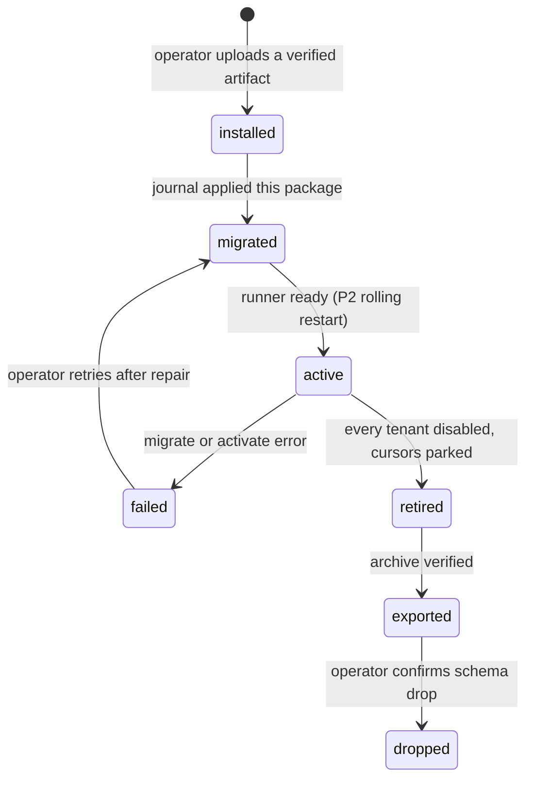
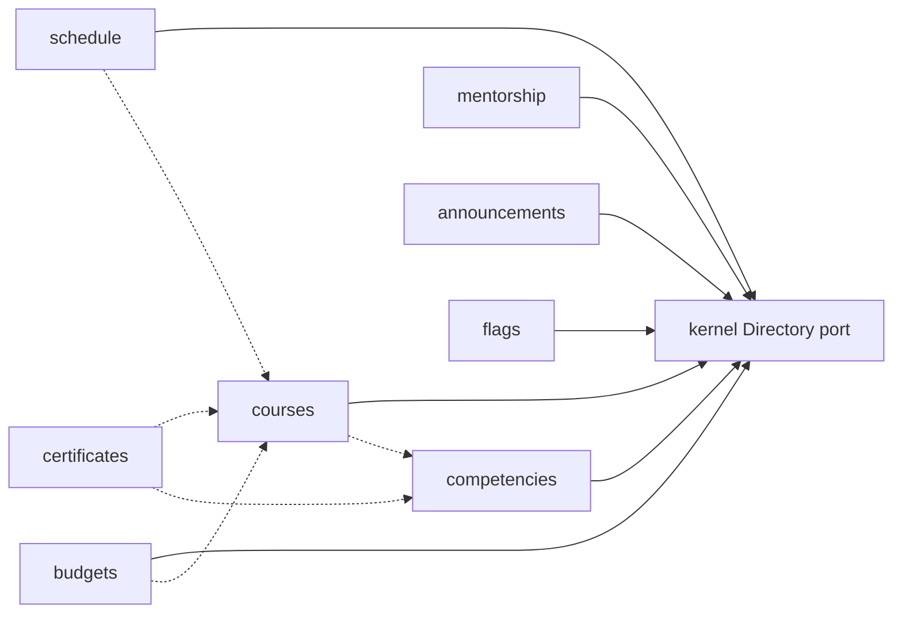

# P1 kernel design — draft B

- **Status:** Selected by the maintainer as the P1 kernel design. It does not amend the spec, the decision register, or any Accepted ADR. The records in §10.3 stay Proposed until their own review.
- **Date:** 2026-11-01
- **Spec:** [`../specs/2026-10-12-plerni-design.md`](../specs/2026-10-12-plerni-design.md) §1, §3–§8, §10, §15 (P1 row), §16
- **Register:** [`../decision-register.html`](../decision-register.html) D01, D05, D07, D08, D10, D11, D16, D22, D26, D27, D32
- **Accepted records this draft builds on:** [ADR-0001](../adr/0001-kernel-and-equal-citizen-plugins.md), [ADR-0002](../adr/0002-orm-data-layer.md), [ADR-0003](../adr/0003-outbox-pgboss.md), [ADR-0004](../adr/0004-plugin-isolation-topology.md), [ADR-0007](../adr/0007-pooled-contamination-recovery.md)
- **Conventions:** [`../specs/contract-conventions.md`](../specs/contract-conventions.md)
- **P0:** [`p0-exit-note.md`](p0-exit-note.md) records P0 complete. This draft starts at that line.
- **Roadmap:** [`../ROADMAP.md`](../ROADMAP.md) P1 paragraph

Draft B is the isolation-and-scale reading of the kernel. The capability wall is a closed grant set plus one database role per plugin schema ([ADR-0008](../adr/0008-capability-grants-and-schema-role.md)). The bus is the accepted log, and P1 proves it with two replicas and no leader ([ADR-0009](../adr/0009-leaderless-replica-log.md)). The operator is a real tenant ([ADR-0010](../adr/0010-operator-tenant-no-bypassrls.md)). Plugins sign digests ([ADR-0011](../adr/0011-digest-signing-port.md)). Adding a fixture plugin leaves `apps/kernel` empty ([ADR-0012](../adr/0012-plugin-addition-leaves-kernel-unchanged.md)). Sensitive and destructive routes stay on human sessions ([ADR-0013](../adr/0013-p1-human-commit-boundary.md)). Learning features stay plugins. The kernel stays the host.

Three maintainer calls decide whether this draft proceeds:

1. The P1 isolation wall is the grant set and the schema role. The OS/container tier stays at P5 (ADR-0004).
2. P1's bus exit includes the two-process subset in ADR-0009. A single-process demo does not pass that subset.
3. The features in §9 are plugins, except the four kernel run modes named there (API-only, cache, cluster, maintenance).

## 0. What this draft will not pretend

P0 is done. `apps/kernel/src` is still absent. P1 builds kernel services. P2 admits plugin tarballs, runs the supervisor, and applies the boundary checker to author SQL. P3 ships the competencies and learning plugins, the AI gateway, and MCP write tools. This draft specifies the plugin lifecycle in enough detail that P1's tables and ports do not have to be rewritten when P2 arrives. It does not schedule the runner into P1.

Issues [#63](https://github.com/tachkovsa/plerni/issues/63), [#64](https://github.com/tachkovsa/plerni/issues/64), [#65](https://github.com/tachkovsa/plerni/issues/65), and [#66](https://github.com/tachkovsa/plerni/issues/66) are open domain-input tasks. As of this draft they have no comments and no files under `docs/domain/`. The walkthrough in §9 shows that those future notes have somewhere to land. It does not record them as product decisions. Default role mappings ship empty. Tenant administrators compose roles from plugin-declared building blocks (D27).

Issue [#62](https://github.com/tachkovsa/plerni/issues/62) is the signing-key backup and rotation guide. §6 states the verifier invariant. The guide itself is task K10, and its checklist is the issue.

**Out of this draft's tasks, on purpose:**

- Domain plugin implementations (competencies, courses, and the rest of §9). They are proofs, not P1 code.
- The runner, stdio supervisor, tarball admission, and the full SQL parser. Those are P2 (spec §15). Until the parser exists, the broker executes kernel SQL and in-repo fixture SQL reviewed in the same change.
- MCP write tools, durable AI proposals, provider adapters. Those are P3.
- An OS sandbox, schema-per-tenant, a dedicated database per tenant, a leader-elected relay, a second queue, plugin-held database connections.
- Edits to `.github/workflows/`, `scripts/gates/`, or `tools/harness/sql/` as part of accepting this document. Later tasks may add gates. This document does not.

## 1. Kernel boundary

Equal citizenship (D01): the kernel never imports a plugin, and a plugin never imports kernel internals. `packages/contracts` and `packages/sdk` are the only shared code (ADR-0001). The kernel-purity gate scans `apps/kernel/src` for the nouns in [`../gates/domain-nouns.txt`](../gates/domain-nouns.txt). Adding a learning feature by editing that list, or by putting the noun in the kernel, fails the build.

### 1.1 In the kernel

| Service | P1 ships | Later phase uses the same service |
|---|---|---|
| Tenant registry, RLS context, application tenant guard | Yes | Every plugin table repeats the same policy shape |
| Local IdP, sessions, revocation epoch, OIDC module | Yes | SAML/SCIM plugins in P4 call `identity.deprovision` |
| Directory: users, groups, typed relation edges as rows | Yes | Plugins register edge types and request `directory.write_edge`. The broker writes the edge. |
| Generic authorization: resource type, id, action, grants, relationship qualifier, time-boxed delegation | Yes | Plugin manifests add namespaces |
| Package registry, approved grants, per-tenant enablement | Rows and APIs | P2 attaches tarball activation to those rows |
| Migration journal for kernel SQL, plus one fixture schema | Yes | P2 points the same journal at installed packages |
| Outbox log, relays, job handoff | Yes, two processes | Plugins publish through the WorkUnit |
| Audit (commitment hash, per-tenant chain) | Yes | Plugin mutations append in the same transaction |
| Secret store (envelope encryption, references, digest sign and verify) | Yes | Plugins hold references and submit digests. Private keys stay in the store (ADR-0011). |
| Object storage gateway | Yes | Plugin bytes live under a derived prefix |
| Notification plumbing: channels, preferences, dedup, delivery | Yes | Templates and copy stay in plugins |
| Tenant settings: opaque keys | Yes | Targeting and experiments stay in the flags plugin |
| MCP server, generated OpenAPI, REST error envelope | Read inventory | Write tools join in P3 by declaration |
| Minimal admin shell | Kernel workflows only | P2 renders declarative plugin slots |
| Telemetry, resource limits, provisional envelope note | Yes | Numbers revised at P4 |
| Self-upgrade preflight, backup-before-migrate | Yes | Plugin expand-contract rides the same preflight in P2 |
| Maintenance run mode | Yes | Works with every plugin disabled |
| API-only run mode | Yes | The shell is one client |
| Valkey client: cache, rate limit, pub/sub hints | Yes | Durability stays in PostgreSQL |

The AI gateway's control tables are P3 (spec §15). P1 does not create them "early." The secret store and the audit chain are the seams that gateway will use.

### 1.2 Outside the kernel

| Concern | Where it lives |
|---|---|
| Indicators, scales, 180/360 assessments | `competencies` plugin |
| Catalog, enrollment, completion | `courses` plugin |
| Dated gatherings and registration | `schedule` plugin |
| Mentorship engagements | `mentorship` plugin |
| Learning spend | `budgets` plugin |
| Issued certificates and their documents | `certificates` plugin |
| Audience-targeted announcements and their copy | `announcements` plugin |
| Feature toggles, cohort targeting, A/B assignment | `flags` plugin |
| Report definitions and metric rollups | The plugin that owns the underlying facts, plus a later report plugin subscribing to its events. Issue #66 does not add kernel report tables |
| HRIS, SCORM, xAPI, LTI, SAML, SCIM, content vendors | Plugins, on the phases the roadmap already names |
| LLM adapters, retrieval, copilot workflows | Plugins, P3 |
| Untrusted-code isolation, Module Federation, marketplace | P5, demand-gated |

"Employee" is a Directory user. The word can appear in a plugin's locale files. It is not a kernel type.

### 1.3 The seam a new plugin is allowed to touch

A new plugin adds a package: manifest, SQL, zod contracts, declarative UI (when P2 slots exist). Admission composes those contracts into the registries (convention R1.2). The kernel source, the kernel `Database` interface, and the kernel migration history stay as they were.

K17 proves the schema role and the codegen boundary with `fixture_alpha`. K28–K30 are the tree proof ([ADR-0012](../adr/0012-plugin-addition-leaves-kernel-unchanged.md)): each fixture commit `F` passes `git diff --exit-code F^ F -- apps/kernel`, and a scratch commit that edits `apps/kernel` makes that command exit non-zero.

## 2. Capability wall

[ADR-0008](../adr/0008-capability-grants-and-schema-role.md) is the decision. The operational shape:

- The operator approves grants at install. A tenant enablement row cannot add a grant.
- The supervisor stamps the approved set into the spawn credential (P2). P1 enforces the same set on kernel ports.
- The broker's app role is a member of each plugin role and uses `SET LOCAL ROLE` only after the hygiene inspect (ADR-0002, ADR-0007).
- Plugin SQL names its own schema. The migration role, not the request role, may `CREATE` there.
- No grant iterates tenant ids. The operator is a tenant ([ADR-0010](../adr/0010-operator-tenant-no-bypassrls.md)). Fan-out is one transaction per target tenant. No runtime role has `BYPASSRLS`.
- `directory.write_edge:<type>` is a broker write inside the WorkUnit, limited to types the manifest lists. The plugin role has no SQL grant on Directory tables.

A plugin process that opens a TCP connection to PostgreSQL is already a failed deployment: production egress is the broker, and the plugin has no database credential (ADR-0001, ADR-0004). The grant wall is the layer that stays in force when a development composition relaxes network placement and says so.

## 3. Plugin manifest, lifecycle, migrations, dependencies

### 3.1 Manifest

Manifest format v0. The field set is closed. Unknown fields fail admission. Id grammar: `^[a-z][a-z0-9_]{0,40}$`. The schema name is derived, `plugin_<id>`. Authors do not choose a schema name.

| Field | Rule |
|---|---|
| `id`, `version` | Id grammar. Version is semver. |
| `license` | SPDX identifier. The platform does not relicense the package (D04). |
| `sdk` | Semver range. Outside the range, install is refused. |
| `provides` | Public contract names this package owns, each with a semver. |
| `requires` | `{plugin, contract, range}` edges. These order migrations and block enablement. |
| `optionalRequires` | Same shape. They do not order migrations and do not block enablement. A call to a missing optional port returns `UNAVAILABLE` with reason `dependency_disabled`. |
| `permissions` | Namespace, resource types, actions, suggested role mappings. Mappings are suggestions. The tenant starts from an empty composition. |
| `routes` | Method, path, operation id, request and response schemas, permission, action class `routine` \| `sensitive` \| `destructive`, `scope` (`tenant` or `platform`), limits. A mutating route with no class fails admission (ADR-0013). |
| `events` | Publish and subscribe entries: type, payload version, owner. |
| `jobs` | Handler name, payload version, optional cron, idempotency. |
| `migrations` | Path of SQL files inside the package. |
| `ui` | Declarative slot contributions. Ignored by the API-only profile. Host JavaScript from a plugin waits for P5 (D12). |
| `grants` | Subset of the ADR-0008 vocabulary. |
| `classification` | Every mutating route appears here. Lint matches it to the route (convention R4.1). |

Entitlement keys stay out (D24).

### 3.2 Lifecycle

Spec §4.5 splits authorities. This draft keeps that split and names uninstall, which the spec describes only through disable and export.



Per-tenant enablement is a second axis, not a state of the artifact. An active package can be enabled for tenant A and disabled for tenant B.

| Stage | Who | What changes | What stays |
|---|---|---|---|
| Install | Operator-tenant admin | Artifact digest, manifest, approved grants, registry row | No customer data. Customer tenants are not enabled implicitly. |
| Migrate | Journal, migration role, unpooled connection | That plugin's schema only | Kernel schema untouched. Other plugin schemas untouched. |
| Activate | P2 runner, readiness-gated rolling restart | Code version that serves routes | v1 does not hot-swap a process in place (spec §4.5). |
| Enable | Tenant administrator, for their tenant | Enablement row, route exposure, subscription watermark | Grants unchanged. Other tenants unchanged. |
| Disable | Tenant administrator | Routes and jobs stop for that tenant. Data remains exportable. | Other tenants keep consuming. See §4.4. |
| Upgrade | Operator | Expand-contract SQL, then activate the new code | Old code may run briefly on the new schema. The checker rejects a migration that is not backward compatible inside the compatibility window (§5). |
| Retire | Operator, after every tenant is disabled | Installation-level park of subscriptions | Schema and objects remain. |
| Export | Operator | Versioned archive: schema rows, referenced objects, grants, config (spec §4.5) | Reconstruction is tested outside the original deployment. |
| Drop | Operator, second action after a verified export | Schema dropped by the journal. Grants and registry row removed. | Audit tombstones remain. Payload content past erasure follows spec §5. |

Tenant administrators never upload executable code.

Disable of a single tenant does not park the installation cursor. Installation retire does. Re-enable after retire runs the throttled catch-up in spec §4.5. The backlog quota is 30 days or a provisional 256 MiB, whichever first (§4.4). Past the quota the operator is warned and may export-then-force-advance. Silent drop of a parked backlog is a failed task. A parked cursor and a watermark stay in the retention minimum until that force-advance, including after the quota has expired.

### 3.3 Migrations

SQL files, alphanumeric within a package. The journal's order:

1. Pending kernel SQL.
2. Packages in topological order of `requires` (a package follows the packages that provide the contracts it requires).
3. Tie-break: plugin id, bytewise ascending.
4. A cycle fails admission for every package on the cycle and every installed package whose required chain reaches that cycle. Nothing in that set migrates.

`optionalRequires` is not an ordering edge. Event subscriptions are not ordering edges (ADR-0002 decision 8). A statement that names another plugin's schema fails the checker. A statement that is a function, a trigger, or a `DO` block fails the checker. `CREATE EXTENSION` fails. The kernel bootstrap owns the extension allowlist (`vector`, `pg_trgm`).

Each migration carries the signed approval artifact (spec §4.6). The public key set and rotation rules are §6 and issue #62. P2 wires verification into admission. P1's kernel migrations follow the same artifact shape so the verifier has one code path.

Tenant-domain tables, kernel or plugin: `tenant_id NOT NULL`, `ENABLE` and `FORCE ROW LEVEL SECURITY`, exactly one canonical permissive policy, composite foreign keys that include `tenant_id`, runtime grants limited to DML. `GRANT ALL` fails the linter. Kernel-internal machinery (outbox, cursors, job store, relay state) has no tenant RLS and is reachable only by the named service identities in spec §5.

Per-tenant reference rows are versioned per-tenant migrations applied in background batches, off the request path (spec §5). They are not seed scripts at tenant creation.

### 3.4 Dependency graph



Solid arrows are `requires`. Dashed arrows are `optionalRequires`. The kernel does not appear as a plugin node. Directory, storage, notify, secrets, and the log are ports, not packages. No dashed or solid arrow is a foreign key.

A tenant may enable `courses` and leave `competencies` disabled. Course completion still records. The optional link to an indicator id is absent, and a call that needs the competencies port returns `UNAVAILABLE` with reason `dependency_disabled`. Completion does not write a competency row and does not imply demonstrated skill (spec §16).

## 4. Event bus

One machinery (D10, ADR-0003, ADR-0009). ADR-0009 follows ADR-0003 and does not amend it. Events and jobs are intents committed in the same transaction as the mutation. Plugins submit them through a WorkUnit. Kernel services insert them directly. There is no second bus to make the cluster case "easier."

### 4.1 Log

Append-only table in the kernel schema: `seq` (global sequence), `tenant_id`, `aggregate_type`, `aggregate_id`, `aggregate_version`, `type`, `version`, `payload`, `created_at`. `seq` is allocated from a PostgreSQL sequence. A rolled-back insert leaves a gap. Readers tolerate gaps. No tombstone row fills a gap.

`aggregate_type` is a string the publishing plugin owns. It is not a kernel enum. Adding a type does not migrate the kernel.

### 4.2 Delivery

- One global cursor per subscription (`last_seq`).
- `safe_point` is a `bigint` sequence cutoff, defined in ADR-0009 decision 2 and repeated here so the two texts match. `seq` is a `bigint`. Comparing `seq` to a timestamp, or casting the 10 second horizon to an integer and treating that integer as a sequence, is not this rule.

  ADR-0003 decision 2 is the delivery rule. The global `seq` comes from `nextval` inside the business transaction. Nothing in this design takes an advisory lock on that sequence, and `nextval` is not held until commit. Two writers on different aggregates do not block each other.

  Per-aggregate order is a version on the aggregate row, taken under `FOR UPDATE` on that row (rows in id-sorted order when a unit touches several). The writer increments `aggregate_version` and copies it onto the event, then calls `nextval` and inserts the event. The row lock lasts until the transaction ends, so the next writer on that same aggregate waits. A writer on another aggregate locks a different row.

  The horizon is 10 seconds of database time (`clock_timestamp()`). `created_at` is that clock at insert. `safe_point` is a `bigint`:

  ```
  safe_point = max(seq) among committed-visible rows
               whose created_at <= clock_timestamp() - horizon
  ```

  If no such row exists, the relay delivers nothing. The reader takes rows with `seq > last_seq AND seq <= safe_point`. A row younger than the horizon is not eligible, so a higher `seq` still inside the horizon cannot move the cursor past a lower `seq` that is also still inside it. A transaction that stays open longer than the horizon is the residual ADR-0003 already states. This design does not close that residual with a global lock.

  An integer `seq <= safe_point` with no event row is a rolled-back `nextval`. The relay skips that gap and does not wait. `nextval` does not return that value again.

  A consumer that applies one aggregate does so in `aggregate_version` order. The subscription cursor stays the single global `last_seq`. Global `seq` order is not the per-aggregate order.

- Claim unit is the subscription row, `FOR UPDATE SKIP LOCKED`, so two relays compete without a leader (ADR-0009). A second relay skips a locked subscription.
- One event, one delivery transaction: unique `(subscription, seq)` dedup marker, handler effects, cursor advance, fencing check. A duplicate delivery updates zero business rows.
- Filtered subscriptions skip types they do not list and still advance. A filter cannot stall the log.
- Unknown payload version for a type the subscription does list: park that subscription with `UNKNOWN_EVENT_VERSION`. The cursor stays. The row stays. Do not best-effort the payload (spec §4.8, convention R5.3). An upgraded consumer unparks. An operator force-advance writes a dead-letter row and advances in one transaction, and only after the export procedure in §4.4.
- Poison handler failures take the same dead-letter path, with an alarm. They are not deleted from the log.
- New subscriptions start at the current high-water `seq`, or at a declared start `seq` recorded in the manifest. They do not replay the history of the installation unless the manifest asks.
- Retention low-water is the minimum of live subscription cursors, every parked installation cursor, and every tenant enablement watermark that has not been force-advanced (§4.4). Quota expiry does not remove a cursor or a watermark from that minimum. A log row at or above that minimum stays. Only export-then-force-advance drops a parked cursor or a watermark out of the minimum.
- `LISTEN`/`NOTIFY` is a zero-payload wake-up on a dedicated unpooled connection per relay. Polling about once a second is the correctness net. Zero listeners raise an alert. Delivery still happens.

At-least-once is the contract outside PostgreSQL. The handoff from outbox row to a job row is one database transaction (exactly-once inside PostgreSQL). The SDK text says so. Handlers that need order consume the event log. Jobs are unordered.

### 4.3 Ordering

There is no global order across aggregates. Per-aggregate order is `aggregate_version`, assigned under that aggregate's row lock. The global `seq` is only the log position ADR-0003 uses for the cursor and the horizon. Two writers on different aggregates do not share a lock. The design does not promise a total order across aggregates, tenants, or types.

Two replicas can deliver different subscriptions at the same time. They do not deliver the same subscription's same `seq` twice as two committed effects.

### 4.4 Enablement watermarks

The installation cursor must keep moving while one tenant has a plugin disabled and another has it enabled.

- Installation disable (retire) parks the subscription cursor. Spec §4.5 applies.
- Tenant disable writes a per-tenant watermark (the last `seq` that tenant consumed) and stops delivery for that `tenant_id`. Other tenants continue. The installation cursor may move past the watermark. The watermark stays in the retention minimum until export-then-force-advance, whether or not the quota has expired.
- The quota is 30 days or a provisional 256 MiB of backlog, whichever bound is hit first (spec §4.5). The size cap is provisional and is copied into the K26 envelope note. Hitting the quota warns the operator. It does not delete rows and it does not take the watermark out of the retention minimum.
- Re-enable catch-up starts at the watermark and delivers the retained backlog, throttled. The rows are still in the log because retention has not dropped the watermark.
- The only way to move a watermark or a parked cursor forward, and to release the rows it holds, is export-then-force-advance. That is true before the quota and after it. An automatic skip, including an audited one, is not a retention path.
- Watermark rows are kernel-internal machinery: service identity of the relay, tenant id in the row, no RLS, application-level scope. Their shape does not change when a plugin is added.

### 4.5 Versioning on the bus

Event types are `<namespace>.<noun>.<verb>` (convention R5.1). The namespace is the publishing plugin id, or `kernel` for kernel facts (`kernel.tenant.created`, `kernel.identity.disabled`). Payload version is an integer stored on the row, equal to the major of the payload schema. The registry holds the semver and the zod schema.

| Change | Version move | Consumer that asked for the previous version |
|---|---|---|
| Add an optional field | Minor of the schema. Row version unchanged. | Still validates. Unknown fields are stripped. |
| Remove, rename, or retype a field | New row version. New major. | Parks. Does not guess. |
| New event type | New registry entry. Subscribers opt in. | Unaffected. Filtered skip. |

Deprecation windows follow convention R2.2. Kernel event types do not use learning nouns. An xAPI-shaped stream, if it ever exists, is a plugin namespace (`xapi.*`) and a plugin-owned table. The kernel log only delivers (roadmap, P0 plan Annex L).

### 4.6 Jobs

pg-boss is the job mechanism behind the log (ADR-0003). The pin is adopted only after task K14 passes through PgBouncer transaction mode under the unnamed-statement default. The kernel envelope on every job: tenant, plugin, handler name, payload version, idempotency key, deadline, attempt budget, trace, service identity. `expiredIn` starts at a conservative cold default of 60 seconds per job class until a measured p99 exists, and then moves to at least three times that p99. Cron is a manifest field with a misfire rule and a uniqueness key. The dead-letter queue has an operator replay action in the admin shell.

Claiming jobs is kernel-internal machinery. Executing a job re-enters `withTenant` for the row's tenant. A fan-out job's parent row is kernel-internal bookkeeping written in the operator tenant's transaction. Each child carries one target tenant id and runs in its own transaction (ADR-0010). A job row with no tenant id is not a legal claim.

## 5. Tenancy, identity, roles

### 5.1 Tenancy

v1 is one database, shared tables, PostgreSQL RLS (D05). Dedicated databases and schema-per-tenant stay out (spec §18). "Each tenant installs only what it needs" is the enablement axis in §3.2, on top of those shared tables.

Every tenant transaction follows ADR-0002 decision 2: one pinned connection, hygiene inspect before any local override, terminate and discard on contamination (ADR-0007), `set_config(..., true)`, read-back, then data. Missing context fails twice: the policy returns no rows, and the application guard raises. The vacuity control is a test that skips the guard setup and must fail.

Pooled connections do not carry session `SET`, `LISTEN`, or session advisory locks. Activation and migration locks use an unpooled connection (spec §7).

Tenant creation is an API: id allocation, registry row, audit, outbox event `kernel.tenant.created`. Reference data for that tenant arrives through the background per-tenant migrations, not a seed embedded in the request.

Erasure is export-then-erase (spec §5). Per-tenant data keys in the secret store make crypto-shredding possible. The audit chain keeps commitment hashes and tombstones. `restore_epoch` is §8.4.

### 5.2 Identity

PostgreSQL is the revocation authority (D16).

- Local accounts: argon2id password, TOTP secret encrypted in the secret store, single-use rescue codes stored hashed, verified email reset, throttled login and recovery.
- Sessions: hashed opaque tokens. `user_auth_state.revocation_epoch`. Local disable is one transaction: set disabled, bump epoch, revoke sessions, audit, `NOTIFY`.
- Ordinary requests trust a freshness lease of five minutes. Admin and sensitive routes read the session row on every request. `strict_disable` makes that per-request check installation-wide for the tenant.
- A successful OIDC login does not clear a local disable.
- OIDC, in the kernel: authorization code and PKCE, issuer mix-up protections, exact redirect match. Tokens stay server-side. Configure-OIDC is one of the API-only workflows.
- Bootstrap: the API creates the operator tenant and its first admin, then the first customer tenant and its admin, using a one-time bootstrap credential supplied in the process environment. The value is never logged, never migrated into a fixture, and never committed. After bootstrap the credential stops working. There is exactly one operator tenant (ADR-0010).
- Service principals: tenant-scoped, hashed, scoped, expiring, rotatable, revocable. An upstream IdP token is not a Plerni token. A service principal that calls a `sensitive` or `destructive` route receives `FORBIDDEN` (ADR-0013). `routine` routes still require the principal's grants.
- `identity.deprovision` is a kernel command in P1, idempotent on `event_id`, bound to a source incarnation so a stale termination after rehire does not disable the account. A future SCIM plugin translates wire events into that command and does not touch sessions.
- Break-glass local operators are WebAuthn-bound, rate-limited, and alarmed.
- Valkey may cache the freshness deadline with a TTL inside the lease. A restored cache cannot authorize (spec §16.15). That case is an acceptance test of K16.

Step-up for P1's own sensitive kernel actions (disable a user, export, rotate a key, erase a tenant) is the spec §6 MFA step-up, at most fifteen minutes, checked per request. Durable AI proposals and the nondelegable proof-of-human ceremony stay P3. P1 already enforces the commit boundary those proposals will wrap: every mutation is classified, MCP does not mutate, and service principals stop at `routine` (ADR-0013).

### 5.3 Directory, roles, permissions

Directory rows: users, groups, memberships, and typed edges. Edge types are data. A mentorship plugin registers `mentors` with `directory.register_edge_type`. Creating an edge instance is `directory.write_edge:mentors`: the plugin names the type and the two user ids in the WorkUnit, and the broker inserts the Directory row in that same transaction. The plugin role has no `INSERT` on Directory tables. An unlisted type is `FORBIDDEN`. Subject and object must be users in the authorized tenant.

Authorization input is resource type, resource id, action, and grants. Grants may say "holder of edge `reports_to` toward the subject." Evaluation is the same function for a session, a service principal, and an MCP actor. An MCP actor receives the human's grants or a delegated subset. It does not receive a superset (D26, D32).

Time-boxed delegation is a grant with an expiry. Expiry is enforced in the check. The audit row records the delegator and the delegate.

Plugins declare a permission namespace in the manifest. Tenant administrators compose roles from those declarations. Issue #65 will name real learning roles when someone writes them. Until then the kernel ships no role called author, manager, or auditor. The relationship machinery is what a later "manager sees this user's row" rule plugs into, and the resource type string will be a plugin string such as `courses.enrollment`.

Object-level scope is applied by the broker before execution, from the query's declared resource binding (spec §4.3). RLS is the tenant wall. The binding is the wall between two users in one tenant. P1's suite covers the kernel resources (users, groups, sessions, audit). Plugin resources join that suite in the phase that adds the plugin. The fixture package in K17 includes two notes in one tenant and shows that a principal without the grant receives none.

### 5.4 Operator tenant

The operator is a tenant with `kind = operator` (ADR-0010). Customer tenants have `kind = customer`. Runtime roles have no `SUPERUSER` and no `BYPASSRLS`. The migration role has neither attribute either.

| Actor | Session tenant | Can |
|---|---|---|
| Customer user or customer service principal | That customer | Read and write that tenant, inside grants and RLS. |
| Operator admin | The operator tenant | Platform routes: packages, maintenance, restore, list tenant ids from `kernel.tenants`. Fan-out opens one child transaction per target customer. A direct plugin-role query returns no customer rows. |

An announcement to every tenant is that fan-out. The operator transaction writes claim rows only. Each child sets `plerni.tenant_id` to one customer and writes that customer's announcement row. A maintenance switch is a platform route, one kernel-internal row, audited. A feature flag aimed at one user is a customer-tenant write.

## 6. Contract versioning

Four axes (convention R2.1). A change names the axis it moves.

| Axis | P1 artifact | Breaking change |
|---|---|---|
| Kernel release | The kernel package | Spec §3 self-upgrade window: N and N+1 overlap during rollout. |
| Plugin package | Manifest `version` | Owns its schema expand-contract and its payload majors. |
| SDK protocol | SDK semver range in the manifest | A port signature change is an SDK major. Installed packages outside the range do not activate. |
| Public API | Operation ids, generated OpenAPI, MCP descriptors | Removing or renaming an operation id, tightening a request, loosening a response, or changing an error code's meaning (convention R2.2). |

The first error envelope is frozen in K19, so later additions are not slipped in as "small" response changes. Fields: closed `code`, human message, `next_step`, optional `reason` from a closed set (`maintenance`, `dependency_disabled`, `cache_unavailable`, `parked`, `quota`). Codes are the convention R3.3 set plus `UNKNOWN_EVENT_VERSION`. HTTP status comes from the code (`CONCURRENCY_CONFLICT` is 409). MCP puts the same envelope in a tool result with `isError: true` and does not use a JSON-RPC protocol error for it.

Public versus plugin-private schemas are marked in the registry. Plugin-private schemas are not generated into the installation OpenAPI. Public schemas carry deprecation windows.

Workflows that exist in P1 (create tenant, bootstrap admin, rotate a service credential, configure OIDC, enable a package for a tenant) each name a no-AI completion path in the inventory (convention R6). The path is the REST call. There is no assistant on these routes. K22 lands the convention R6.2 check: every inventory entry names an acceptance-test ID that exists, and a fixture entry whose ID is missing fails that check.

## 7. MCP surface

One registry produces REST routes, OpenAPI, and MCP tool descriptors (D26, convention R1). Hand-written MCP descriptors fail review.

P1's curated read inventory is kernel-only:

| Tool | Permission | Notes |
|---|---|---|
| `kernel.session.whoami` | Authenticated actor | Tenant kind, tenant, subject, grant summary. No secrets. |
| `kernel.tenant.get` | Tenant reader | The caller's tenant. |
| `kernel.directory.user.get` | Directory read on that user | Authorization applied before the query. |
| `kernel.directory.user.list` | Directory read | Keyset pagination. Bounded. |
| `kernel.directory.group.list` | Directory read | |
| `kernel.directory.edge.list` | Directory read | Edge type is a filter parameter, not a new tool per type. |
| `kernel.audit.list` | Audit reader | Bounded. Payload hashes, not secret values. |
| `kernel.package.list` | Tenant admin or operator | Enablement for the caller's tenant. Operators may pass a tenant id. |

Admin mutations, uploads, streaming, and maintenance switches stay REST (D26). MCP write tools wait for the P3 proposal ceremony. In P1 a write-shaped MCP call returns `FORBIDDEN` with `next_step` pointing at the human route (ADR-0013). A plugin joins the read inventory later by declaring `mcp: read` on a route. Declaration is admission data. The kernel generator does not gain a branch for that plugin.

The alignment check compares the generated MCP manifest to this inventory for schema and permission identity, then a real MCP client runs the read workflows. The API-parity workflows in §8.1 run over REST without the shell. Equivalence for the overlapping reads: same rows, same permission denials, ignoring generated ids and timestamps (spec §16.11).

Authentication for MCP is the same service principals and, where a human delegates, authorization-code plus PKCE. Dynamic client registration is P4. Token passthrough is refused.

## 8. Run modes the kernel owns

These four are kernel behavior. They are the part of the maintainer's test list that is not a plugin. Each works with zero plugins enabled.

### 8.1 API-only

A process configuration `surfaces=api` starts REST, OpenAPI, and MCP. It does not start the shell, and it does not require the shell's assets. The named P1 workflows pass against this process with no browser:

1. Create a tenant.
2. Bootstrap an administrator.
3. Provision a service principal.
4. Rotate that credential.
5. Configure OIDC.

MCP then reads back the tenant, the administrator's directory row, and the service principal's metadata (not the secret). K22 is the proof. The shell's e2e is a separate gate and is not this proof (spec §10).

### 8.2 Cache

Valkey is the default (D22, ADR-0009). P1 uses get, set, delete, expire, increment, publish, subscribe, and ping. Keys are prefixed by plane, tenant, and purpose. Session authorization is a PostgreSQL read. The cache holds a freshness hint whose TTL is inside the lease.

Loss test, required: stop Valkey, send an ordinary request, observe a PostgreSQL session check and a successful authorized read; send an admin request, observe a per-request session read; send a rate-limited route, observe `UNAVAILABLE` with reason `cache_unavailable`; restore a stale cache snapshot that still contains a revoked session, observe the session denied.

A Redis-protocol server the operator supplies can replace Valkey if it implements that command subset. The default artifact is Valkey. The pin is chosen in K16 against the release notes current on that day. ADR-0009 records the 9.1.3 observation so the task does not start from memory.

### 8.3 Cluster

P1's cluster proof is two kernel processes and two relays, one PostgreSQL primary, one Valkey primary, PgBouncer in transaction mode in front of the primary (ADR-0009). It is a test composition, not the P4 Helm chart.

The processes share no in-memory bus. SSE subscribers on process A receive a publish that landed on process B through Valkey, or they miss the hint and the next poll catches up. The log does not depend on that hint. Killing either process leaves the other serving, and the surviving relay drains. There is no leader lock to steal.

This does not claim a multi-primary database, a Valkey Cluster deployment, or a tenant-sharded cell. Those remain the measured D10 path and the deferred placement annex.

### 8.4 Maintenance

The live switch is a row in kernel machinery, read on each request. The boot configuration can force maintenance until the process is healthy, so a replica that cannot reach PostgreSQL stays on the maintenance path.

While maintenance is on:

- Tenant routes, MCP tools, and plugin dispatches return `UNAVAILABLE`, reason `maintenance`, with a `next_step` that says the installation is in maintenance and to retry after the operator clears it.
- `GET /health` stays available to the orchestrator and reports maintenance, without tenant data, so a cluster probe can tell maintenance from a dead process.
- The shell serves a static page from its image and does not call a plugin to render it. The API-only profile has no page; clients use the envelope.

The switch is one kernel-internal row, so two replicas agree. Draining one replica during a rollout is the proxy's job; the application flag is the wrong tool for that. Clearing the flag is an operator-tenant action, audited.

### 8.5 Backup, restore, upgrade

Backup covers PostgreSQL, object storage, and secret-store custody, including the key-encryption key's custody outside the database. The artifact manifest (kernel version, package digests, journal position) is in the backup. Restore onto clean infrastructure replays that manifest.

Every restore bumps `restore_epoch`. Sessions and service credentials issued before that epoch fail. The K24 equality check is the spec's: manifest hash, row counts, and a written sampling rule. The test asserts a pre-restore session is denied.

Kernel self-upgrade: expand-contract, two-release tolerance, preflight (disk, pending migrations, SDK ranges once packages exist), backup-before-migrate on the appliance profile, stuck-instance detection. P1 proves the preflight on kernel SQL. Plugin SDK-range checks are wired in P2 when packages exist, against the same preflight.

## 9. Walkthroughs

Each plugin below is specified so a later package, admitted in P2, can be written without a kernel diff. The kernel files touched by every row are: none. The seams they use are the ones §1–§8 already assign to the kernel: Directory port, grant check, RLS, the WorkUnit the broker commits for plugin writes, the log, a storage prefix, a secret reference, notify plumbing, and per-tenant enablement. P1 builds those seams for kernel callers and for the fixture package. It does not implement these eight packages.

Issue #63's example stories (mandatory training for a department, a manager approving an external course, a role change that updates a plan) are expressible as courses plus Directory groups plus a `reports_to` grant plus events. They become acceptance tests when that issue gains real write-ups. They are not kernel services waiting for the write-ups.

### 9.1 Competencies

| | |
|---|---|
| Id | `competencies` |
| Schema | `plugin_competencies` |
| Tables | `indicator`, `scale`, `assessment`, `assessment_rater` |
| Ports | `directory.read` |
| Publishes | `competencies.assessment.submitted` |
| Subscribes | none required |
| Grants | `db.own_schema`, `events.publish:competencies.assessment.submitted`, `directory.read` |

An indicator is a row with a stable id and a scale. An assessment names a subject (Directory user id) and a mode column the plugin owns: `one_eighty` or `three_sixty`. Raters are rows. In `one_eighty` the plugin asks the Directory for the `reports_to` edge and requires that manager. In `three_sixty` it also stores peer raters the subject or an administrator nominated. Peer nomination is plugin data. The edge type `reports_to` is a Directory row the installation already has; registering it does not migrate the kernel.

Submitting writes the assessment and the outbox row in one WorkUnit. A second submit with the same idempotency key returns the original. A rater from another tenant fails RLS. A rater in the same tenant who is not on the rater list fails the object grant.

No kernel noun is added. `competency` stays on the purity list, and the word occurs in this plugin's tree and in its locale files.

### 9.2 Courses

| | |
|---|---|
| Id | `courses` |
| Schema | `plugin_courses` |
| Tables | `course`, `offering`, `enrollment`, `completion` |
| Requires | Directory port |
| Optional | `competencies` public contract, to store an indicator id |
| Publishes | `courses.enrollment.opened`, `courses.completion.recorded` |
| Grants | `db.own_schema`, publish those two types, `directory.read` |

Enrollment targets a Directory user or a Directory group. Group expansion is a Directory read at enrollment time, and the membership snapshot is stored in the plugin so a later group edit does not rewrite history. Completion inserts `completion` and emits `courses.completion.recorded`. It does not write `plugin_competencies`. With competencies disabled, the indicator field is null and the course still completes.

A department-wide mandatory assignment, the shape issue #63 names, is an enrollment of a group plus a deadline column on the offering. Overdue is a query in this plugin, or a subscription in a report plugin. It is not a kernel job class.

### 9.3 Gatherings

The product word "event" for a dated gathering would collide with the log's word. The package id is `schedule`. The contract namespace is `schedule.gathering`.

| | |
|---|---|
| Id | `schedule` |
| Schema | `plugin_schedule` |
| Tables | `gathering`, `registration` |
| Requires | Directory port |
| Optional | `courses` contract, to point at an offering id |
| Publishes | `schedule.gathering.scheduled`, `schedule.registration.recorded` |
| Grants | `db.own_schema`, publish those types, `directory.read`, `notify.send` |

Registration checks the gathering's audience (a user or a group) through Directory. A registration emits the event and, through notify plumbing, asks the notification service to deliver. The template string lives in this plugin. The kernel plumbing deduplicates on the idempotency key.

### 9.4 Mentorship

| | |
|---|---|
| Id | `mentorship` |
| Schema | `plugin_mentorship` |
| Tables | `engagement`, `note` |
| Requires | Directory port, `directory.register_edge_type` |
| Publishes | `mentorship.engagement.opened` |
| Grants | `db.own_schema`, `directory.read`, `directory.register_edge_type`, `directory.write_edge:mentors`, publish that type |
| Class | Opening an engagement is `sensitive` |

On install the package registers the edge type `mentors`. That is an insert of a type row. The kernel schema is unchanged. An engagement lists the edge upsert as a kernel effect and the engagement insert as plugin SQL. The broker writes both in one WorkUnit: the Directory edge as the broker, the plugin row as `plerni_plugin_mentorship`. The plugin role has no SQL grant on Directory tables. A grant of the form "holder of `mentors` may read `mentorship.note` of the subject" is tenant configuration over the generic evaluator. A service principal and an MCP client receive `FORBIDDEN` on the open route. The kernel does not learn the word mentor. The purity list already contains `mentor` and `mentorship`; they stay out of `apps/kernel/src`.

### 9.5 Budgets

Learning spend is not the AI budget ledger. The ledger arrives with the P3 gateway and is kernel control data. This package is tenant spending.

| | |
|---|---|
| Id | `budgets` |
| Schema | `plugin_budgets` |
| Tables | `fund`, `posting` |
| Requires | Directory port |
| Optional | `courses`, to reserve against `courses.enrollment.opened` |
| Publishes | `budgets.posting.recorded` |
| Subscribes | `courses.enrollment.opened`, `courses.completion.recorded` (optional) |
| Grants | `db.own_schema`, subscribe and publish as declared, `directory.read` |

A posting is a reservation or a release, with an idempotency key. The subscriber uses a process-manager row in this schema (pending, posted, compensated). A duplicate delivery hits the unique key and does not double-spend. If courses is disabled, the package still records manual postings. The optional subscription is parked at the watermark rules in §4.4, not by editing the kernel.

### 9.6 Certificates

| | |
|---|---|
| Id | `certificates` |
| Schema | `plugin_certificates` |
| Tables | `certificate` |
| Optional | `courses`, `competencies` |
| Subscribes | `courses.completion.recorded`, `competencies.assessment.submitted` |
| Publishes | `certificates.certificate.issued` |
| Grants | `db.own_schema`, those subscriptions, publish, `storage.prefix`, `secrets.sign` |
| Class | Issuing is `sensitive` |

The handler verifies the payload version it declared. An unknown version parks the subscription (no best-effort certificate). The plugin hashes the document, calls `secrets.sign` with the digest and a key reference, and stores the signature and the digest (ADR-0011). The document bytes go to storage under the derived prefix. The broker does not return the private key. A completion event alone does not satisfy an assessment rule inside this plugin unless the tenant configured that rule. The plugin can refuse to treat completion as competence, which keeps the spec §16 invariant in plugin policy rather than in a kernel special case.

### 9.7 Announcements

| | |
|---|---|
| Id | `announcements` |
| Schema | `plugin_announcements` |
| Tables | `announcement`, `audience_snapshot` |
| Requires | Directory port, notify plumbing |
| Publishes | `announcements.announcement.published` |
| Grants | `db.own_schema`, `directory.read`, `notify.send`, publish |
| Scope | Group and single-tenant sends are `tenant`. The all-tenant send is `platform` and `sensitive`. |

Three audiences:

| Audience | Who may send | Write shape |
|---|---|---|
| One group in one tenant | Tenant administrator | One announcement row, snapshot of member ids, notify each member. |
| One tenant | Tenant administrator | Snapshot is every Directory user in that tenant. RLS confines the read. |
| Every customer tenant | Operator-tenant admin | The operator transaction writes kernel-internal claim rows only. Each child transaction sets the target tenant and writes that tenant's row (ADR-0010). Bounded batch, admission limit, resumable cursor on the job. |

The all-tenant job does not read announcement rows across tenants. A group change after the snapshot does not rewrite the snapshot. Notify dedup uses the announcement id plus the user id.

### 9.8 Flags and A/B tests

| | |
|---|---|
| Id | `flags` |
| Schema | `plugin_flags` |
| Tables | `flag`, `variant`, `assignment` |
| Requires | Directory port |
| Publishes | `flags.assignment.recorded` |
| Public port | `flags.assignment.read` |
| Grants | `db.own_schema`, `directory.read`, publish |

A flag names variants with integer weights. The subject is a Directory user, optionally constrained to a group or a relationship. The bucket is `hash(tenant_id, flag_id, subject_id)` into those weights, so two replicas assign the same subject the same variant with no coordination. The assignment row is written on first read so an audit can show the variant later, including after the weights change. Other plugins read the public port. They do not read `plugin_flags`. The kernel settings table stays opaque key/value and does not grow a targeting language.

Targeting "employees" is targeting Directory users. A plugin that wants a flag checks the port and treats `dependency_disabled` as the flag being absent, which is a defined fallback the caller records.

### 9.9 The four kernel modes, as a negative proof

API-only, the cache, the two-process composition, and the maintenance switch are exercised with the package registry empty. Create-tenant, directory read, session revoke, and the maintenance envelope all succeed or fail as §8 says. No plugin manifest is loaded. That is the proof they are kernel run modes.

A package from §9.1–§9.8 enabled afterward does not change those four behaviors, and disabling it does not change them either. Maintenance still returns the envelope when a plugin request is in flight: the flag is checked before dispatch, and an in-flight tenant transaction either commits or rolls back under the fencing rules. It does not half-write because the flag flipped.

### 9.10 One chain, still without a kernel change

With the optional edges enabled, a tenant administrator enrolls a group in a course. The courses plugin emits `courses.enrollment.opened`. The budgets plugin posts a reservation. On completion, courses emits `courses.completion.recorded`. Certificates issues a document if its rule matches. Flags decides whether the certificate card is offered. Announcements notifies the subject's group. Each hop is an event or a public port. The kernel diff for the whole chain is empty. A duplicate delivery does not double the posting or the certificate, because each consumer's idempotency key is committed with its effect.

Issue #64's integrations (HRIS, content libraries, calendars, BI) attach the same way: a plugin subscribes or calls a public port, and brokered HTTP egress is an explicit `http.egress:<host>` grant. Issue #66's metrics are subscriptions off these events into a report plugin. The kernel does not pre-aggregate completion or skill gap. If a metric needs a fact the event does not carry, the publishing plugin versions the payload (§4.5). That is a plugin major, not a kernel migration.

## 10. Risks, open questions, proposed ADRs

### 10.1 Risks

| # | Risk | What this draft does |
|---|---|---|
| 1 | The grant wall gets described as an OS sandbox (spec §17 risk 2). | ADR-0008 forbids that reading. Same-UID residuals stay with ADR-0004. |
| 2 | The operator tenant becomes a standing bypass of RLS. | ADR-0010: the operator session sees operator rows only. Fan-out is one transaction per customer. The suite shows a plugin role cannot `SELECT` two tenants' rows in one statement, and no runtime role has `BYPASSRLS`. |
| 3 | `SET LOCAL ROLE` interacts with PgBouncer's `search_path` replay (ADR-0007). | SQL is schema-qualified. K17 measures replay and discards the client session if it happens. |
| 4 | pg-boss 12.38.0 may need session state the pooler cannot keep. | K14 is a gate, not a guess. No pin is adopted on the registry reading alone. |
| 5 | A disabled tenant's watermark holds the log past the quota until an operator acts. | That hold is required. Retention includes every watermark and parked cursor that has not been force-advanced. Quota expiry warns. Only export-then-force-advance releases rows. |
| 6 | Domain issues #63–#66 arrive with a role or a report that "has to be in the kernel." | The mapping in §9 is the bet. A fact that cannot be a plugin payload, a Directory edge, or a grant is a maintainer decision against D27/D32, not a quiet kernel noun. |
| 7 | Two processes on one host pass, and a real pause between them does not. | K15 kills a process and pauses one relay. It does not only start two threads. |
| 8 | First-party packages later import kernel internals. | No first-party package is added in P1. Import parity is a P2 gate, already specified. |
| 9 | The all-tenant announcement is an unbounded write. | It is a resumable job with a batch bound and an oldest-pending alarm. It is not a request. |
| 10 | A Valkey hit is treated as authorization. | K16's stale-snapshot test is acceptance, not a drill we may skip. |
| 11 | One PostgreSQL primary is the ceiling, and two app replicas hide that. | ADR-0009 says so. D10's measured threshold is unchanged. |
| 12 | P1 grows the AI gateway or the runner "while we are here." | §0 lists them as out. A PR that adds them is scope creep against this draft. |

### 10.2 Open questions

1. **Quota numbers.** The 30-day bound is the spec's. The size cap used here is a provisional 256 MiB per watermark or parked subscription. K26 copies it into the envelope note. §12 says when crossing it reopens the quota.
2. **Bootstrap credential delivery.** The environment is the entry. Whether the appliance prompt accepts it once and then drops it is an operator-doc question for K3. The value stays out of the repository either way.
3. **Edge-type strings.** Decided: the manifest lists the type names, `directory.register_edge_type` inserts only those names, and `directory.write_edge:<type>` writes instances only for those names. K17's fixture registers none.
4. **Hash for A/B buckets.** The flags plugin owns the algorithm. Draft B requires it to be stable across processes and to take tenant, flag, and subject as inputs. The exact function is chosen in that plugin's spec, with a test vector. It is not a kernel choice.
5. **Health authentication.** `GET /health` is unauthenticated and contains no tenant data. Confirming that the orchestrator can scrape it without a credential is part of K23. It must not grow into a status dashboard.
6. **pg-boss versus a kernel-only job table if K14 fails.** ADR-0009's flip is to stay on the outbox. A replacement dispatcher is a new ADR, not a silent BullMQ import inside K14.
7. **Issue #62 transition overlap.** This draft requires the verifier to accept a set of public keys during a named window. The length of the window is written in the guide's PR, not here.

### 10.3 Proposed ADRs

| Record | Decision | Status |
|---|---|---|
| [ADR-0008](../adr/0008-capability-grants-and-schema-role.md) | Closed grant vocabulary, one `NOBYPASSRLS` role per plugin, `SET LOCAL ROLE` after hygiene, schema-qualified SQL, brokered edge writes. | Proposed |
| [ADR-0009](../adr/0009-leaderless-replica-log.md) | P1 proves the log with two processes. `safe_point` is a sequence. Valkey is outside durability. pg-boss pin waits on a pooler proof. | Proposed |
| [ADR-0010](../adr/0010-operator-tenant-no-bypassrls.md) | The operator is a tenant. No runtime `BYPASSRLS`. All-tenant work is one transaction per target tenant. | Proposed |
| [ADR-0011](../adr/0011-digest-signing-port.md) | Plugins sign digests. Private keys stay in the secret store. | Proposed |
| [ADR-0012](../adr/0012-plugin-addition-leaves-kernel-unchanged.md) | Three neutral fixture plugins prove an empty `apps/kernel` diff, purity, and the import check. | Proposed |
| [ADR-0013](../adr/0013-p1-human-commit-boundary.md) | Mutations are classified. MCP does not mutate in P1. Service principals stop at `routine`. | Proposed |

No further ADR is required to start K1. An ADR is required before: a new grant name, a job dispatcher other than the outbox, moving the OS tier forward, or putting a §9 feature in the kernel. §12 names the measurements that open that ADR.

### 10.4 What would make this draft wrong

- A §9 feature whose data cannot live in its own schema and whose contracts cannot be zod plus the log.
- A two-process loss test that passes only with a leader.
- A broker check that plugins can skip by holding their own connection.
- A domain note that needs a kernel enum of roles or metrics. That note triggers a maintainer decision. It does not edit `apps/kernel/src` inside a feature PR.

## 11. P1 task breakdown

Tasks are one PR each. High-risk tasks (tenancy, authorization, cryptography, migrations, the bus, restore) follow `docs/ai/model-routing.md`: when the drafting family is known, review is a human or a different family; when it is unknown, the maintainer decision of 2026-10-26 applies. The receipt is revision-bound and lives on that PR. This design PR does not contain those receipts.

Every task's PR still passes the gates that already exist: secrets, private-markers, kernel-purity, license audit, commit-policy, SCA. The "Gates" column names the additional proof that task adds. "Done" means the proof was run and the output observed.

Every task's dependencies must cover everything its acceptance and gates use.

Suggested order is the dependency column, not a calendar. After K1, K2 and K17 can proceed beside each other. Once K2 exists, identity continues with K3–K8 and the error envelope (K19) beside K13 and K14: K2 creates the outbox table, and K13 adds relay and retention on it. K18 follows K13 and K17. Its retention pass is one process and covers watermarks, parked cursors, force-advance, and the quota. K15 follows K18. On two processes it keeps live-cursor retention and repeats the watermark, force-advance, and quota retention. That two-process run is the ADR-0009 decision 4 proof. K20 follows K5, K7, K8, K18, and K19. K21 and K23 are near the end: the shell waits for principals, OIDC, audit, and enablement, and maintenance waits for MCP and the shell. K28 publishes on the K13 log. K29 and K30 follow K18, because requires-resolution, per-tenant enablement, and the enablement subscription are K18. K30 also follows K19 for the `UNAVAILABLE` envelope. Manifest edge-type parsing is K17, which K6 already lists.

| ID | Task | Depends | Acceptance | Gates | Risk |
|---|---|---|---|---|---|
| K1 | Kernel schema, RLS, hygiene, tenant guard | P0 | Two tenants, overlapping ids, pooled and direct. Missing context returns no rows and the guard raises. Contamination terminates the backend, discards the pooler session, retries at most twice. Vacuity control fails when the guard is skipped. | Tenancy suite on PostgreSQL through PgBouncer. Kernel-purity still green (no domain nouns). | High |
| K2 | Tenant registry and create-tenant API | K1 | API creates a customer tenant. Bootstrap has already created the one operator tenant (ADR-0010). Second call with the same idempotency key returns the same tenant. A customer session is refused. `kernel.tenants` has no tenant policy. A plugin role cannot select it. `kernel.tenant.created` is in the log. This task adds the minimal outbox table from ADR-0003: `seq` comes from `nextval` inside the business transaction, `aggregate_version` is taken under the aggregate row lock, and nothing takes a global lock on the sequence. K13 adds relay and retention on that table. | API test, no shell. Catalog check that no runtime role has `BYPASSRLS`. | High |
| K3 | Local IdP, sessions, epoch, bootstrap admin | K2 | Bootstrap creates the operator admin and one customer admin, then the bootstrap credential stops working. Disable bumps the epoch and revokes sessions in one transaction. A revoked token fails. Rescue codes are stored hashed. No secret in logs. | Auth suite, including the epoch bump. | High |
| K4 | OIDC authorization code + PKCE | K3 | Configure-OIDC via API. Exact redirect match. A local disable survives a successful IdP login. IdP tokens are not API tokens. | OIDC suite against a local test issuer. | High |
| K5 | Service principals | K3 | Provision, call a `routine` route, rotate, revoke. The previous credential fails after rotate. Scope does not include undeclared permissions. A route classed `sensitive` or `destructive` returning `FORBIDDEN` is K7. | Principal suite. | High |
| K6 | Directory users, groups, edges | K3, K17 | CRUD inside one tenant. Tenant B sees none of tenant A's users. Registering an edge type inserts a row and does not add a kernel migration. `directory.write_edge` inserts an edge only for a type K17's manifest parsing lists (that fixture registers none), in the same transaction as a fixture plugin row, and rolls both back together. The plugin role's `INSERT` on the Directory table fails a privilege check. | Two-tenant Directory suite. | High |
| K7 | Authorization, relationship grants, delegation | K5, K6 | A `reports_to` grant allows the holder and denies a peer. An expired delegation denies. A service principal, and a synthetic MCP actor checked in the authorization layer, receive `FORBIDDEN` on a route classed `sensitive` or `destructive` (ADR-0013). K20 re-asserts that denial end to end. A mutating route with no class fails admission. | Authz suite with a same-tenant adversarial query. | High |
| K8 | Audit commitment chain | K3 | Mutating the audited action writes the audit row in the same transaction. A rollback writes neither. The chain is per tenant. Payloads are hashes. | Audit suite, rollback case included. | High |
| K9 | Secret store and digest sign | K1, K8, K17 | Put, reference, resolve inside the broker, rotate the data key. `secrets.sign` takes a digest and returns a signature and a public key id. The response and the audit row contain no private key bytes. A caller without the `secrets.sign` grant is refused. KEK comes from the environment or a key file. Air-gap profile has no cloud KMS call. | Secret suite. Log scan shows no value and no private key. | High |
| K10 | Signing-key guide | K9 | The guide requested by issue #62: backup posture, rotation PR, overlap of public keys, compromise. Satisfies §6: the verifier honors a key set; a removed key fails closed after the window the guide names; no private key in the diff. | Docs review plus a verifier fixture that accepts two public keys and rejects an unknown one. The fixture key is synthetic. | High |
| K11 | Object storage gateway | K1, K19 | Put and get under a derived prefix. Tenant B cannot read tenant A's key. A missing object is `NOT_FOUND` with `next_step`. | Storage suite against an S3-compatible test double. | High |
| K12 | Notification plumbing | K1 | Deliver, dedup on idempotency key, record preference. A duplicate send does not duplicate delivery. No template lives in the kernel. | Notify suite. | Medium |
| K13 | Outbox log and one relay | K1, K2 | Follow ADR-0003. Relay and retention run on the minimal outbox table K2 created. No advisory lock is taken on the global sequence. Different aggregates: two writers overlap, each commits while the other's transaction is still open, and `pg_locks` shows they do not wait on each other. Paused writer: writer X holds aggregate X's row lock and has not committed; writer Y on aggregate Y commits while X is still paused. The test waits on Y's committed row and on `pg_locks`, not on a sleep. Same aggregate: writer A locks aggregate X, assigns `aggregate_version` V and `seq` N, and pauses before commit. Writer B on X blocks. No committed event for X has a version above V. A commits. B then commits version V+1. Once both are at or below `safe_point`, the consumer applies V before V+1. `safe_point` is the max committed `seq` whose `created_at` is at least the horizon old. A rolled-back `nextval` at or below `safe_point` is skipped. A filtered subscription advances. Version-park fixture: a consumer of `fixture_publisher.note.recorded` at version 1 receives version 1; version 2 parks that subscription with the cursor unchanged and the row retained; a second subscription that does not list the type advances past the same row. Duplicate-delivery fixture: a crash after the effect and before ack redelivers the same idempotency key, and `UNIQUE(subscription, seq)` leaves one business row. Polling delivers with `LISTEN` down. The kernel test uses the fixture type, not a learning noun. The version-park fixture inserts test-only rows with type `fixture_publisher.note.recorded` and does not load the K28 package. | Bus suite, one process. | High |
| K14 | pg-boss pooler proof, then handoff | K13 | The candidate pin runs through PgBouncer `pool_mode=transaction`, `max_prepared_statements=0`, with no session `SET`, no session advisory lock, and no `LISTEN` on a pooled connection. Claim uses `SKIP LOCKED`. Handoff is one transaction. If the pin fails, the task stops at the written failure and adopts nothing (ADR-0009). Zombie fixture, required by ADR-0003 decision 6 and ADR-0009 decision 4: worker A holds a job and keeps renewing its heartbeat on the reserved path. After the lease interval, with heartbeats still landing, the sweeper does not redispatch. A then stops heartbeats and stays inside the effects transaction. After the lease expires and a heartbeat is missed, the sweeper redispatches to worker B. A's later commit uses the stale fencing token and updates zero rows. B's token commits. Reclaim does not happen on lease expiry alone. | Spike report in `docs/plans/`, commands and exit codes included. | High |
| K15 | Two-process relay | K13, K18 | ADR-0009 subset: two processes, kill one relay, the duplicate-delivery fixture from K13 under two claimers, the version-park fixture with the cursor held on one subscription while the other advances, listener-absent polling. Retention stays at or above the minimum of the live cursors and any watermark or parked cursor that has not been force-advanced, including one past the quota. Force-advance without the export procedure deletes nothing. After export-then-force-advance, a later retention pass may drop rows at or below the advanced watermark. No leader row. The survivor drains. | Two-process suite. A one-process run does not count. | High |
| K16 | Valkey cache and loss | K3 | §8.2 loss tests, including a restored snapshot that still holds a revoked session. Rate limit fails closed when Valkey is down. Ordinary reads still authorize from PostgreSQL. | Cache suite. Pin and source recorded in the PR. | High |
| K17 | Grants, plugin role, fixture schema | K1 | ADR-0008. Fixture package `fixture_alpha` migrates `plugin_fixture_alpha` without a kernel source edit and without entering the kernel `Database` interface. A fixture-file check rejects unqualified table names, another plugin schema, and functions. That check is not the P2 admission parser. `SET LOCAL ROLE` replay is measured. The fixture manifest is parsed for edge-type names and registers none. Two notes in one tenant: a synthetic principal id without the grant reads zero. This task has no K3 dependency. | Fixture suite plus kernel-purity. Codegen diff empty. | High |
| K18 | Package registry and per-tenant enablement | K13, K17 | Enable for tenant A, leave B disabled. A's watermark receives a fixture event; B's does not; the installation cursor advances. A retention pass while B is inside the quota leaves B's backlog in the log. The test then expires the quota (30 days or 256 MiB) and runs retention again before any operator action. B's rows are still present. Re-enable catch-up delivers them. The same pass keeps a parked cursor's rows. Force-advance without the export procedure deletes nothing. After export-then-force-advance, a later retention pass may drop rows at or below the advanced watermark. That pass is one process: watermarks, parked cursors, force-advance, and the quota. K15 repeats this retention on two processes. Grants do not widen on enable. | Enablement suite. | High |
| K19 | Error envelope and generated OpenAPI | K2 | Envelope matches §6, including `reason`. OpenAPI is generated from the zod registry. A hand-written path fails review. `CONCURRENCY_CONFLICT` maps to 409. | Contract test. Breaking-change check on the kernel routes. | Medium |
| K20 | MCP read inventory | K5, K7, K8, K18, K19 | The eight tools in §7. Alignment check against the curated list. A real MCP client reads the same tenant the REST client reads, and is denied the same cross-tenant read. No write tool is registered. A write-shaped call returns `FORBIDDEN` with `isError: true` and a successful transport status. This re-asserts the K7 denial end to end. | MCP alignment suite. | High |
| K21 | Minimal admin shell | K3, K4, K5, K8, K18, K19 | Shell screens for the kernel workflows only: tenant, admin, principal, OIDC, audit list, package enablement. No plugin slot host yet (P2). Tokens only, no domain nouns in kernel client code. | Browser walkthrough of those screens, plus the API-only proof that they are not required. | Medium |
| K22 | API-only profile | K4, K5, K20 | `surfaces=api` completes the five workflows in §8.1 with the shell absent. MCP read-back matches. The no-AI inventory in `packages/contracts` lists each of those workflows with an acceptance-test ID (convention R6.2). The check fails when an entry's ID does not name a test that exists. A negative fixture adds an entry whose ID is missing and the check exits non-zero. Removing that fixture, the five real IDs pass. | Headless suite. R6.2 inventory check, including the missing-ID fixture. | High |
| K23 | Maintenance mode | K19, K20, K21 | Flag on: tenant routes and MCP return `UNAVAILABLE` reason `maintenance`; `/health` reports maintenance and no tenant data; shell static page renders with plugins disabled. Flag off: the next request proceeds. Two processes observe one row. | Maintenance suite. | Medium |
| K24 | Backup, restore, `restore_epoch` | K3, K5, K9, K11 | Restore onto a clean database and object store. Manifest hash, row counts, and the written sample match. A pre-restore session and service credential are denied. | Restore drill log in the PR. | High |
| K25 | Upgrade preflight | K1, K24 | Preflight refuses a pending migration when the backup step has not run, and allows it when the drill backup exists. N and N+1 kernel SQL are both valid during a mixed read of the expanded schema. | Preflight suite. | High |
| K26 | Telemetry, limits, envelope note | K13, K16, K19 | Oldest-pending age, pool wait, and rate-limit rejections are metrics. A limit over the draft ceiling returns `RATE_LIMITED` or `UNAVAILABLE` with `next_step`. The note records the provisional ceilings from §12: watermark cap 256 MiB, per-plugin idle RSS 128 MiB, 20 plugins on one runner, and the D10 lag numbers. Each figure is labeled provisional. | Metric smoke plus the limit test. | Medium |
| K27 | Contract gate for kernel events | K13, K19 | A fixture diff that removes a payload field without a version bump fails the check. A fixture that bumps the version passes. | Breaking-change gate, with a negative fixture. | Medium |
| K28 | Fixture publisher | K13, K17 | ADR-0012. `plugins/fixture_publisher/` publishes `fixture_publisher.note.recorded` at version 1. For fixture commit `F`, `git diff --exit-code F^ F -- apps/kernel` exits 0. A scratch commit whose parent is `F^` and whose only extra change is a file under `apps/kernel` makes `git diff --exit-code <scratch>^ <scratch> -- apps/kernel` exit non-zero. The scratch commit is not pushed. Kernel-purity exits 0 on `F`. The import check finds no kernel import of `plugins/`. Publishing writes the K13 log. Per-tenant enablement and `requires` resolution are K18, used by K29 and K30. | Parent-to-commit diff, negative scratch commit, purity, import check. | High |
| K29 | Fixture subscriber | K18, K28 | `plugins/fixture_subscriber/` requires the publisher contract and imports only that contract module. Resolving `requires`, and the subscriber's enablement subscription, are K18. A duplicate delivery of the publisher's event inserts one subscriber row. For this task's commit `F`, `git diff --exit-code F^ F -- apps/kernel` exits 0. The same scratch-commit control as K28, built on this `F^`, exits non-zero. Purity and the import check pass on `F`. | Parent-to-commit diff, negative scratch commit, purity, import check, duplicate-delivery assertion. | High |
| K30 | Fixture optional dependency | K18, K19, K28 | `plugins/fixture_optional/` names the publisher under `optionalRequires`. With the publisher disabled for the tenant, the call returns `UNAVAILABLE` reason `dependency_disabled` and the caller keeps its declared default. Disabling the publisher for one tenant is K18. The envelope is K19. For this task's commit `F`, `git diff --exit-code F^ F -- apps/kernel` exits 0. The same scratch-commit control as K28, built on this `F^`, exits non-zero. Purity and the import check pass on `F`. | Parent-to-commit diff, negative scratch commit, purity, import check. | High |

### 11.1 Trace to the spec §15 P1 exit

| Exit criterion | Tasks |
|---|---|
| Two-tenant isolation suite, including events, cursors, and a vacuity guard | K1, K13, K15, K17, K18 |
| API-only: create tenant, bootstrap admin, provision service principal, rotate credential, configure OIDC | K2, K3, K4, K5, K22 |
| MCP verifies the curated read surface | K20, K22 |
| Backup, restore, `restore_epoch`, manifest equality | K24 |
| The rest of the P1 contents row (Directory, grants, audit, storage, secrets, notify, bus, telemetry, admin shell, self-upgrade, limits, envelope note) | K6–K12, K14–K16, K21, K23, K25–K30 |

§9 is the proof those exits stay enough when the learning features arrive. It is not an extra exit that smuggles P3 into P1.

### 11.2 Definition of done for this draft

This document is done when a reviewer can, from the text alone:

- say which of the three calls in the header they accept,
- point at the task that proves each spec §15 P1 exit,
- and confirm that each §9 feature names its schema, its events, and a kernel diff of none.

It is not done by an implementation PR, and it is not an Accepted ADR.

## 12. Kernel review triggers

These are the measurements that reopen the kernel. Crossing one starts the action in the last column. It does not authorize a plugin PR to edit `apps/kernel`. The provisional figures are the ones K26 records, and P4 may replace them with measured ones. D10's capacity C, once measured, supersedes the early event and tenant counts.

| Signal | Threshold | Owner action |
|---|---|---|
| A feature plugin needs a kernel change | `git diff --exit-code F^ F -- apps/kernel` exits non-zero for the plugin commit `F`, or kernel-purity or the import check fails | Stop the plugin PR. Open a superseding ADR for the missing primitive. |
| Tenant count or event volume | 1,000 tenants in one database, or 100 sustained events/s for 10 minutes, before C exists. After C exists: forecast peak above 50% of C (p99 publication lag above 1 s, claim p95 above 50 ms, or foreground p99 degradation above 20%). | Run the capacity measurement. Open the D10 migration ADR if the forecast is over 50% of C. |
| Event-log lag | Healthy relays, and p99 publication lag above 1 s across the ADR-0003 measurement window | Spike the relay and the `safe_point` formula. Open an ADR if the spike cannot hold the lag inside C. |
| Retention pressure | A watermark or parked cursor that has not been force-advanced holds more than 256 MiB, or has been held for 30 days | The rows stay until the operator runs export-then-force-advance (§4.4). If three such cursors in one installation hit a bound, open an ADR on the quota. |
| A grant cannot express a plugin need | The only implementation is a kernel conditional on a plugin id | Open an ADR that adds one grant name, or refuse the need. |
| Process-per-plugin overhead | Idle RSS above 128 MiB for one fixture plugin, or 20 plugins exceed the host envelope, or a child crash takes down a sibling or the supervisor | Re-run the ADR-0004 spike. Open an ADR only if that record's flip conditions are met. |
