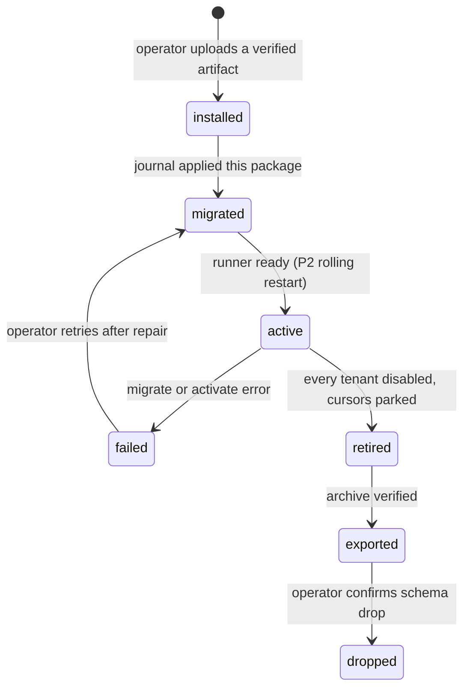
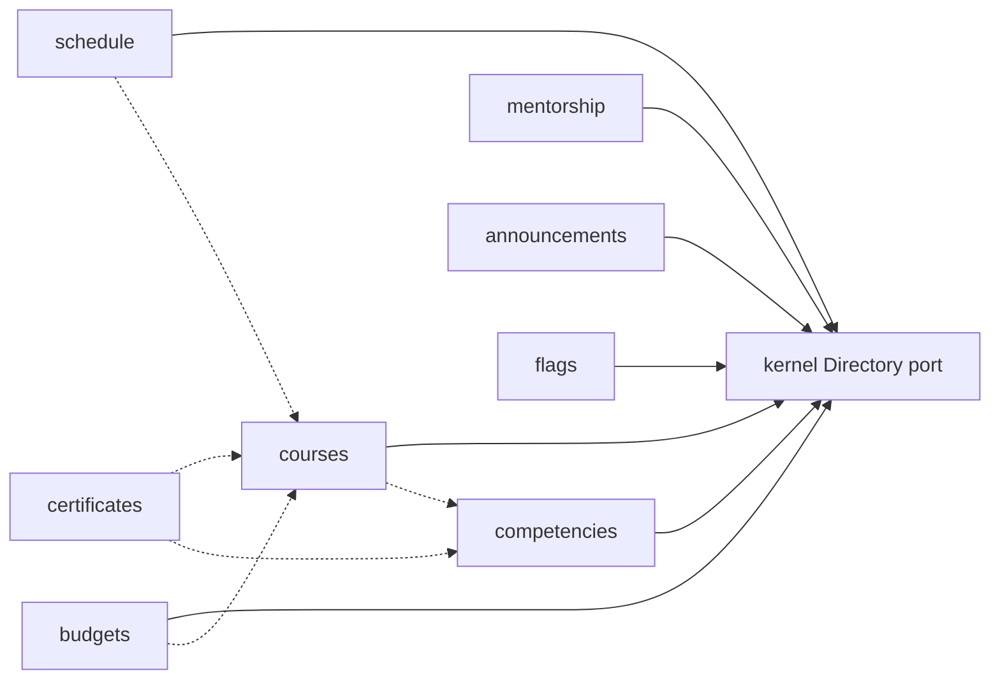

# P1 kernel design — draft B

- **Status:** Draft for review. It does not amend the spec, the decision register, or any Accepted ADR. [ADR-0008](../adr/0008-capability-grants-and-schema-role.md) and [ADR-0009](../adr/0009-leaderless-replica-log.md) are Proposed beside it.
- **Date:** 2026-11-01
- **Spec:** [`../specs/2026-10-12-plerni-design.md`](../specs/2026-10-12-plerni-design.md) §1, §3–§8, §10, §15 (P1 row), §16
- **Register:** [`../decision-register.html`](../decision-register.html) D01, D05, D07, D08, D10, D11, D16, D22, D26, D27, D32
- **Accepted records this draft builds on:** [ADR-0001](../adr/0001-kernel-and-equal-citizen-plugins.md), [ADR-0002](../adr/0002-orm-data-layer.md), [ADR-0003](../adr/0003-outbox-pgboss.md), [ADR-0004](../adr/0004-plugin-isolation-topology.md), [ADR-0007](../adr/0007-pooled-contamination-recovery.md)
- **Conventions:** [`../specs/contract-conventions.md`](../specs/contract-conventions.md)
- **P0:** [`p0-exit-note.md`](p0-exit-note.md) records P0 complete. This draft starts at that line.
- **Roadmap:** [`../ROADMAP.md`](../ROADMAP.md) P1 paragraph

Draft B is the isolation-and-scale reading of the kernel. The capability wall is a closed grant set plus one database role per plugin schema ([ADR-0008](../adr/0008-capability-grants-and-schema-role.md)). The bus is the accepted log, and P1 proves it with two replicas and no leader ([ADR-0009](../adr/0009-leaderless-replica-log.md)). Learning features stay plugins. The kernel stays the host.

Three maintainer calls decide whether this draft proceeds:

1. The P1 isolation wall is the grant set and the schema role. The OS/container tier stays at P5 (ADR-0004).
2. P1's bus exit includes the two-process subset in ADR-0009. A single-process demo does not pass that subset.
3. The features in §9 are plugins, except the four kernel run modes named there (API-only, cache, cluster, maintenance).

## 0. What this draft will not pretend

P0 is done. `apps/kernel/src` is still absent. P1 builds kernel services. P2 admits plugin tarballs, runs the supervisor, and applies the boundary checker to author SQL. P3 ships the competencies and learning plugins, the AI gateway, and MCP write tools. This draft specifies the plugin lifecycle in enough detail that P1's tables and ports do not have to be rewritten when P2 arrives. It does not schedule the runner into P1.

Issues [#63](https://github.com/tachkovsa/plerni/issues/63), [#64](https://github.com/tachkovsa/plerni/issues/64), [#65](https://github.com/tachkovsa/plerni/issues/65), and [#66](https://github.com/tachkovsa/plerni/issues/66) are open domain-input tasks. As of this draft they have no comments and no files under `docs/domain/`. The walkthrough in §9 shows that those future notes have somewhere to land. It does not record them as product decisions. Default role mappings ship empty. Tenant administrators compose roles from plugin-declared building blocks (D27).

Issue [#62](https://github.com/tachkovsa/plerni/issues/62) is the signing-key backup and rotation guide. §6 states the verifier invariant. The guide itself is task K10, and its checklist is the issue.

**Out of this draft's tasks, on purpose:**

- Domain plugin implementations (competencies, courses, and the rest of §9). They are proofs, not P1 code.
- The runner, stdio supervisor, tarball admission, and the full SQL parser. Those are P2 (spec §15). Until the parser exists, the broker executes kernel SQL and in-repo fixture SQL reviewed in the same change.
- MCP write tools, durable AI proposals, provider adapters. Those are P3.
- An OS sandbox, schema-per-tenant, a dedicated database per tenant, a leader-elected relay, a second queue, plugin-held database connections.
- Edits to `.github/workflows/`, `scripts/gates/`, or `tools/harness/sql/` as part of accepting this document. Later tasks may add gates. This document does not.

## 1. Kernel boundary

Equal citizenship (D01): the kernel never imports a plugin, and a plugin never imports kernel internals. `packages/contracts` and `packages/sdk` are the only shared code (ADR-0001). The kernel-purity gate scans `apps/kernel/src` for the nouns in [`../gates/domain-nouns.txt`](../gates/domain-nouns.txt). Adding a learning feature by editing that list, or by putting the noun in the kernel, fails the build.

### 1.1 In the kernel

| Service | P1 ships | Later phase uses the same service |
|---|---|---|
| Tenant registry, RLS context, application tenant guard | Yes | Every plugin table repeats the same policy shape |
| Local IdP, sessions, revocation epoch, OIDC module | Yes | SAML/SCIM plugins in P4 call `identity.deprovision` |
| Directory: users, groups, typed relation edges as rows | Yes | Plugins register edge types; they do not migrate the kernel |
| Generic authorization: resource type, id, action, grants, relationship qualifier, time-boxed delegation | Yes | Plugin manifests add namespaces |
| Package registry, approved grants, per-tenant enablement | Rows and APIs | P2 attaches tarball activation to those rows |
| Migration journal for kernel SQL, plus one fixture schema | Yes | P2 points the same journal at installed packages |
| Outbox log, relays, job handoff | Yes, two processes | Plugins publish through the WorkUnit |
| Audit (commitment hash, per-tenant chain) | Yes | Plugin mutations append in the same transaction |
| Secret store (envelope encryption, references) | Yes | Plugins hold references. P3 signing hooks use the same store |
| Object storage gateway | Yes | Plugin bytes live under a derived prefix |
| Notification plumbing: channels, preferences, dedup, delivery | Yes | Templates and copy stay in plugins |
| Tenant settings: opaque keys | Yes | Targeting and experiments stay in the flags plugin |
| MCP server, generated OpenAPI, REST error envelope | Read inventory | Write tools join in P3 by declaration |
| Minimal admin shell | Kernel workflows only | P2 renders declarative plugin slots |
| Telemetry, resource limits, provisional envelope note | Yes | Numbers revised at P4 |
| Self-upgrade preflight, backup-before-migrate | Yes | Plugin expand-contract rides the same preflight in P2 |
| Maintenance run mode | Yes | Works with every plugin disabled |
| API-only run mode | Yes | The shell is one client |
| Valkey client: cache, rate limit, pub/sub hints | Yes | Durability stays in PostgreSQL |

The AI gateway's control tables are P3 (spec §15). P1 does not create them "early." The secret store and the audit chain are the seams that gateway will use.

### 1.2 Outside the kernel

| Concern | Where it lives |
|---|---|
| Indicators, scales, 180/360 assessments | `competencies` plugin |
| Catalog, enrollment, completion | `courses` plugin |
| Dated gatherings and registration | `schedule` plugin |
| Mentorship engagements | `mentorship` plugin |
| Learning spend | `budgets` plugin |
| Issued certificates and their documents | `certificates` plugin |
| Audience-targeted announcements and their copy | `announcements` plugin |
| Feature toggles, cohort targeting, A/B assignment | `flags` plugin |
| Report definitions and metric rollups | The plugin that owns the underlying facts, plus a later report plugin subscribing to its events. Issue #66 does not add kernel report tables |
| HRIS, SCORM, xAPI, LTI, SAML, SCIM, content vendors | Plugins, on the phases the roadmap already names |
| LLM adapters, retrieval, copilot workflows | Plugins, P3 |
| Untrusted-code isolation, Module Federation, marketplace | P5, demand-gated |

"Employee" is a Directory user. The word can appear in a plugin's locale files. It is not a kernel type.

### 1.3 The seam a new plugin is allowed to touch

A new plugin adds a package: manifest, SQL, zod contracts, declarative UI (when P2 slots exist). Admission composes those contracts into the registries (convention R1.2). The kernel source, the kernel `Database` interface, and the kernel migration history stay as they were.

The proof fixture for that sentence is task K17: a package whose schema is `plugin_fixture_alpha`, whose tables are `note` and `label`, whose SQL lives outside `apps/kernel/src`, and whose names do not appear in the kernel type interface.

## 2. Capability wall

[ADR-0008](../adr/0008-capability-grants-and-schema-role.md) is the decision. The operational shape:

- The operator approves grants at install. A tenant enablement row cannot add a grant.
- The supervisor stamps the approved set into the spawn credential (P2). P1 enforces the same set on kernel ports.
- The broker's app role is a member of each plugin role and uses `SET LOCAL ROLE` only after the hygiene inspect (ADR-0002, ADR-0007).
- Plugin SQL names its own schema. The migration role, not the request role, may `CREATE` there.
- `plane.installation` is the only grant that may iterate tenant ids. It still writes each tenant in a separate tenant-scoped transaction. It is not `BYPASSRLS`.

A plugin process that opens a TCP connection to PostgreSQL is already a failed deployment: production egress is the broker, and the plugin has no database credential (ADR-0001, ADR-0004). The grant wall is the layer that stays in force when a development composition relaxes network placement and says so.

## 3. Plugin manifest, lifecycle, migrations, dependencies

### 3.1 Manifest

Manifest format v0. The field set is closed. Unknown fields fail admission. Id grammar: `^[a-z][a-z0-9_]{0,40}$`. The schema name is derived, `plugin_<id>`. Authors do not choose a schema name.

| Field | Rule |
|---|---|
| `id`, `version` | Id grammar. Version is semver. |
| `license` | SPDX identifier. The platform does not relicense the package (D04). |
| `sdk` | Semver range. Outside the range, install is refused. |
| `provides` | Public contract names this package owns, each with a semver. |
| `requires` | `{plugin, contract, range}` edges. These order migrations and block enablement. |
| `optionalRequires` | Same shape. They do not order migrations and do not block enablement. A call to a missing optional port returns `UNAVAILABLE` with reason `dependency_disabled`. |
| `permissions` | Namespace, resource types, actions, suggested role mappings. Mappings are suggestions. The tenant starts from an empty composition. |
| `routes` | Method, path, operation id, request and response schemas, permission, action class `routine` \| `sensitive` \| `destructive`, limits. |
| `events` | Publish and subscribe entries: type, payload version, owner. |
| `jobs` | Handler name, payload version, optional cron, idempotency. |
| `migrations` | Path of SQL files inside the package. |
| `ui` | Declarative slot contributions. Ignored by the API-only profile. Host JavaScript from a plugin waits for P5 (D12). |
| `grants` | Subset of the ADR-0008 vocabulary. |
| `classification` | Every mutating route appears here. Lint matches it to the route (convention R4.1). |

Entitlement keys stay out (D24).

### 3.2 Lifecycle

Spec §4.5 splits authorities. This draft keeps that split and names uninstall, which the spec describes only through disable and export.

Per-tenant enablement is a second axis, not a state of the artifact. An active package can be enabled for tenant A and disabled for tenant B.

| Stage | Who | What changes | What stays |
|---|---|---|---|
| Install | Installation operator | Artifact digest, manifest, approved grants, registry row | No tenant data. Tenants are not enabled implicitly. |
| Migrate | Journal, migration role, unpooled connection | That plugin's schema only | Kernel schema untouched. Other plugin schemas untouched. |
| Activate | P2 runner, readiness-gated rolling restart | Code version that serves routes | v1 does not hot-swap a process in place (spec §4.5). |
| Enable | Tenant administrator, for their tenant | Enablement row, route exposure, subscription watermark | Grants unchanged. Other tenants unchanged. |
| Disable | Tenant administrator | Routes and jobs stop for that tenant. Data remains exportable. | Other tenants keep consuming. See §4.4. |
| Upgrade | Operator | Expand-contract SQL, then activate the new code | Old code may run briefly on the new schema. The checker rejects a migration that is not backward compatible inside the compatibility window (§5). |
| Retire | Operator, after every tenant is disabled | Installation-level park of subscriptions | Schema and objects remain. |
| Export | Operator | Versioned archive: schema rows, referenced objects, grants, config (spec §4.5) | Reconstruction is tested outside the original deployment. |
| Drop | Operator, second action after a verified export | Schema dropped by the journal. Grants and registry row removed. | Audit tombstones remain. Payload content past erasure follows spec §5. |

Tenant administrators never upload executable code.

Disable of a single tenant does not park the installation cursor. Installation retire does. Re-enable after retire runs the throttled catch-up in spec §4.5. The backlog quota default stays the spec's: 30 days or a size cap, whichever first. Past the quota the operator is warned and may export-then-force-advance. Silent drop of a parked backlog is a failed task.

### 3.3 Migrations

SQL files, alphanumeric within a package. The journal's order:

1. Pending kernel SQL.
2. Packages in topological order of `requires` (a package follows the packages that provide the contracts it requires).
3. Tie-break: plugin id, bytewise ascending.
4. A cycle fails admission for every package on the cycle and every installed package whose required chain reaches that cycle. Nothing in that set migrates.

`optionalRequires` is not an ordering edge. Event subscriptions are not ordering edges (ADR-0002 decision 8). A statement that names another plugin's schema fails the checker. A statement that is a function, a trigger, or a `DO` block fails the checker. `CREATE EXTENSION` fails. The kernel bootstrap owns the extension allowlist (`vector`, `pg_trgm`).

Each migration carries the signed approval artifact (spec §4.6). The public key set and rotation rules are §6 and issue #62. P2 wires verification into admission. P1's kernel migrations follow the same artifact shape so the verifier has one code path.

Tenant-domain tables, kernel or plugin: `tenant_id NOT NULL`, `ENABLE` and `FORCE ROW LEVEL SECURITY`, exactly one canonical permissive policy, composite foreign keys that include `tenant_id`, runtime grants limited to DML. `GRANT ALL` fails the linter. Kernel-internal machinery (outbox, cursors, job store, relay state) has no tenant RLS and is reachable only by the named service identities in spec §5.

Per-tenant reference rows are versioned per-tenant migrations applied in background batches, off the request path (spec §5). They are not seed scripts at tenant creation.

### 3.4 Dependency graph

Solid arrows are `requires`. Dashed arrows are `optionalRequires`. The kernel does not appear as a plugin node. Directory, storage, notify, secrets, and the log are ports, not packages. No dashed or solid arrow is a foreign key.

A tenant may enable `courses` and leave `competencies` disabled. Course completion still records. The optional link to an indicator id is absent, and a call that needs the competencies port returns `UNAVAILABLE` with reason `dependency_disabled`. Completion does not write a competency row and does not imply demonstrated skill (spec §16).

## 4. Event bus

One machinery (D10, ADR-0003, ADR-0009). Events and jobs are intents committed in the same transaction as the mutation. Plugins submit them through a WorkUnit. Kernel services insert them directly. There is no second bus to make the cluster case "easier."

### 4.1 Log

Append-only table in the kernel schema: `seq` (sequence), `tenant_id`, `aggregate_type`, `aggregate_id`, `type`, `version`, `payload`, `created_at`. `seq` is allocated from a PostgreSQL sequence. A rolled-back insert leaves a gap. Readers tolerate gaps. No tombstone row fills a gap.

`aggregate_type` is a string the publishing plugin owns. It is not a kernel enum. Adding a type does not migrate the kernel.

### 4.2 Delivery

- One global cursor per subscription (`last_seq`).
- Lagging horizon: deliver rows with `seq > last_seq` and `seq <= safe_point`, where `safe_point` is the database clock minus 10 seconds. The app clock is not the horizon.
- Claim unit is the subscription row, `FOR UPDATE SKIP LOCKED`, so two relays compete without a leader (ADR-0009).
- One event, one delivery transaction: unique `(subscription, seq)` dedup marker, handler effects, cursor advance, fencing check. A duplicate delivery updates zero business rows.
- Filtered subscriptions skip types they do not list and still advance. A filter cannot stall the log.
- Unknown payload version for a type the subscription does list: park that subscription with an error. Do not best-effort the payload (spec §4.8, convention R5.3). An operator, or a consumer upgraded to that version, resolves the park. The resolution writes a dead-letter row and advances in one transaction. The log row stays.
- Poison handler failures take the same dead-letter path, with an alarm. They are not deleted from the log.
- New subscriptions start at the current high-water `seq`, or at a declared start `seq` recorded in the manifest. They do not replay the history of the installation unless the manifest asks.
- Retention low-water is the minimum `last_seq` among live cursors. Parked installation cursors are exempt inside the §3.2 quota.
- `LISTEN`/`NOTIFY` is a zero-payload wake-up on a dedicated unpooled connection per relay. Polling about once a second is the correctness net. Zero listeners raise an alert. Delivery still happens.

At-least-once is the contract outside PostgreSQL. The handoff from outbox row to a job row is one database transaction (exactly-once inside PostgreSQL). The SDK text says so. Handlers that need order consume the event log. Jobs are unordered.

### 4.3 Ordering

There is no global order. Per-aggregate order holds because the writer locks the aggregate row before inserting the event, so sequence numbers for that aggregate are allocated in lock order. The horizon bounds the window where a later transaction could commit a lower sequence. The design states that bound. It does not promise a total order across aggregates, tenants, or types.

Two replicas can deliver different subscriptions at the same time. They do not deliver the same subscription's same `seq` twice as two committed effects.

### 4.4 Enablement watermarks

The installation cursor must keep moving while one tenant has a plugin disabled and another has it enabled.

- Installation disable (retire) parks the subscription cursor. Spec §4.5 applies.
- Tenant disable writes a per-tenant watermark and stops delivery for that `tenant_id`. Other tenants continue. The installation cursor advances across the skipped rows.
- Tenant re-enable catch-up starts at that watermark, throttled, inside the same quota. If retention has already passed the watermark, catch-up starts at the low-water, and the gap is an audited skip, not a silent one.
- Watermark rows are kernel-internal machinery: service identity of the relay, tenant id in the row, no RLS, application-level scope. Their shape does not change when a plugin is added.

### 4.5 Versioning on the bus

Event types are `<namespace>.<noun>.<verb>` (convention R5.1). The namespace is the publishing plugin id, or `kernel` for kernel facts (`kernel.tenant.created`, `kernel.identity.disabled`). Payload version is an integer stored on the row, equal to the major of the payload schema. The registry holds the semver and the zod schema.

| Change | Version move | Consumer that asked for the previous version |
|---|---|---|
| Add an optional field | Minor of the schema. Row version unchanged. | Still validates. Unknown fields are stripped. |
| Remove, rename, or retype a field | New row version. New major. | Parks. Does not guess. |
| New event type | New registry entry. Subscribers opt in. | Unaffected. Filtered skip. |

Deprecation windows follow convention R2.2. Kernel event types do not use learning nouns. An xAPI-shaped stream, if it ever exists, is a plugin namespace (`xapi.*`) and a plugin-owned table. The kernel log only delivers (roadmap, P0 plan Annex L).

### 4.6 Jobs

pg-boss is the job mechanism behind the log (ADR-0003). The pin is adopted only after task K14 passes through PgBouncer transaction mode under the unnamed-statement default. The kernel envelope on every job: tenant, plugin, handler name, payload version, idempotency key, deadline, attempt budget, trace, service identity. `expiredIn` starts at a conservative cold default of 60 seconds per job class until a measured p99 exists, and then moves to at least three times that p99. Cron is a manifest field with a misfire rule and a uniqueness key. The dead-letter queue has an operator replay action in the admin shell.

Claiming jobs is cross-tenant machinery. Executing a job re-enters `withTenant` for the row's tenant. A job without a tenant id is installation-plane and requires `plane.installation`.

## 5. Tenancy, identity, roles

### 5.1 Tenancy

v1 is one database, shared tables, PostgreSQL RLS (D05). Dedicated databases and schema-per-tenant stay out (spec §18). "Each tenant installs only what it needs" is the enablement axis in §3.2, on top of those shared tables.

Every tenant transaction follows ADR-0002 decision 2: one pinned connection, hygiene inspect before any local override, terminate and discard on contamination (ADR-0007), `set_config(..., true)`, read-back, then data. Missing context fails twice: the policy returns no rows, and the application guard raises. The vacuity control is a test that skips the guard setup and must fail.

Pooled connections do not carry session `SET`, `LISTEN`, or session advisory locks. Activation and migration locks use an unpooled connection (spec §7).

Tenant creation is an API: id allocation, registry row, audit, outbox event `kernel.tenant.created`. Reference data for that tenant arrives through the background per-tenant migrations, not a seed embedded in the request.

Erasure is export-then-erase (spec §5). Per-tenant data keys in the secret store make crypto-shredding possible. The audit chain keeps commitment hashes and tombstones. `restore_epoch` is §8.4.

### 5.2 Identity

PostgreSQL is the revocation authority (D16).

- Local accounts: argon2id password, TOTP secret encrypted in the secret store, single-use rescue codes stored hashed, verified email reset, throttled login and recovery.
- Sessions: hashed opaque tokens. `user_auth_state.revocation_epoch`. Local disable is one transaction: set disabled, bump epoch, revoke sessions, audit, `NOTIFY`.
- Ordinary requests trust a freshness lease of five minutes. Admin and sensitive routes read the session row on every request. `strict_disable` makes that per-request check installation-wide for the tenant.
- A successful OIDC login does not clear a local disable.
- OIDC, in the kernel: authorization code and PKCE, issuer mix-up protections, exact redirect match. Tokens stay server-side. Configure-OIDC is one of the API-only workflows.
- Bootstrap: the first installation operator and the first tenant administrator are created by the API, using a one-time bootstrap credential supplied in the process environment. The value is never logged, never migrated into a fixture, and never committed. After bootstrap the credential stops working.
- Service principals: tenant-scoped, hashed, scoped, expiring, rotatable, revocable. An upstream IdP token is not a Plerni token.
- `identity.deprovision` is a kernel command in P1, idempotent on `event_id`, bound to a source incarnation so a stale termination after rehire does not disable the account. A future SCIM plugin translates wire events into that command and does not touch sessions.
- Break-glass local operators are WebAuthn-bound, rate-limited, and alarmed.
- Valkey may cache the freshness deadline with a TTL inside the lease. A restored cache cannot authorize (spec §16.15). That case is an acceptance test of K16.

Step-up for P1's own sensitive kernel actions (disable a user, export, rotate a key, erase a tenant) is the spec §6 MFA step-up, at most fifteen minutes, checked per request. Durable AI proposals and the nondelegable proof-of-human ceremony stay P3. The action class is still recorded on P1 routes so the later ceremony has a field to read.

### 5.3 Directory, roles, permissions

Directory rows: users, groups, memberships, and typed edges. Edge types are data. A mentorship plugin registers `mentors` with `directory.register_edge_type`. The kernel table gained that type as a row, not as a migration.

Authorization input is resource type, resource id, action, and grants. Grants may say "holder of edge `reports_to` toward the subject." Evaluation is the same function for a session, a service principal, and an MCP actor. An MCP actor receives the human's grants or a delegated subset. It does not receive a superset (D26, D32).

Time-boxed delegation is a grant with an expiry. Expiry is enforced in the check. The audit row records the delegator and the delegate.

Plugins declare a permission namespace in the manifest. Tenant administrators compose roles from those declarations. Issue #65 will name real learning roles when someone writes them. Until then the kernel ships no role called author, manager, or auditor. The relationship machinery is what a later "manager sees this user's row" rule plugs into, and the resource type string will be a plugin string such as `courses.enrollment`.

Object-level scope is applied by the broker before execution, from the query's declared resource binding (spec §4.3). RLS is the tenant wall. The binding is the wall between two users in one tenant. P1's suite covers the kernel resources (users, groups, sessions, audit). Plugin resources join that suite in the phase that adds the plugin. The fixture package in K17 includes two notes in one tenant and shows that a principal without the grant receives none.

### 5.4 Two planes

| Plane | Actor | Can |
|---|---|---|
| Tenant | Tenant user, tenant service principal | Read and write that tenant, inside grants and RLS. |
| Installation | Operator principal holding `plane.installation` | Iterate tenant ids from the registry. Open a tenant transaction per id. Manage packages, maintenance, and restore. |

An announcement to every tenant is an installation-plane job that copies the payload into each tenant's plugin table. It does not select one tenant's plugin rows while serving another. A maintenance switch is installation-plane. A feature flag aimed at one user is tenant-plane.

## 6. Contract versioning

Four axes (convention R2.1). A change names the axis it moves.

| Axis | P1 artifact | Breaking change |
|---|---|---|
| Kernel release | The kernel package | Spec §3 self-upgrade window: N and N+1 overlap during rollout. |
| Plugin package | Manifest `version` | Owns its schema expand-contract and its payload majors. |
| SDK protocol | SDK semver range in the manifest | A port signature change is an SDK major. Installed packages outside the range do not activate. |
| Public API | Operation ids, generated OpenAPI, MCP descriptors | Removing or renaming an operation id, tightening a request, loosening a response, or changing an error code's meaning (convention R2.2). |

The first error envelope is frozen in K19, so later additions are not slipped in as "small" response changes. Fields: closed `code`, human message, `next_step`, optional `reason` from a closed set (`maintenance`, `dependency_disabled`, `cache_unavailable`, `parked`, `quota`). Codes include the convention R3.3 set. HTTP status comes from the code (`CONCURRENCY_CONFLICT` is 409). MCP puts the same envelope in a tool result with `isError: true` and does not use a JSON-RPC protocol error for it.

Public versus plugin-private schemas are marked in the registry. Plugin-private schemas are not generated into the installation OpenAPI. Public schemas carry deprecation windows.

Workflows that exist in P1 (create tenant, bootstrap admin, rotate a service credential, configure OIDC, enable a package for a tenant) each name a no-AI completion path in the inventory (convention R6). The path is the REST call. There is no assistant on these routes.

## 7. MCP surface

One registry produces REST routes, OpenAPI, and MCP tool descriptors (D26, convention R1). Hand-written MCP descriptors fail review.

P1's curated read inventory is kernel-only:

| Tool | Permission | Notes |
|---|---|---|
| `kernel.session.whoami` | Authenticated actor | Plane, tenant, subject, grant summary. No secrets. |
| `kernel.tenant.get` | Tenant reader | The caller's tenant. |
| `kernel.directory.user.get` | Directory read on that user | Authorization applied before the query. |
| `kernel.directory.user.list` | Directory read | Keyset pagination. Bounded. |
| `kernel.directory.group.list` | Directory read | |
| `kernel.directory.edge.list` | Directory read | Edge type is a filter parameter, not a new tool per type. |
| `kernel.audit.list` | Audit reader | Bounded. Payload hashes, not secret values. |
| `kernel.package.list` | Tenant admin or operator | Enablement for the caller's tenant. Operators may pass a tenant id. |

Admin mutations, uploads, streaming, and maintenance switches stay REST (D26). MCP write tools wait for the P3 proposal ceremony. A plugin joins this inventory later by declaring `mcp: read` on a route. Declaration is admission data. The kernel generator does not gain a branch for that plugin.

The alignment check compares the generated MCP manifest to this inventory for schema and permission identity, then a real MCP client runs the read workflows. The API-parity workflows in §8.1 run over REST without the shell. Equivalence for the overlapping reads: same rows, same permission denials, ignoring generated ids and timestamps (spec §16.11).

Authentication for MCP is the same service principals and, where a human delegates, authorization-code plus PKCE. Dynamic client registration is P4. Token passthrough is refused.

## 8. Run modes the kernel owns

These four are kernel behavior. They are the part of the maintainer's test list that is not a plugin. Each works with zero plugins enabled.

### 8.1 API-only

A process configuration `surfaces=api` starts REST, OpenAPI, and MCP. It does not start the shell, and it does not require the shell's assets. The named P1 workflows pass against this process with no browser:

1. Create a tenant.
2. Bootstrap an administrator.
3. Provision a service principal.
4. Rotate that credential.
5. Configure OIDC.

MCP then reads back the tenant, the administrator's directory row, and the service principal's metadata (not the secret). K22 is the proof. The shell's e2e is a separate gate and is not this proof (spec §10).

### 8.2 Cache

Valkey is the default (D22, ADR-0009). P1 uses get, set, delete, expire, increment, publish, subscribe, and ping. Keys are prefixed by plane, tenant, and purpose. Session authorization is a PostgreSQL read. The cache holds a freshness hint whose TTL is inside the lease.

Loss test, required: stop Valkey, send an ordinary request, observe a PostgreSQL session check and a successful authorized read; send an admin request, observe a per-request session read; send a rate-limited route, observe `UNAVAILABLE` with reason `cache_unavailable`; restore a stale cache snapshot that still contains a revoked session, observe the session denied.

A Redis-protocol server the operator supplies can replace Valkey if it implements that command subset. The default artifact is Valkey. The pin is chosen in K16 against the release notes current on that day. ADR-0009 records the 9.1.3 observation so the task does not start from memory.

### 8.3 Cluster

P1's cluster proof is two kernel processes and two relays, one PostgreSQL primary, one Valkey primary, PgBouncer in transaction mode in front of the primary (ADR-0009). It is a test composition, not the P4 Helm chart.

The processes share no in-memory bus. SSE subscribers on process A receive a publish that landed on process B through Valkey, or they miss the hint and the next poll catches up. The log does not depend on that hint. Killing either process leaves the other serving, and the surviving relay drains. There is no leader lock to steal.

This does not claim a multi-primary database, a Valkey Cluster deployment, or a tenant-sharded cell. Those remain the measured D10 path and the deferred placement annex.

### 8.4 Maintenance

The live switch is a row in kernel machinery, read on each request. The boot configuration can force maintenance until the process is healthy, so a replica that cannot reach PostgreSQL stays on the maintenance path.

While maintenance is on:

- Tenant routes, MCP tools, and plugin dispatches return `UNAVAILABLE`, reason `maintenance`, with a `next_step` that says the installation is in maintenance and to retry after the operator clears it.
- `GET /health` stays available to the orchestrator and reports maintenance, without tenant data, so a cluster probe can tell maintenance from a dead process.
- The shell serves a static page from its image and does not call a plugin to render it. The API-only profile has no page; clients use the envelope.

The switch is installation-wide, so two replicas agree. Draining one replica during a rollout is the proxy's job; the application flag is the wrong tool for that. Clearing the flag is an installation-operator action, audited.

### 8.5 Backup, restore, upgrade

Backup covers PostgreSQL, object storage, and secret-store custody, including the key-encryption key's custody outside the database. The artifact manifest (kernel version, package digests, journal position) is in the backup. Restore onto clean infrastructure replays that manifest.

Every restore bumps `restore_epoch`. Sessions and service credentials issued before that epoch fail. The K24 equality check is the spec's: manifest hash, row counts, and a written sampling rule. The test asserts a pre-restore session is denied.

Kernel self-upgrade: expand-contract, two-release tolerance, preflight (disk, pending migrations, SDK ranges once packages exist), backup-before-migrate on the appliance profile, stuck-instance detection. P1 proves the preflight on kernel SQL. Plugin SDK-range checks are wired in P2 when packages exist, against the same preflight.

## 9. Walkthroughs

Each plugin below is specified so a later package, admitted in P2, can be written without a kernel diff. The kernel files touched by every row are: none. The seams they use are the ones §1–§8 already assign to the kernel: Directory port, grant check, RLS, the WorkUnit the broker commits for plugin writes, the log, a storage prefix, a secret reference, notify plumbing, and per-tenant enablement. P1 builds those seams for kernel callers and for the fixture package. It does not implement these eight packages.

Issue #63's example stories (mandatory training for a department, a manager approving an external course, a role change that updates a plan) are expressible as courses plus Directory groups plus a `reports_to` grant plus events. They become acceptance tests when that issue gains real write-ups. They are not kernel services waiting for the write-ups.

### 9.1 Competencies

| | |
|---|---|
| Id | `competencies` |
| Schema | `plugin_competencies` |
| Tables | `indicator`, `scale`, `assessment`, `assessment_rater` |
| Ports | `directory.read` |
| Publishes | `competencies.assessment.submitted` |
| Subscribes | none required |
| Grants | `db.own_schema`, `events.publish:competencies.assessment.submitted`, `directory.read` |

An indicator is a row with a stable id and a scale. An assessment names a subject (Directory user id) and a mode column the plugin owns: `one_eighty` or `three_sixty`. Raters are rows. In `one_eighty` the plugin asks the Directory for the `reports_to` edge and requires that manager. In `three_sixty` it also stores peer raters the subject or an administrator nominated. Peer nomination is plugin data. The edge type `reports_to` is a Directory row the installation already has; registering it does not migrate the kernel.

Submitting writes the assessment and the outbox row in one WorkUnit. A second submit with the same idempotency key returns the original. A rater from another tenant fails RLS. A rater in the same tenant who is not on the rater list fails the object grant.

No kernel noun is added. `competency` stays on the purity list, and the word occurs in this plugin's tree and in its locale files.

### 9.2 Courses

| | |
|---|---|
| Id | `courses` |
| Schema | `plugin_courses` |
| Tables | `course`, `offering`, `enrollment`, `completion` |
| Requires | Directory port |
| Optional | `competencies` public contract, to store an indicator id |
| Publishes | `courses.enrollment.opened`, `courses.completion.recorded` |
| Grants | `db.own_schema`, publish those two types, `directory.read` |

Enrollment targets a Directory user or a Directory group. Group expansion is a Directory read at enrollment time, and the membership snapshot is stored in the plugin so a later group edit does not rewrite history. Completion inserts `completion` and emits `courses.completion.recorded`. It does not write `plugin_competencies`. With competencies disabled, the indicator field is null and the course still completes.

A department-wide mandatory assignment, the shape issue #63 names, is an enrollment of a group plus a deadline column on the offering. Overdue is a query in this plugin, or a subscription in a report plugin. It is not a kernel job class.

### 9.3 Gatherings

The product word "event" for a dated gathering would collide with the log's word. The package id is `schedule`. The contract namespace is `schedule.gathering`.

| | |
|---|---|
| Id | `schedule` |
| Schema | `plugin_schedule` |
| Tables | `gathering`, `registration` |
| Requires | Directory port |
| Optional | `courses` contract, to point at an offering id |
| Publishes | `schedule.gathering.scheduled`, `schedule.registration.recorded` |
| Grants | `db.own_schema`, publish those types, `directory.read`, `notify.send` |

Registration checks the gathering's audience (a user or a group) through Directory. A registration emits the event and, through notify plumbing, asks the notification service to deliver. The template string lives in this plugin. The kernel plumbing deduplicates on the idempotency key.

### 9.4 Mentorship

| | |
|---|---|
| Id | `mentorship` |
| Schema | `plugin_mentorship` |
| Tables | `engagement`, `note` |
| Requires | Directory port, `directory.register_edge_type` |
| Publishes | `mentorship.engagement.opened` |
| Grants | `db.own_schema`, `directory.read`, `directory.register_edge_type`, publish that type |

On install the package registers the edge type `mentors`. That is an insert into the Directory edge-type table. The kernel schema is unchanged. An engagement creates the edge and the plugin row in one WorkUnit. A grant of the form "holder of `mentors` may read `mentorship.note` of the subject" is tenant configuration over the generic evaluator. The kernel does not learn the word mentor. The purity list already contains `mentor` and `mentorship`; they stay out of `apps/kernel/src`.

### 9.5 Budgets

Learning spend is not the AI budget ledger. The ledger arrives with the P3 gateway and is kernel control data. This package is tenant spending.

| | |
|---|---|
| Id | `budgets` |
| Schema | `plugin_budgets` |
| Tables | `fund`, `posting` |
| Requires | Directory port |
| Optional | `courses`, to reserve against `courses.enrollment.opened` |
| Publishes | `budgets.posting.recorded` |
| Subscribes | `courses.enrollment.opened`, `courses.completion.recorded` (optional) |
| Grants | `db.own_schema`, subscribe and publish as declared, `directory.read` |

A posting is a reservation or a release, with an idempotency key. The subscriber uses a process-manager row in this schema (pending, posted, compensated). A duplicate delivery hits the unique key and does not double-spend. If courses is disabled, the package still records manual postings. The optional subscription is parked at the watermark rules in §4.4, not by editing the kernel.

### 9.6 Certificates

| | |
|---|---|
| Id | `certificates` |
| Schema | `plugin_certificates` |
| Tables | `certificate` |
| Optional | `courses`, `competencies` |
| Subscribes | `courses.completion.recorded`, `competencies.assessment.submitted` |
| Publishes | `certificates.certificate.issued` |
| Grants | `db.own_schema`, those subscriptions, publish, `storage.prefix`, `secrets.use:signing` |

The handler verifies the payload version it declared. An unknown version parks the subscription (no best-effort certificate). The document bytes go to storage under the derived prefix. The signing key is a secret reference; the broker resolves it for the sign operation and does not return the key to the plugin. A completion event alone does not satisfy an assessment rule inside this plugin unless the tenant configured that rule. The plugin can refuse to treat completion as competence, which keeps the spec §16 invariant in plugin policy rather than in a kernel special case.

### 9.7 Announcements

| | |
|---|---|
| Id | `announcements` |
| Schema | `plugin_announcements` |
| Tables | `announcement`, `audience_snapshot` |
| Requires | Directory port, notify plumbing |
| Publishes | `announcements.announcement.published` |
| Grants | `db.own_schema`, `directory.read`, `notify.send`, publish. Installation-wide audience also needs `plane.installation`, which a tenant admin cannot grant. |

Three audiences, one code path:

| Audience | Who may send | Write shape |
|---|---|---|
| One group in one tenant | Tenant administrator | One announcement row, snapshot of member ids, notify each member. |
| One tenant | Tenant administrator | Snapshot is every Directory user in that tenant. RLS confines the read. |
| Every tenant | Installation operator | A job lists tenant ids from the registry and, per id, opens a tenant transaction that writes that tenant's row. Bounded batch, admission limit, resumable cursor on the job. |

The all-tenant job does not read announcement rows across tenants. A group change after the snapshot does not rewrite the snapshot. Notify dedup uses the announcement id plus the user id.

### 9.8 Flags and A/B tests

| | |
|---|---|
| Id | `flags` |
| Schema | `plugin_flags` |
| Tables | `flag`, `variant`, `assignment` |
| Requires | Directory port |
| Publishes | `flags.assignment.recorded` |
| Public port | `flags.assignment.read` |
| Grants | `db.own_schema`, `directory.read`, publish |

A flag names variants with integer weights. The subject is a Directory user, optionally constrained to a group or a relationship. The bucket is `hash(tenant_id, flag_id, subject_id)` into those weights, so two replicas assign the same subject the same variant with no coordination. The assignment row is written on first read so an audit can show the variant later, including after the weights change. Other plugins read the public port. They do not read `plugin_flags`. The kernel settings table stays opaque key/value and does not grow a targeting language.

Targeting "employees" is targeting Directory users. A plugin that wants a flag checks the port and treats `dependency_disabled` as the flag being absent, which is a defined fallback the caller records.

### 9.9 The four kernel modes, as a negative proof

API-only, the cache, the two-process composition, and the maintenance switch are exercised with the package registry empty. Create-tenant, directory read, session revoke, and the maintenance envelope all succeed or fail as §8 says. No plugin manifest is loaded. That is the proof they are kernel run modes.

A package from §9.1–§9.8 enabled afterward does not change those four behaviors, and disabling it does not change them either. Maintenance still returns the envelope when a plugin request is in flight: the flag is checked before dispatch, and an in-flight tenant transaction either commits or rolls back under the fencing rules. It does not half-write because the flag flipped.

### 9.10 One chain, still without a kernel change

With the optional edges enabled, a tenant administrator enrolls a group in a course. The courses plugin emits `courses.enrollment.opened`. The budgets plugin posts a reservation. On completion, courses emits `courses.completion.recorded`. Certificates issues a document if its rule matches. Flags decides whether the certificate card is offered. Announcements notifies the subject's group. Each hop is an event or a public port. The kernel diff for the whole chain is empty. A duplicate delivery does not double the posting or the certificate, because each consumer's idempotency key is committed with its effect.

Issue #64's integrations (HRIS, content libraries, calendars, BI) attach the same way: a plugin subscribes or calls a public port, and brokered HTTP egress is an explicit `http.egress:<host>` grant. Issue #66's metrics are subscriptions off these events into a report plugin. The kernel does not pre-aggregate completion or skill gap. If a metric needs a fact the event does not carry, the publishing plugin versions the payload (§4.5). That is a plugin major, not a kernel migration.

## 10. Risks, open questions, proposed ADRs

### 10.1 Risks

| # | Risk | What this draft does |
|---|---|---|
| 1 | The grant wall gets described as an OS sandbox (spec §17 risk 2). | ADR-0008 forbids that reading. Same-UID residuals stay with ADR-0004. |
| 2 | The installation plane becomes a standing bypass of RLS. | `plane.installation` iterates tenant ids and then uses a normal tenant transaction. The suite includes a test that an operator job cannot `SELECT` two tenants' plugin rows in one statement. |
| 3 | `SET LOCAL ROLE` interacts with PgBouncer's `search_path` replay (ADR-0007). | SQL is schema-qualified. K17 measures replay and discards the client session if it happens. |
| 4 | pg-boss 12.38.0 may need session state the pooler cannot keep. | K14 is a gate, not a guess. No pin is adopted on the registry reading alone. |
| 5 | A per-tenant watermark holds retention hostage. | Same quota as a parked cursor. Past the quota, the skip is audited. |
| 6 | Domain issues #63–#66 arrive with a role or a report that "has to be in the kernel." | The mapping in §9 is the bet. A fact that cannot be a plugin payload, a Directory edge, or a grant is a maintainer decision against D27/D32, not a quiet kernel noun. |
| 7 | Two processes on one host pass, and a real pause between them does not. | K15 kills a process and pauses one relay. It does not only start two threads. |
| 8 | First-party packages later import kernel internals. | No first-party package is added in P1. Import parity is a P2 gate, already specified. |
| 9 | The all-tenant announcement is an unbounded write. | It is a resumable job with a batch bound and an oldest-pending alarm. It is not a request. |
| 10 | A Valkey hit is treated as authorization. | K16's stale-snapshot test is acceptance, not a drill we may skip. |
| 11 | One PostgreSQL primary is the ceiling, and two app replicas hide that. | ADR-0009 says so. D10's measured threshold is unchanged. |
| 12 | P1 grows the AI gateway or the runner "while we are here." | §0 lists them as out. A PR that adds them is scope creep against this draft. |

### 10.2 Open questions

1. **Quota numbers.** The 30-day / size-cap default is the spec's. The size cap's byte number is unset. K13 records a provisional cap in the envelope note and treats it as revisable, not as a promise.
2. **Bootstrap credential delivery.** The environment is the entry. Whether the appliance prompt accepts it once and then drops it is an operator-doc question for K3. The value stays out of the repository either way.
3. **Edge-type governance.** Any plugin with `directory.register_edge_type` can add a type. Open: should install-time approval list the type names, not only the grant? Draft B says yes: the manifest lists the type strings, and the grant only allows those strings. K17's fixture registers none.
4. **Hash for A/B buckets.** The flags plugin owns the algorithm. Draft B requires it to be stable across processes and to take tenant, flag, and subject as inputs. The exact function is chosen in that plugin's spec, with a test vector. It is not a kernel choice.
5. **Health authentication.** `GET /health` is unauthenticated and contains no tenant data. Confirming that the orchestrator can scrape it without a credential is part of K23. It must not grow into a status dashboard.
6. **pg-boss versus a kernel-only job table if K14 fails.** ADR-0009's flip is to stay on the outbox. A replacement dispatcher is a new ADR, not a silent BullMQ import inside K14.
7. **Issue #62 transition overlap.** This draft requires the verifier to accept a set of public keys during a named window. The length of the window is written in the guide's PR, not here.

### 10.3 Proposed ADRs

| Record | Decision | Status |
|---|---|---|
| [ADR-0008](../adr/0008-capability-grants-and-schema-role.md) | Closed grant vocabulary, one `NOBYPASSRLS` role per plugin, `SET LOCAL ROLE` after hygiene, schema-qualified SQL. | Proposed |
| [ADR-0009](../adr/0009-leaderless-replica-log.md) | P1 proves the log with two processes. Valkey is outside durability. pg-boss pin waits on a pooler proof. | Proposed |

No further ADR is required to start K1. An ADR is required before: a new grant name, a job dispatcher other than the outbox, moving the OS tier forward, or putting a §9 feature in the kernel.

### 10.4 What would make this draft wrong

- A §9 feature whose data cannot live in its own schema and whose contracts cannot be zod plus the log.
- A two-process loss test that passes only with a leader.
- A broker check that plugins can skip by holding their own connection.
- A domain note that needs a kernel enum of roles or metrics. That note triggers a maintainer decision. It does not edit `apps/kernel/src` inside a feature PR.

## 11. P1 task breakdown

Tasks are one PR each. High-risk tasks (tenancy, authorization, cryptography, migrations, the bus, restore) follow `docs/ai/model-routing.md`: when the drafting family is known, review is a human or a different family; when it is unknown, the maintainer decision of 2026-10-26 applies. The receipt is revision-bound and lives on that PR. This design PR does not contain those receipts.

Every task's PR still passes the gates that already exist: secrets, private-markers, kernel-purity, license audit, commit-policy, SCA. The "Gates" column names the additional proof that task adds. "Done" means the proof was run and the output observed.

Suggested order is the dependency column, not a calendar. Tracks that can proceed beside each other after K1: identity (K2–K7), bus (K13–K15), surfaces (K19–K23).

| ID | Task | Depends | Acceptance | Gates | Risk |
|---|---|---|---|---|---|
| K1 | Kernel schema, RLS, hygiene, tenant guard | P0 | Two tenants, overlapping ids, pooled and direct. Missing context returns no rows and the guard raises. Contamination terminates the backend, discards the pooler session, retries at most twice. Vacuity control fails when the guard is skipped. | Tenancy suite on PostgreSQL through PgBouncer. Kernel-purity still green (no domain nouns). | High |
| K2 | Tenant registry and create-tenant API | K1 | API creates a tenant. Second call with the same idempotency key returns the same tenant. A request with no operator credential is refused. `kernel.tenant.created` is in the log. | API test, no shell. | High |
| K3 | Local IdP, sessions, epoch, bootstrap admin | K2 | Bootstrap creates one admin, then the bootstrap credential stops working. Disable bumps the epoch and revokes sessions in one transaction. A revoked token fails. Rescue codes are stored hashed. No secret in logs. | Auth suite, including the epoch bump. | High |
| K4 | OIDC authorization code + PKCE | K3 | Configure-OIDC via API. Exact redirect match. A local disable survives a successful IdP login. IdP tokens are not API tokens. | OIDC suite against a local test issuer. | High |
| K5 | Service principals | K3 | Provision, call, rotate, revoke. The previous credential fails after rotate. Scope does not include undeclared permissions. | Principal suite. | High |
| K6 | Directory users, groups, edges | K3 | CRUD inside one tenant. Tenant B sees none of tenant A's users. Registering an edge type inserts a row and does not add a kernel migration. | Two-tenant Directory suite. | High |
| K7 | Authorization, relationship grants, delegation | K6 | A `reports_to` grant allows the holder and denies a peer. An expired delegation denies. MCP-shaped actor (same function, service principal) cannot exceed the delegator. | Authz suite with a same-tenant adversarial query. | High |
| K8 | Audit commitment chain | K3 | Mutating the audited action writes the audit row in the same transaction. A rollback writes neither. The chain is per tenant. Payloads are hashes. | Audit suite, rollback case included. | High |
| K9 | Secret store | K1 | Put, reference, resolve inside the broker, rotate the data key. A plugin-shaped caller receives the reference and not the value. KEK comes from the environment or a key file. Air-gap profile has no cloud KMS call. | Secret suite. Log scan shows no value. | High |
| K10 | Signing-key guide | K9 | The guide requested by issue #62: backup posture, rotation PR, overlap of public keys, compromise. Satisfies §6: the verifier honors a key set; a removed key fails closed after the window the guide names; no private key in the diff. | Docs review plus a verifier fixture that accepts two public keys and rejects an unknown one. The fixture key is synthetic. | High |
| K11 | Object storage gateway | K1 | Put and get under a derived prefix. Tenant B cannot read tenant A's key. A missing object is `NOT_FOUND` with `next_step`. | Storage suite against an S3-compatible test double. | High |
| K12 | Notification plumbing | K1 | Deliver, dedup on idempotency key, record preference. A duplicate send does not duplicate delivery. No template lives in the kernel. | Notify suite. | Medium |
| K13 | Outbox log and one relay | K1 | Append with the business transaction. Horizon skips a rolled-back seq. A filtered subscription advances. Unknown version parks. Polling delivers with `LISTEN` down. | Bus suite, one process. | High |
| K14 | pg-boss pooler proof, then handoff | K13 | The candidate pin runs through PgBouncer `pool_mode=transaction`, `max_prepared_statements=0`, with no session `SET`, no session advisory lock, and no `LISTEN` on a pooled connection. Claim uses `SKIP LOCKED`. Handoff is one transaction. If the pin fails, the task stops at the written failure and adopts nothing (ADR-0009). | Spike report in `docs/plans/`, commands and exit codes included. | High |
| K15 | Two-process relay | K13 | ADR-0009 subset: two processes, kill one relay, duplicate delivery, listener-absent polling, retention above the live cursor. No leader row. The survivor drains. | Two-process suite. A one-process run does not count. | High |
| K16 | Valkey cache and loss | K3 | §8.2 loss tests, including a restored snapshot that still holds a revoked session. Rate limit fails closed when Valkey is down. Ordinary reads still authorize from PostgreSQL. | Cache suite. Pin and source recorded in the PR. | High |
| K17 | Grants, plugin role, fixture schema | K1 | ADR-0008. Fixture package `fixture_alpha` migrates `plugin_fixture_alpha` without a kernel source edit and without entering the kernel `Database` interface. A fixture-file check rejects unqualified table names, another plugin schema, and functions. That check is not the P2 admission parser. `SET LOCAL ROLE` replay is measured. Two notes in one tenant: the principal without the grant reads zero. | Fixture suite plus kernel-purity. Codegen diff empty. | High |
| K18 | Package registry and per-tenant enablement | K17 | Enable for tenant A, leave B disabled. A's watermark receives a fixture event; B's does not; the installation cursor advances. Re-enable catch-up delivers inside the quota. Grants do not widen on enable. | Enablement suite. | High |
| K19 | Error envelope and generated OpenAPI | K2 | Envelope matches §6, including `reason`. OpenAPI is generated from the zod registry. A hand-written path fails review. `CONCURRENCY_CONFLICT` maps to 409. | Contract test. Breaking-change check on the kernel routes. | Medium |
| K20 | MCP read inventory | K7, K19 | The eight tools in §7. Alignment check against the curated list. A real MCP client reads the same tenant the REST client reads, and is denied the same cross-tenant read. No write tool is registered. | MCP alignment suite. | High |
| K21 | Minimal admin shell | K19, K3 | Shell screens for the kernel workflows only: tenant, admin, principal, OIDC, audit list, package enablement. No plugin slot host yet (P2). Tokens only, no domain nouns in kernel client code. | Browser walkthrough of those screens, plus the API-only proof that they are not required. | Medium |
| K22 | API-only profile | K4, K5, K20 | `surfaces=api` completes the five workflows in §8.1 with the shell absent. MCP read-back matches. | Headless suite. | High |
| K23 | Maintenance mode | K19 | Flag on: tenant routes and MCP return `UNAVAILABLE` reason `maintenance`; `/health` reports maintenance and no tenant data; shell static page renders with plugins disabled. Flag off: the next request proceeds. Two processes observe one row. | Maintenance suite. | Medium |
| K24 | Backup, restore, `restore_epoch` | K9, K11 | Restore onto a clean database and object store. Manifest hash, row counts, and the written sample match. A pre-restore session and service credential are denied. | Restore drill log in the PR. | High |
| K25 | Upgrade preflight | K1, K24 | Preflight refuses a pending migration when the backup step has not run, and allows it when the drill backup exists. N and N+1 kernel SQL are both valid during a mixed read of the expanded schema. | Preflight suite. | High |
| K26 | Telemetry, limits, envelope note | K13, K16 | Oldest-pending age, pool wait, and rate-limit rejections are metrics. A limit over the draft ceiling returns `RATE_LIMITED` or `UNAVAILABLE` with `next_step`. The provisional numbers live in the PR's doc and are labeled provisional. | Metric smoke plus the limit test. | Medium |
| K27 | Contract gate for kernel events | K13, K19 | A fixture diff that removes a payload field without a version bump fails the check. A fixture that bumps the version passes. | Breaking-change gate, with a negative fixture. | Medium |

### 11.1 Trace to the spec §15 P1 exit

| Exit criterion | Tasks |
|---|---|
| Two-tenant isolation suite, including events, cursors, and a vacuity guard | K1, K13, K15, K17, K18 |
| API-only: create tenant, bootstrap admin, provision service principal, rotate credential, configure OIDC | K2, K3, K4, K5, K22 |
| MCP verifies the curated read surface | K20, K22 |
| Backup, restore, `restore_epoch`, manifest equality | K24 |
| The rest of the P1 contents row (Directory, grants, audit, storage, secrets, notify, bus, telemetry, admin shell, self-upgrade, limits, envelope note) | K6–K12, K14–K16, K21, K23, K25, K26 |

§9 is the proof those exits stay enough when the learning features arrive. It is not an extra exit that smuggles P3 into P1.

### 11.2 Definition of done for this draft

This document is done when a reviewer can, from the text alone:

- say which of the three calls in the header they accept,
- point at the task that proves each spec §15 P1 exit,
- and confirm that each §9 feature names its schema, its events, and a kernel diff of none.

It is not done by an implementation PR, and it is not an Accepted ADR.
