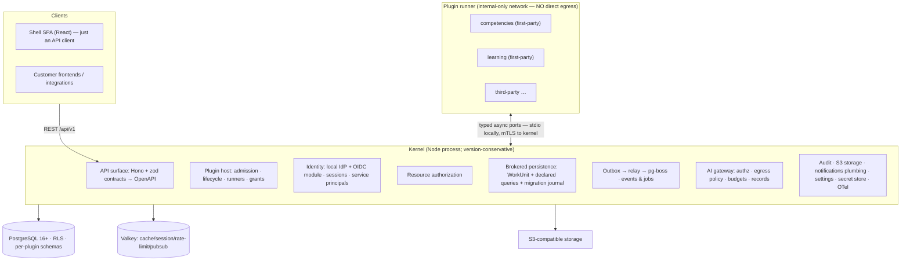

# Plerni — Product & Architecture Design

**Status:** Draft v6 — δ 5.5 blind pass consolidated (5 new blockers resolved: runner topology, event-engine rewrite, Directory/ReBAC, bounded query grammar, proof-of-human classification; cost cuts adopted) · **Date:** 2026-10-12
**Working name:** Plerni (codename; renameable)
**Review provenance:** adversarial review rounds by four independent model families — α (authoring) · β ×5 · γ ×3 · δ ×1 — pseudonymized per `AGENTS.md` §0 (the maintainer's tooling is private) + historical counter-evidence pass against the predecessor's repository + founder field experience. Review transcripts are retained privately by the maintainer (they cite predecessor internals); their integrity manifest lives in `docs/reviews/SHA256SUMS.txt`.

---

## 1. Product definition

**One-liner:** the open-source, AI-first skills and learning platform — a stable kernel, everything else a plugin.

**What it is:** a self-hostable LXP (Learning Experience Platform): competency/skill models, learning content, development goals, career-development workflows, mentorship. An AI copilot is embedded in every workflow where AI is enabled — *AI proposes, humans commit*. Every capability, including the ones we ship, is a plugin built on one public SDK.

**Audiences:** (1) companies ~500–50,000 employees running it on-prem or in their cloud (CIS market first; EN-master OSS community); (2) developers/integrators building plugins; (3) customers who integrate via API only and never touch our UI.

**Hard invariants (founder constraints):**

1. **Equal plugin citizenship** — identical SDK, contracts, *and admission path* for first- and third-party plugins. Enforced by CI on both axes: first-party code importing outside the SDK fails the build (import parity), and first-party plugins pass the identical sign→verify→install→migrate→activate pipeline in CI (admission parity — §12).
2. **API-first parity** — the platform is fully usable as pure API, and **one contract registry drives every surface**: REST endpoints, OpenAPI, and MCP tool descriptors are generated from the same zod contracts; declarative UI schemas are *declared* per plugin and registered (not generated — presentation metadata has no home in zod). MCP read parity from P1; MCP write tools land with the proposal ceremony in P3; the alignment gate (§10) runs continuously over whatever surfaces are exposed. Parity is an *executable acceptance gate* (§10), distinct from browser acceptance.
3. **Multi-tenant from commit #1** — one artifact serves single-tenant appliances and multi-tenant SaaS; tenancy is config. Tenant identity is placement-independent (no host-specific bits) so dedicated-DB placements stay *possible in the future* without code forks — but **v1 is shared-DB only**; dedicated-DB routing, per-DB journals/relays, and per-tenant restore are explicitly out of scope until a placement annex is written.
4. **No marketplace before demand** — distribution machinery is demand-gated (Phase 5). Year-1 success has **three** terms, and a platform-purity metric alone cannot constitute success: (a) zero kernel PRs leaking domain nouns + one external extension installing from a tarball into a running kernel in CI; (b) **≥1 design-partner pilot deployment running the P3 slice with named users and measured learning-workflow adoption**; (c) the capacity annex's delivery arithmetic confirmed by actual phase velocities. (All three blind reviewers independently found that without (b) the product can "succeed" with zero users.)
5. **Mainstream-only tech** — well-known to developers, well-documented, well-represented in AI-agent training data; the *combination* must be maintained and have a replacement path.
6. **Dependency freshness** — newest *validated* stable within supported compatibility lines (policy in §14), never blanket automerge.
7. **Anti-AI-slop UI** — a packaged UI kit and icon set; no bespoke component library; every visual value is a token (§9 preserves the predecessor's counter-evidence and the insurance architecture).
8. **Pure OSS** — Apache-2.0 + DCO. Monetization deferred; no entitlement machinery in v1.
9. **AI-agent-native development** — machine-enforced boundaries, typed contracts, small files, ADRs. **Agent-native ≠ human-free:** a named human maintainer role holds migration approval and visual-diff review authority, with availability and escalation defined in GOVERNANCE.md (§13).
10. **CIS-first, global-ready** — the constraints of the CIS enterprise market are design inputs, not afterthoughts: local AI providers (GigaChat, YandexGPT, Ollama/local models) as first-class adapter plugins; Keycloak-first OIDC interop; air-gap as a first-class deployment profile (default-deny egress, offline bundles, no cloud KMS assumption); documented data-residency posture (152-FZ-style on-prem answers); RU-complete product locale with Cyrillic-complete typography, KK/UZ next; no region-locked features and an EN-master repo keep the global market open.

**Non-goals (v1):** marketplace/moderation/publisher portal; untrusted-plugin UI tier; OpenSearch in core; general AI eval platform; per-tenant SaaS productization machinery; entitlement keys; payroll/recruiting/HRIS domains; Next.js/SSR; dedicated-DB tenant placement.

---

## Product & engineering principles (carried over from the predecessor product)

Validated by the predecessor's enterprise deployment; adopted as principles, rewritten — no text or code carried over.

**Product truths** *(each principle names its enforcement or is explicitly culture — the blind panel's audit):*
1. **The unprepared-user test.** If completing a scenario requires hidden expert knowledge, the design is wrong — not the user. *(Enforcement: role-chain walkthroughs are written for unprepared-persona flows; periodic moderated usability pass before public launch — process gate.)*
2. **Honesty over polish.** Never show a feature the user cannot actually use. *(Enforcement: dead-CTA lint + banned-placeholder-string gate, §12.)*
3. **AI proposes; humans commit.** Mechanized by the durable-proposal ceremony + proof-of-human step-up (§8).
4. **No dead ends.** Every screen offers a way back and a search. Where AI is enabled, the assistant is the map; in no-AI mode the map is search + docs + an explicit navigation index (a specified, gallery-tested assistant-absent state — never a dead widget). Every error states what happened, what it means, and the next step. *(Culture + gallery fixture.)*
5. **Easy to leave, worth staying.** *(Enforcement: export-reconstruction test §4.5; tenant erasure §5.)*
6. **Success is visible in the data**, not only in a toast — and an action's consequences are visible on *every affected role's* surface (verified by role-chain walkthroughs, §12).
7. **Consequences before confirmation** — the **impact-preview contract** (§8) recomputes scope at confirmation time and refuses stale previews.

**Interface discipline** *(binds shell and declarative plugin UI by construction; MF-remote UI is enforced by admission lint — §9)*
8. **Tokens only** — no ad-hoc colors, spacing, radii, shadows, font sizes.
9. **Muscle memory is sacred** — confirm/cancel order never changes; safe and dangerous actions never share visual priority.
10. **Color is never the only signal** for status, error, or required fields.
11. **Real data, slow hardware** — designed and tested against realistic volumes and weak devices.
12. **Canonical vocabulary** — one name per concept, governed and enforced; user-facing copy is informal, localized, jargon-free.

**Engineering culture**
13. **ADRs carry the why.**
14. **Docs are part of the product** — behavior changes update docs in the same change.
15. **No god-components** — agents naturally produce god files (the predecessor fought 3,000-line components); a file-size ratchet exists from day 0.
16. **Done = demonstrable behavior** — a live click-through and an executable test. Gates are fail-closed and proven so by negative fixtures (the predecessor shipped a silently fail-open gate).
17. **Cheapest capable agent/model per task; independent review for high-risk work.** Codified failure modes: cheap models guess conventions (disqualifier list for convention-heavy tasks); reviewers pin the exact git revision under review; one channel's confidence is not a signal.
18. **Nobody is trusted by default — in either direction.** Agents never blindly agree with people: a human's statement is a hypothesis to verify, exactly like a model's output. A single model never both generates and verifies — verification goes to a different family with the pinned revision. When the human doesn't know, we consult another model instead of guessing together. Agreement is not evidence; verification is evidence.
19. **"Done" is never taken on faith.** A completion report *starts* verification, not ends it: run the thing, exercise the changed path, observe the result. Claimed-but-unverified artifacts are treated as noise — by CI where mechanizable (gates, negative fixtures), by a verifying agent where not.
20. **Every bug gets an owner the moment it's seen.** Whoever spots a bug either fixes it immediately or files a tracked deep-dive task — "another agent wrote this code" is not a valid reason to pass by. Unowned bugs are how phantom-bug populations breed (the predecessor's slop inventory is the counterexample record).

---

## 2. System overview



One application image; plugin executable state is identified by an **artifact manifest** (kernel version + plugin packages/digests + migration journal state), not by image digest (§14). On-prem appliance = docker-compose (kernel, **plugin-runner**, Postgres, PgBouncer, Valkey, S3, nginx). SaaS = same artifact, multi-replica.

**Plugin topology (δ B1 fix — the previous draft contradicted itself):** plugins cannot be both kernel child processes (stdio needs a parent) and residents of an egress-denied container (a container boundary needs sockets). The resolution: the **plugin-runner service** hosts a supervisor that (a) talks to the kernel over one mutually-authenticated channel on the internal-only network, (b) spawns plugin child processes locally and speaks framed NDJSON over their stdio, (c) issues a per-plugin capability credential at spawn that binds every IPC call to plugin identity/version/grants. The runner's network reaches only the kernel broker (+ operator-approved internal allowlist); all external egress goes through tenant-bound broker ports. v1 runs **one process per plugin** — pooled mode is dropped (pooling collapses per-plugin identity).

---

## 3. Kernel

The only version-conservative component. Thin Hono transport; zod schemas as source of truth; OpenAPI generated.

**Services:** identity/sessions · tenant registry + RLS context · **resource authorization (plugin-extensible RBAC — §6)** · plugin host · brokered persistence gateway · unified outbox · audit (commits with the mutation) · AI gateway (controls only — §8) · **MCP server (tool descriptors generated from the contract registry — §10)** · S3 storage · notifications plumbing (channels, preferences, dedup, delivery — *templates and copy are plugin content*) · tenant settings · kernel secret store (§6) · OTel telemetry · admin shell backend.

**Kernel explicitly excludes:** all domain logic, LLM provider adapters, retrieval implementations, SCORM/xAPI/LTI adapters, SAML/SCIM connectors. The OIDC sign-in module is kernel-builtin (identity is kernel).

**Kernel-purity gates (CI):** primary = architectural dependency-graph/import rules; secondary = governed domain-noun grep whose noun list and allowlist diffs require an ADR and a reviewer outside the first-party plugin authors (an ungoverned allowlist is the leak channel).

**Framework trust answer (the two models split — β: Fastify for recognizability; γ: keep Hono — adjudicated):** **Hono stays, isolated behind a kernel-owned handler interface** (Web-standard `Request`/`Response`; a lint rule forbids `hono` imports outside `transport/` — the framework becomes a replaceable ~N-LOC edge adapter, and Fastify is the documented swap). Enterprise trust is answered with artifacts, not brand: a one-direct-dependency SBOM, CI-generated OpenAPI 3.1 published for scanners, standard OIDC, no framework session magic. (Had Fastify won, its schema-compilation-executes-code warning would apply: the host never compiles plugin-supplied schemas — our contracts are zod-authored and host-controlled regardless.)

**Hono-era lessons applied (predecessor evidence):** explicit AsyncLocalStorage cookie context + byte-compared parity test (the silent no-Set-Cookie trap); route registration enforces static→dynamic→catch-all precedence; fail-fast env/config validation at bootstrap; boot preflight verifies CA-cert chains for external integrations; SSE/streaming is process-local — multi-instance streaming routes through Valkey pub/sub.

**Kernel self-upgrade (decided now — retrofit-hostile):** expand-contract migrations with two-release tolerance (kernel and plugins); upgrade preflight gate (disk, plugin SDK-range compatibility, pending migrations) in the admin shell with stuck-instance detection; backup-before-migrate mandatory on appliances (restore = rollback; documented restorable version pairs); concurrent-version tolerance (kernel N and N+1 live during rollout).

---

## 4. Plugin platform

### 4.1 Package & supply chain

Signed npm tarball (Sigstore provenance), digest-pinned, **no npm lifecycle scripts at install**, offline-verifiable bundles, emergency disablement. Catalog automation deferred until manual distribution is a demonstrated bottleneck.

**Plugin licensing posture (decided early, per founder review):** the manifest requires an SPDX `license` field. Third-party authors keep their own licenses, including commercial ones — we never relicense or redistribute proprietary plugins without permission, and the platform never claims rights over plugin code. The future catalog (P5, demand-gated) MAY support paid plugins with revenue share as the monetization path; nothing in v1 precludes it, and no entitlement machinery is built meanwhile.

### 4.2 Manifest (v0 — experimental)

Declares: id, version, SDK semver range, required ports, routes, event pub/sub, jobs (incl. declarative cron), migrations dir, UI contributions (declarative schemas and/or remotes), requested capability grants. SDK v0 ships with a **stated support/deprecation window and a v0→v1 author migration path with tooling**; the compatibility window (§10) covers installed plugin code across SDK majors, not only API clients. (Entitlement keys: cut — YAGNI.)

### 4.3 Ports & the WorkUnit protocol

Every port call carries host-constructed context: tenant, actor, plugin identity+version, grants, trace, deadline. **Plugins never mint these identities.** Ports: Db, Events/Jobs (§7), AI, Notify, Storage, Audit, Config, Clock, **Directory** (read access to users/groups/relation edges — §6), brokered HttpEgress, Secrets (references, never values).

**DbPort — static SQL + WorkUnit.** Plugin SQL is declared at package time and **parsed at kernel admission** (never only in the author's CLI — an author could skip it): a real SQL parser (libpg_query-class) validates an **allowlist** of statement/node types and functions (denylists invite false confidence — the parser *classifies* each statement, and data-modifying CTEs inside a "read" are rejected as mutations outside a WorkUnit). Real UIs need dynamics, so declared queries support a **bounded grammar**: whitelisted sort columns, declared optional predicates, and keyset pagination parameters — composed by the broker from the grammar, never from raw strings. The broker injects authz predicates (tenant + object-grant scope from the query's declared resource binding) into the parsed AST before execution — filtering happens *before* execution, not after, and a 50k-row employee list is the reference benchmark. Runtime binds only parameters. All durable writes go through a typed **WorkUnit** — declared mutations + kernel effects (event emissions, job intents, audit entries) — submitted to the broker and committed in **one kernel-side transaction**; this is what makes "outbox rows commit with the business write" true at the plugin tier despite plugins holding no transactions.

**WorkUnit conditional semantics (read-modify-write, blind-panel blocker):** a WorkUnit may carry (a) `expect` preconditions — resource identity + expected version, verified at commit time; a failed precondition aborts the *entire* unit (mutations + audit + outbox) with a typed `CONCURRENCY_CONFLICT` error the plugin may retry; (b) **lock reads** — declared queries marked `FOR UPDATE`, executed *inside* the WorkUnit transaction (the only reads allowed there); (c) declared result-chaining (output values of statement N bound as parameters of statement N+1 — mutation results feed subsequent statements without leaving the transaction). Default scope is single-aggregate; multi-aggregate WorkUnits must lock aggregates in canonical (id-sorted) order. **Delivery protocol join:** consumer-side effects + dedup marker + cursor advance + execution-authority (fencing-token) check commit as one transaction — the transactional inbox.

**Object-level authorization binding:** every declared query/mutation names the resource type(s) it reads or writes (including through joins and bulk predicates); the broker evaluates object-level grants against that binding (collection filters are authz-scoped *before* execution, not after). RLS separates tenants; this contract is what separates employee A's records from employee B's inside one tenant. Same-tenant adversarial tests live in the isolation suite.

**Cross-plugin consistency (named vocabulary):** cross-plugin multi-entity operations are event-driven (no distributed transactions). The SDK provides a minimal **process-manager contract** — named steps, compensations, and intermediate states — with one worked example (goal + linked-assignment) in the conformance suite. Intermediate states are *labeled* (pending), so during the consistency window every surface shows a truthful in-progress state (principle 6). IPC waits never occur inside the broker's transaction.

### 4.4 Isolation & trust tiers

Equal citizenship = identical contracts and admission policy — **not** equal trust.

| Tier | Isolation | Who |
|---|---|---|
| Operator-approved (MVP default) | Supervised Node **child process per plugin** (never per tenant), spawned by the runner supervisor; per-plugin capability credential binds every call | Any operator-installed plugin, incl. all first-party |
| Verified publisher | Child process + restricted grants | Later, with catalog |
| Untrusted | OS/container isolation OR remote-integration-only (scoped APIs + webhooks) | Deferred tier |

`worker_threads` rejected as a boundary. **IPC transport (named):** framed NDJSON over stdio between the supervisor and each plugin child; the supervisor bridges to the kernel over one mutually-authenticated TLS channel per runner on the internal network (control + port calls, correlation IDs, cancel frames, bounded messages, stream backpressure). Kernel↔supervisor authentication is mTLS with operator-issued certs; supervisor↔plugin identity comes from the spawn-time capability credential. (An IPC harness spike joins the DB spike in P0/P1.)

**Egress containment, precisely scoped:** the plugin-runner environment denies direct outbound networking; the runner may reach ONLY the kernel broker endpoint (and an explicit per-plugin allowlist of internal services the operator approves, e.g. an internal IdP). All external egress — HTTP, telemetry, subprocess — is forced through tenant-context-bound broker ports; enforcement is topological, not trust-based. Plugin channels are mutually authenticated and per-plugin (a sibling cannot ride another plugin's channel). Browser-executed MF remotes have a separate egress surface, governed by per-plugin CSP `connect-src` allowlists. (Single-process dev topology relaxes this and says so honestly.)

**Containment honesty:** timeouts request cancellation; a plugin that ignores cancellation cannot commit — the broker checks **fencing tokens at commit time**. External effects already issued are marked "outcome unknown" and reconciled, never assumed.

### 4.5 Lifecycle — stages and activation state machine

Artifact **install** → schema **migrate** → code **activate** → per-tenant **enable**; distinct stages, distinct authorities. **v1 activation is a readiness-gated rolling restart of runner workers** (seconds, orchestrator-driven) — the full hot multi-replica activation machinery (epochs, fencing, late-joiner reconciliation) is deferred as over-engineering for a stage with no external authors; the journal still records activation state (`installed → migrated → active → failed`) so the future hot path has an honest foundation. A plugin upgrade = migrate (expand-contract checked by the boundary checker for backward compatibility, since old code may briefly run against a migrated schema) → rolling runner restart → version-aware route activation. Install authority is operator-only; tenant admins never upload executable code.

**Subscription suspension (disable semantics):** disabling a plugin **parks** its subscription cursors. Parked subscriptions are exempt from the retention low-water mark for a bounded backlog quota (default 30 days or a size cap, whichever first); beyond quota, the operator is warned and may export-then-force-advance. Re-enable runs a throttled catch-up replay with a stated budget. §16 test 8 fires events *during* disable to prove no silent loss and no unbounded growth.

**Disable** stops new execution, retains exportable data; **re-enable** is a tested round trip. **Export format:** versioned archive of the plugin's schema rows + referenced S3 objects + the grants/config metadata needed to interpret them — verified in CI by reconstruction outside the original deployment.

### 4.6 Migrations & schema rules

Per-plugin PG schema containing **tables, indexes, constraints only** — no functions, triggers, or `DO` blocks (closes the indirect `set_config` path). Migration identity: CREATE on its own schema only, no kernel-schema grants, no CREATE EXTENSION, no SECURITY DEFINER. **Kernel-owned extension allowlist** (`vector`, `pg_trgm`) is provisioned by the kernel's bootstrap migrations and baked into the appliance image — plugins never install extensions (air-gap change control honored). **Identity references:** plugin tables reference kernel identity only via declared read-only `REFERENCES` grants on the kernel's identity columns (`users(id, tenant_id)`), preserving the tenant-preserving composite-FK rule; no other kernel-schema grants exist.

**Approval artifact:** every migration carries a signed approval (approver identity — human or delegated reviewer agent per the §13 gate policy — scope hash of the migration content, timestamp), committed alongside it; CI verifies signature and scope — the gate is real *and* pipelines never stall or bypass. The identical policy applies to third-party installs.

**Boundary checker** (against the **live migrated DB**, plus a periodic live-DB audit gate — doc invariants drift): per plugin table — ownership inside the plugin schema; `tenant_id NOT NULL`; `ENABLE` **and** `FORCE RLS`; **exactly one canonical tenant policy** (PostgreSQL OR-combines permissive policies; policy *text* is verified, not existence); tenant-preserving composite FKs `(tenant_id, id)`; runtime-DML-only grants (a migration-grant linter blocks `GRANT ALL` — the predecessor's TRUNCATE/TRIGGER escape).

### 4.7 Routes

Host-owned route registry: plugin owner, API version, method/path, stable operation ID, request/response schemas, permissions, execution limits. Collisions and incomplete contracts rejected before activation; **no undeclared handlers**. Kernel authenticates → resolves tenant → authorizes → validates input → applies limits → constructs trusted execution context → *then* dispatches over IPC; responses validated on return (with a declared size/streaming exemption for large collections and SSE — validation tax acknowledged and bounded).

### 4.8 Plugin→plugin dependencies

Cross-plugin reads via the owner's public query port or events — never tables. Event payloads semver-versioned under the same breaking-change CI gate as the SDK. **Unknown event version → park with error, never best-effort handle.** A platform contract registry marks public vs. plugin-private schemas; public ones carry semver + deprecation windows.

### 4.9 Proof gates (CI)

Black-box install of an externally-built tarball into a running kernel; SDK conformance suite; breaking-change checks across routes/events/jobs/ports/SDK/event payloads; **admission parity** — first-party plugins pass the identical sign→verify→install→migrate→activate pipeline in both compose and SaaS validation profiles.

---

## 5. Data & tenancy

PostgreSQL 16+ (supported-major baseline; major upgrades = rehearsed migrations). Single DB, shared tables (v1; dedicated-DB placement deferred — §1 invariant 3).

**Table taxonomy (two classes, both explicit):**
- **Tenant-domain tables** (kernel + plugin): `tenant_id NOT NULL` + FORCE RLS + exactly one canonical tenant policy — enforced at migration time against the live DB.
- **Kernel-internal machinery tables** (outbox, delivery records, pg-boss job store, AI budget ledger, relay state): no tenant RLS; access only via **named service identities** (relay, job-runner, broker, migration, admin) with least-privilege grants; every identity exercised against a migrated DB in CI. Tenant scoping inside these tables lives in row payload + application-level enforcement by the owning kernel service, audited.

**Data-layer decision (both reviewing models converged):** **Kysely over node-postgres (`pg`) for the kernel.** The tournament record, honestly: the "aggregate client can't cover plugin schemas" argument against Prisma was falsified (ADR-0148 solved plugin schemas ORM-independently); the founder's air-gap evidence cut back (engine binaries at generate time — mitigated partially by image-baked clients); both independent reviews then selected Kysely on the same mechanism-level grounds — SQL migrations are the single source of truth (our journal), the TS `Database` interface is *derived* (`kysely-codegen` runs in CI and its output is committed: drift becomes a compile error — fail-closed, ideal for agent-authored code), zero runtime deps with no generate step (air-gap clean by construction), direct `Pool` control making `SET LOCAL` pinning transparent and greppable in one choke point, and an API small enough to vendor/fork ourselves in an emergency. Drizzle is the documented runner-up (same no-codegen property; its `schema.ts` is a second representation to keep in sync). Prisma 6 is rejected *for this project* (generated-type compile costs and codegen coordination outweigh conveniences at kernel scale — its production-verified RLS pinning is noted with respect); Prisma 7 stays blocked until driver-adapter pinning is proven. Plugin schemas are plain SQL applied by the journal (no ORM involved). **The P0 spike gates this with named criteria:** `transaction().execute` connection pinning + `set_config(..., true)` transaction-local RLS context + PgBouncer transaction-mode compatibility + unnamed-statement discipline + a typecheck-RSS benchmark of Kysely's generics at representative schema size. **Fallback coherence (δ M1):** a driver-level failure (pinning/SET LOCAL/PgBouncer) predicts Prisma failing too — those are node-postgres properties — so that failure class means redesigning the tenancy substrate, not swapping ORMs. Only a typecheck-ergonomics failure triggers the ORM fallback, and it lands on **Drizzle** (same no-codegen property), never on the tool rejected *for* compile costs. Kernel schema stays small by design.

- Missing tenant context fails closed at **two** layers: RLS *and* an application-layer tenant guard (the warm-pool lesson: pooled connections reverting `SET LOCAL` fail *silent* — zero rows, no error — so the app layer verifies context independently).
- Standing BYPASSRLS roles are minimized, enumerated, and audited; platform operations use a dedicated, scope-limited role.
- Brokered persistence: DB grants contain (plugin role reaches only its schema), RLS catches forgetfulness, static DbPort resists forgery. All three required.
- Pooling: PgBouncer transaction-mode compatible (no session SET / session advisory locks / LISTEN on pooled connections; the relay gets a dedicated connection). Interactive (non-batch) transactions only where `SET LOCAL` matters. Read replicas are incompatible with this pinning model — documented trade-off.
- **Tenant reference data is versioned per-tenant migrations**, not provision-time seeds (the predecessor's seed model was later judged operationally brittle — late-created tenants never received later-shipped reference rows).
- **Isolation CI:** two-tenant suite (CRUD, joins, FKs, jobs, **events/subscriptions/cursors**, missing context, pool reuse, rollback, search, export, tenant-GUC manipulation attempts) against a real migrated DB — with a **vacuity guard** proving the tests can fail.
- **Tenant lifecycle end-state (erasure):** whole-tenant exit = export-then-erase. Per-tenant DEKs in the secret store enable **crypto-shredding** (destroying the tenant's DEKs renders its encrypted-at-rest content unrecoverable); the append-only audit retains tombstone records (who/what/when), never payload content past erasure; event-log rows are tenant-tagged and purged past cursor floors; S3 objects and analytics events included. Verified by a restore-and-search-negative test.
- **Per-tenant reference migrations** roll out in background batches (resumable, throttled) — fleet cost acknowledged, bounded, and never in the request path.

---

## 6. Auth, identity & secrets

- **Built-in local IdP (kernel):** email+password (argon2id), TOTP MFA (encrypted secrets), hashed single-use rescue codes, email-verified reset, secure initial-admin bootstrap, login/recovery throttling, **offline recovery path**. Deliberately not a general IdP product.
- **OIDC module (kernel-builtin, P1):** auth-code + PKCE, issuer/mix-up protection (RFC 9700), exact redirect matching; IdP tokens server-side. SAML/SCIM connectors: later plugins (reassess Ory Polis then); lifecycle *semantics* are kernel-owned from day one.
- **Linking:** stable `issuer+subject` → user; never auto-merge by email; tenant policy may enforce SSO-only (governs local login too, with audited break-glass access).
- **Sessions & the disablement protocol (the fired-employee fix — β+γ consolidated):** PostgreSQL is the only revocation authority: `sessions` (hashed opaque tokens) + `user_auth_state` (`disabled_at`, `revocation_epoch`). Local disable is **one atomic PG transaction** (set disabled → bump epoch → revoke sessions → audit + NOTIFY) and never depends on the IdP; the epoch bump is the universal kill; a successful SSO login never clears a local disable. Worst-case disable latency for ordinary requests = the **5-minute identity-freshness lease**; admin and sensitive surfaces validate the session row *per request* (immediate); a `strict_disable` tenant policy makes per-request validation global for regulated customers. Lifetimes (tenant-overridable): access credential 5 min; session idle 12h / absolute 7d (then mandatory re-auth); admin session 1h; step-up MFA ≤15 min for sensitive ops (user management, exports, keys).
- **IdP synchronization:** OIDC backchannel logout (signature/audience/event/sid-sub validated, replay-protected) as the fast path; refresh-time revalidation through the IdP connector — whose contract *must* prove "disabled account ⇒ revalidation fails" (introspection `active:true` alone is not disablement semantics); per-request userinfo/introspection **rejected** (couples availability, multiplies IdP load). IdP-down grace ladder: continue on local authority with `degraded_since` + per-refresh audit; a failed renewal never extends freshness; IdP 5xx never means "valid"; >24h degraded + privileged role → forced logout; >72h → for SSO-enforcing tenants, **break-glass-mediated audited policy suspension** (never a silent fallback to forbidden local login); other tenants force local re-auth; on reconnect, batch-revalidate every session of that IdP. Front-channel logout is best-effort cosmetics only. **Lifecycle ordering:** a late termination event arriving after legitimate reactivation must not re-disable the account — identity carries an **incarnation counter** (termination/rehire events bind to source incarnation + event version; stale-incarnation events are rejected and reconciled). **Federated admin MFA:** for SSO-only tenants, admin MFA is verified via IdP `acr`/`amr` claim validation, with local WebAuthn step-up as the fallback.
- **Break-glass:** separately provisioned local admins, WebAuthn-bound, rate-limited, alarmed on every use.
- **SCIM/HR deprovisioning** arrives as a later plugin, but the kernel command ships in v1: `identity.deprovision { external_id, source, event_id, source_incarnation, source_version }` — idempotent on `event_id`; termination/rehire events bind to the source incarnation so a stale termination arriving after rehire is rejected and reconciled. The plugin translates wire events; it never touches sessions.
- **Freshness-lease caching:** Valkey accelerates invalidation fan-out and may cache the freshness deadline with TTL ≤ the lease — but it never *authorizes*: authority is the PG session/epoch record, and a Valkey snapshot restore can only *shorten* access (§16.15). Admin MFA mandatory.
- **Audit** (append-only `auth_audit`): login/refresh/logout/epoch_bump/revoked/disable/deprovision/stepup/breakglass events with actor, target, session hash, epoch before/after, IdP subject reference, reason, and **`decision_basis` (local | idp-confirmed | degraded-grace)** — the field that answers "why was this user still active on day 3 after termination." Never log tokens.
- **Machine access:** tenant-scoped service principals — hashed, scoped, expiring, revocable, rotatable opaque credentials; client-credentials for confidential integrations; auth-code+PKCE for delegated browser clients. An upstream IdP token is never automatically a Plerni API token. JWT only when offline verification is genuinely needed. Explicit CORS policy for custom browser clients.
- **Kernel secret store:** PG-resident, envelope-encrypted (per-tenant/purpose DEKs under a kernel KEK); KEK from env or key file — air-gap compatible, no cloud KMS assumption; rotation = KEK re-wrap + DEK re-encrypt procedures; Secrets port resolves references at the broker, never exposing values. Covered by the P1 backup/restore drill.

**Authorization model (plugin-extensible RBAC + relationship grants):** the kernel's authorization is fully generic — resource-type + resource-id + action + grants — with no kernel-native domain taxonomy. Plugins declare in their manifest: permission namespaces, resource types, actions, and default role mappings; tenant administrators compose roles from these building blocks. **Time-boxed delegation is a first-class grant type:** a user can delegate a subset of their own permissions to another user for a defined period (vacation coverage), with expiry, auto-revocation, and full audit trail. **The kernel owns a domain-neutral Directory** (users, groups, and typed relation edges such as `reports_to` — edge types are *data* registered by plugins/admins, not kernel schema; this is how the purity gate and "manager sees employee progress" coexist). Grants may be **relationship-qualified** — e.g. "holder of edge `reports_to` → subject's resources of type `learning.assignment`, action `read`" — giving ReBAC-lite without per-pair grant maintenance across reorgs. Evaluation is identical for human sessions, service principals, and MCP/AI actors — an agent acting via MCP holds exactly its actor's (or a delegated subset's) permissions, never more. Authorization checks execute kernel-side at the route registry before dispatch and again inside the broker for object-level access (§4.3 predicate injection).

---

## 7. Queue & events — one machinery

**Contract:** *"commit durable work intent with the business mutation"* — via WorkUnit (§4.3) at the plugin tier, directly in kernel services. A relay (dedicated LISTEN/NOTIFY connection + authoritative polling — notifications are hints) dispatches:

- **Topology:** stateless competing relay workers on every replica — **no leader election** (correctness never depends on a leader; a leader lock is at most a measured efficiency optimization). Claiming via short `FOR UPDATE SKIP LOCKED` transactions (PgBouncer-transaction-mode safe). LISTEN/NOTIFY is a zero-payload wake-up hint on a dedicated, unpooled, health-checked connection (alert when no relay listener appears in `pg_stat_activity`); polling every ~1s — continuous under backlog — is the correctness net, not a fallback: notifications vanish when no healthy listener exists, and NOTIFY payload overflow would block committing business transactions. NOTIFY shares the outbox row's transaction, so wakeups are commit-consistent.
- **Events (rewritten after the blind+δ panels — the per-aggregate cursor design was doubly broken):** a single **append-only event log** in the kernel schema: `(seq bigserial, tenant_id, aggregate_type, aggregate_id, type, version, payload, created_at)`. Writers insert inside the business transaction via WorkUnit. `seq` comes from a PG sequence — allocation is non-transactional, so rollbacks simply leave absent rows; no lock serialization on the write path. Each subscription holds **one global cursor** (`last_seq`), not per-aggregate state. Readers use the **lagging-horizon rule**: process committed-visible rows with `seq > last_seq AND seq <= safe_point`, where `safe_point` excludes rows younger than the in-flight horizon (default 10s — younger rows may belong to still-open transactions). Absent rows (aborted inserts) are skipped naturally by the horizon — no tombstones, no lock probing. **Filtered subscriptions can never stall:** the sequence is global, so unsubscribed types are skipped without creating gaps. Per-aggregate ordering is preserved by writer-side discipline (business writes lock the aggregate row, so its events allocate in lock order) — probability-bounded by the horizon, which is stated. Delivery = dedup marker `UNIQUE(subscription, seq)` + handler effects + cursor advance + fencing check in **one transaction** (transactional inbox). Pending-work discovery is a plain index scan (`seq > :cursor AND seq <= :safe_point` + subscription filter) — no S×A anti-join. New subscriptions initialize at the current max seq (or a declared start point). Retention: min over live cursors, parked subscriptions exempt per the §4.5 quota. Hot-aggregate throughput and the horizon trade-off are stated in the capacity annex. No global *ordering* promise; per-aggregate order only.
- **Fan-out amplification fix:** no eager per-subscription delivery rows at write time (the S×E write amplification is the in-DB killer shape) — an append-only event log + durable per-subscription cursors materialize deliveries lazily. Retention is low-water-marked on the slowest live cursor; poison/unroutable events go to a DLQ table with alarms, never to silent deletion.
- **Jobs** → pg-boss (claim/retries/expiry; verify SKIP LOCKED claiming in our pinned version) with the kernel envelope: tenant, plugin, handler+payload version, idempotency key, deadline, attempt budget, trace, service identity. The outbox→job handoff is a single transaction (claim row, insert job, mark dispatched) — exactly-once *inside* PostgreSQL; beyond PG's boundary only at-least-once exists and the SDK says so in writing. Jobs are unordered by contract; handlers needing ordered side effects consume the event layer. Knobs: `expiredIn` ≥ 3× p99 handler runtime — with a **cold-start default** per job class (conservative fixed bound, e.g. 60s, until real p99 exists; expiry-vs-runtime is *the* duplicate source — a re-queued but still-running job executes twice), bounded retries, aggressive retention (queue churn is a vacuum problem, not a claim-throughput problem), singleton keys for debounce. Declarative cron via manifest with misfire/uniqueness rules; DLQ + authorized operator replay in the admin shell. pg-boss tables are kernel-internal (§5 taxonomy): handlers re-enter tenant context via `withTenant` — claiming is cross-tenant machinery, execution is tenant-scoped.
- **Duplicate/loss battery (§16 test 17):** consumer crash after side-effect before ack → redelivery carries the same idempotency key (external calls send `Idempotency-Key`); zombie worker + lease re-dispatch → fencing tokens rejected by executors, sweeper re-claims only after lease expiry *and* missed heartbeat; retention blocked below the slowest cursor; relay crash between enqueue and publish-ack → same-connection transaction.
- **Fairness:** per-tenant/plugin concurrency + enqueue admission limits as protection; bounded batches; oldest-pending-age alerts; a boot/health check fails loudly if the dispatcher isn't draining.
- **Capacity — measured, never calendared.** Capacity C = sustained deliveries/sec while p99 publication lag ≤1s, claim p95 ≤50ms, foreground p99 degradation ≤20%, vacuum keeps up. Migration starts when forecast peak exceeds 50% of measured C. Named next step: **Debezium outbox CDC → Kafka**, keyed by tenant+aggregate. If foreground OLTP is the limit instead → tenant-to-cell PG sharding (Kafka doesn't fix that). Reference ceilings on tuned NVMe PG: ~10–30k events/s batched dispatch; pg-boss low thousands of jobs/s per queue. A million mostly-idle tenants is a trivial shape; burst fan-out is the killer shape. The founder's scale requirement (millions of users in one tenant / a million tenants, multi-server, no duplicates) is answered by: sharded stateless relays + SKIP LOCKED claiming + cursor ordering + measured-C migration trigger.
- **Concurrency bounds (activation):** per-plugin activation/migration takes a DB advisory lock (unpooled connection) with a stated wait budget (5s) and wall-clock budget (60s) — §16 test 7 exercises both under two replicas.
- **Upgrade path:** BullMQ (incl. its PostgreSQL backend) remains a possible dispatcher swap behind the unchanged contract.

---

## 8. AI gateway — kernel owns control, plugins own intelligence

**Kernel owns only:** provider capability registry (tools / structured output / streaming / context limits / usage reporting — plus declared modalities: text, image, audio, video); **provider presets + automatic model discovery** — an admin enters a provider preset (OpenAI-compatible endpoint, GigaChat, YandexGPT, Ollama, …) plus credentials once, and the gateway fetches the model list and capability map automatically (the predecessor forced manual per-model setup with re-entered keys — a repeated, named pain); PII egress policy engine (per-tenant; **default-deny offline appliance profile**: BYO key / local-approved model / no-AI mode); atomic budget reservations reconciled post-call (uncertain charges stay reserved; **reservations carry a TTL and a sweeper reclaims them on plugin crash** — tested by killing a plugin mid-call and observing reclamation); bounded agent execution (steps/tokens/tool-calls/time/concurrency + kill switch); durable proposals; versioned execution records; gateway invariant evals (PII-filter regression, budget correctness — no general eval platform).

**Proposals, impact preview & action classification:** every mutating action is **manifest-classified** (`routine` | `sensitive` | `destructive` — declared by the plugin, lint-verified against its route contracts; principle 7 becomes enforceable). Routine delegated agent writes are allowed with full audit; **sensitive/destructive actions require the durable proposal + nondelegable proof-of-human** (fresh WebAuthn/MFA step-up ≤5 min, bound to the action hash — bearer credentials can't produce it; an agent attempting self-approval is acceptance test 9). The proof-of-human ceremony is **browser-gated by design and carved out of the API-parity gate** (which covers everything else; the ceremony gets its own browser test — resolving the parity contradiction). Proposals bind tenant, actor, exact action+arguments, resource versions, expiry; authorization rechecked at execution; approval consumption + durable execution intent are one atomic write. The impact-preview contract recomputes scope/count/reversibility at confirmation; stale previews refused.

**Budget reservation states (crash-correct):** reservations are durable with explicit states — `reserved` → `dispatched-uncertain` → `reconciled`/`released`. The TTL sweeper releases **only** abandoned-before-dispatch reservations; a dispatched-but-uncertain charge stays reserved until the provider reconciliation window closes (the provider may still complete and charge it). For providers without billing APIs (Ollama, some GigaChat tiers) the reconciliation window closes on **token-metered estimate** — actuals are declared unavailable, metering is the record. Delayed-charge tests prove the budget stays bounded after crashes.

**Plugins provide:** provider adapters, retrieval implementations (pgvector + FTS hybrid; tenant+ACL filtered *before* content enters prompts; exact-filtered first — shared ANN indexes suffer cross-tenant recall interference), copilot workflows.

**Containment:** retrieved content and tool output are untrusted; authorization outside the model; action IDs verified against candidate sets. **Egress is enforced by topology** (§4.4): plugin code runs on an internal-only network, so adapters, retrieval, telemetry, and tools reach the network only through the tenant-bound broker. **MCP server (first-class, not deferred):** tool descriptors are generated from the same contract registry as REST/OpenAPI, through the same command/query authorization layer — no privileged agent API, no token passthrough. Destructive MCP tools pass through the durable-proposal/impact-preview ceremony like any AI-initiated mutation.

---

## 9. Frontend & UI foundation

React 19 + Vite SPA. **FSD pragmatic variant** (ratcheting baseline, extra `entities/` layer where canonical FSD forbids necessary cross-domain reads, no pure-churn renames, every gate reachable via a documented npm alias) enforced by lint with real slice public-API rules. EN-master + **RU as the equal default pair from day one** (founder directive) with KK/UZ next (locale-parity CI gate; zero hardcoded strings). WCAG AA pursued as evidence on our workflows, never assumed from kit choice.

**UI kit (evidence-amended decision):** **Ant Design**, pinned to the latest validated stable of the v6 (CSS-variables-native) line at scaffold time, with a v6-behavior watch ADR — the kit-agnostic token compiler below isolates us from behavioral shifts, and the founder's freshness invariant favors current majors once validated + **lucide-react** icons. Openness verified: MIT-licensed, official Figma design kits exist (importable into Pixso), and it runs at enterprise scale across the Ant Financial ecosystem and thousands of B2B products. Honest record: the predecessor ran antd in production and later removed it when a whale client's pixel-fidelity brand requirement exceeded any kit's theming — its most expensive UI decision; that was a brand-fidelity bar, not a scale or licensing problem. Plerni consciously accepts the opposite trade-off (founder invariant 7); the token contract is the insurance: if that fidelity bar ever returns, the blast radius is the adapter, not the product.

**Token architecture (kit-agnostic):** versioned defaults + tenant overrides → shared theme compiler → resolved semantic tokens → `--plerni-*` CSS variables + kit adapter (ConfigProvider). Layers: foundation → semantic (incl. states) → component roles. Tenant overrides typed, with `schemaVersion`+`revision`; admin edits within constrained ranges + contrast validation; bootstrap delivers resolved CSS *before* React mount; live preview runs the same compiler; publish saves a revision.

**Plugin UI — mechanisms by slot complexity (predecessor's ADR-0193 lesson, hardened by δ):**
1. **Declarative UI schemas (the only plugin UI until P5):** settings panels, forms, menu entries, widgets, and list/detail screens are declared as data (bounded grammar over the shared kit's components) and shell-rendered — **no plugin JavaScript in the host at all**, and interface principles 8–12 enforced by construction.
2. **Module Federation remotes — deferred to P5 (demand-gated):** δ demonstrated the admission-lint premise was infeasible (minified bundles can't be statically proven to preserve dialog order, signal redundancy, or token discipline), so the lint is dropped rather than shipped as a rubber stamp. When demand justifies remotes: digest-pinned, immutable hosting, chunk verification, shared React/kit singletons (a kit major upgrade policy for remotes is defined then), per-slot ErrorBoundary + CSS isolation + kernel-served disable hatch. Untrusted-plugin UI: not built.

**Anti-slop guardrails:** token lint parsing CSS *and* TS style objects (literal visual values/unknown tokens rejected; structural exemptions); component allowlist via one re-export package; fixture gallery of composed workflows (incl. the assistant-absent no-AI state); visual regression with human-reviewed diffs across themes/densities/long-RU-text/open overlays (theme scope breaks first in overlays — context-aware hooks only); agent instructions with approved page compositions.

**A11y test priorities:** date selection, table sort/filter, nested dialogs, form labels/errors, zoom, tenant contrast; Select virtualization caveat (`virtual={false}` where screen-reader completeness matters). Kit failure on a procurement-critical scenario → revisit the kit before rollout.

---

## 10. API surface & versioning

- One host-owned route registry (§4.7) generating a **deployment-specific OpenAPI** from kernel + active plugin declarations: namespaced components, stable operation IDs, errors, auth, pagination, async operations, uploads, streaming. A capability/activation revision lets clients discover changes.
- **Four independent version axes:** kernel release · plugin package · SDK protocol · public API — and the compatibility window covers API clients, queued work, persisted proposals, **and installed plugin code across SDK majors** (§4.2).
- **Two acceptance gates, never conflated:** (a) **API-parity gate** — an independently generated API client executes the maintained workflow inventory (install/configure/administer/AI-approval/domain workflows) without the shell; (b) **browser-acceptance gate** — shell e2e for what APIs can't prove (host-provider identity, overlays, CSS behavior, old-client compatibility).
- **MCP alignment gate:** MCP exposes a **curated tool inventory** (agent-appropriate capabilities — not every REST endpoint; admin/upload/streaming surfaces stay REST-only). The gate CI-compares the generated MCP manifest against the curated inventory for schema/permission identity, and a real MCP client executes the parity workflow inventory. Kernel and plugin routes join the inventory by explicit declaration, at activation. MCP authentication: tenant-scoped service principals + OAuth authorization-code/PKCE delegation (Dynamic Client Registration deferred to P4 with the SAML/SCIM wave). Scope: read surfaces align from P1; write tools land with the proposal ceremony in P3.
- **REST conventions:** stable error envelope with a closed code set that includes `CONCURRENCY_CONFLICT` (409) — the WorkUnit precondition-abort surfaces identically via REST and MCP.

---

## 11. Observability & analytics

Three streams, never merged: **audit evidence** (commits atomically with the mutation) · **product analytics** (in-DB typed events, retention + partitioning, bounded queries; egress adapters as plugins; opt-out documented) · **ops telemetry** (OTel traces/metrics/logs, Prometheus endpoint, JSON logs; OpenSearch = later plugin).

Kernel correlates HTTP → plugin IPC → jobs → events → AI calls; plugin-supplied attributes can't overwrite host identity; URLs/headers/exceptions/AI payloads redacted. Egress/exporters have bounded queues and cannot stall business operations. SLO signals shipped early: oldest pending job/outbox age, plugin crash loops, quota rejections, DB pool wait, AI cost/throttle/fallback. Cardinality budgets; no PII/prompts in default telemetry.

**Logs are a product surface, not an ops afterthought.** Structured JSON logs carry correlation IDs end-to-end; retention and access policy are explicit per stream. The admin console ships first-class viewers: (a) **security & audit log** — the PG-resident audit/auth_audit stream (§6), filterable, exportable. **Tamper evidence, honestly scoped:** audit rows hash **commitments** (payload hashes, not payloads — erasure can't break the chain), chained **per tenant** (a global chain would serialize all writes); checkpoints are exported to a customer-controlled sink outside the deployment (a same-deployment checkpoint can't catch whole-deployment rollback). The appliance operator is inside the trust boundary — the chain detects *covert* alteration, which is the honest claim; (b) **error log** — application errors with traces, grouped by fingerprint, linked to OTel trace IDs; (c) job/outbox health. Appliance profile keeps these fully functional without external systems (in-DB or file-backed stores); SaaS profile may back them by the customer's log platform.

**Embedded analytics — "engine outside, data viewed inside."** Analytics-adapter plugins (Matomo first) both *emit* allowlisted events to the external engine and *pull its reports back via API* to render them in admin dashboards — the operator never leaves Plerni to see web analytics. The same adapter pattern covers external log platforms (view Loki/OpenSearch content in-platform) as plugins. In-DB product analytics remain the source of truth for product events; adapters are render/egress layers, never stores of record.

**Operator assistant (later):** an AI plugin that reads audit/logs/analytics and *suggests* operator actions (capacity, security drift, unused features) through the same durable-proposal ceremony — recorded as a P4/P5 candidate, not v1 scope.

---

## 12. Security & supply chain (day-one blocking CI)

| Gate | Tool | Blocks on |
|---|---|---|
| Secrets | gitleaks | any finding |
| SAST | CodeQL + Semgrep | findings |
| SCA | osv-scanner + Renovate (majors enabled) | high/critical, EOL majors |
| Containers | Trivy | high/critical |
| SBOM | CycloneDX diff per release | new critical |
| License | license audit | non-OSI in appliance deps |
| Coverage | per-package ratchet + named security-invariant tests | regression below floor |
| Tenancy | RLS isolation suite + GUC-forgery attempts + vacuity guard | any leak |
| Migrations | boundary checker against live DB + grant linter + signed approval artifact | violation / missing approval |
| Kernel purity | dependency-graph rules + governed noun gate | any hit |
| Contracts | breaking-change: routes/events/jobs/ports/SDK/event payloads | unversioned break |
| Plugin proof | black-box tarball install into running kernel | failure |
| Admission parity | first-party plugins via the identical signed-tarball pipeline, both deploy profiles | divergence |
| Provenance | commit-policy gate: Conventional Commits subject + human DCO sign-off + role-only `AI-assisted: yes` trailer | non-conventional subject, missing sign-off, identity-bearing trailer |
| Gate health | negative fixtures proving each gate blocks (and fails CLOSED) | fixture passes |
| File-size ratchet | max-LOC-per-file budget, ratcheting down (god-file prevention) | over budget |
| Test quality | duplicate-test detection (title/body similarity), assertion-density lint (no `toBeDefined`-only suites), skip/todo budget | violation |
| Dead code | knip (unused exports/files/deps) | new dead code |
| i18n discipline | hardcoded user-facing string lint | any hit |
| Doc coupling | path-based heuristic (changes under `src/`, `contracts/`, `migrations/` require doc-tree changes) + PR-template declaration; AI classification advisory only | missing docs |
| Vocabulary | terminology lint over locale files against the canonical glossary (principle 12) | non-canonical term |
| Honest UI | dead-CTA lint (routes/links must resolve), banned "coming soon" strings in shipping flows (principle 2) | any hit |
| Perf smoke | k6 smoke + bundle-size budget from P2 (principle 11 gets teeth before P4) | regression over budget |
| License | license audit; boundary: gate covers platform/distribution dependencies — commercial *plugins* installed by operators are out of scope by definition | non-OSI in appliance deps |

**Gate status (2026-10-12):** implemented and blocking today — secrets (gitleaks, with a negative-fixture proof in CI), private-markers (governed + maintainer-local patterns), license-audit, kernel-purity, commit-policy, SCA (osv-scanner), plus the gate-health fixture suite proving each implemented gate fail-closed. Every other row in this table is planned and lands with its subject phase; green P0 CI proves only the implemented set.

**AI-assisted review in CI (advisory-only, per δ's cut):** a pipeline step runs a configurable OpenAI-compatible LLM endpoint (DeepSeek, GigaChat, self-hosted — an API key in CI secrets) over every diff with the repo's conventions and ADR history injected. The reviewer is pinned to the exact git revision; findings must cite file:line + a concrete failure scenario or they're discarded; security-sensitive diffs go to a different model family than the author. It stays **advisory** — the FP-rate promotion machinery was cut as pre-demand overhead; maintainers label findings opportunistically to revisit promotion later with evidence.

**Two lint-backed envelope rules:** every error response carries a `next_step` field (principle 4 mechanized); every mutating route carries the manifest's action classification (`routine|sensitive|destructive`) — mismatches fail CI (principle 7 mechanized).

**Role-chain verification (workflow-level truth).** Every feature ships with a **multi-role e2e walkthrough**: the full chain of personas touches the real UI, and each step asserts that the previous step's consequences are *visible* on the next role's surface. Canonical shape (from founder's field experience): author creates and lists → employee discovers and assigns → author's statistics reflect the assignment → manager sees the employee's progress → admin sees and confirms on the dashboard. Rules: persona fixtures (author/employee/manager/admin at minimum); the workflow inventory (§10) doubles as the chain inventory, so a feature without a chain test is undeclared work by definition; feature PRs must include or update their chain walkthrough; the same chain also runs headlessly through the API/MCP parity gates. This is how broken *processes* — not just broken code — get caught, and it is the executable form of principle 6.

Gates staged as their subjects exist (P0 exits enumerate exactly which gates exist at P0 and prove them), with defined blocking severities, scan-failure behavior, and expiring exceptions (owner, reason, mitigation, review date). Public-repo rules: fork PRs get no secrets/privileged execution; release credentials isolated; signed kernel/shell images + published SBOMs + documented trust-root rotation. Threat model, vulnerability-reporting channel, supported-version policy, SECURITY.md before public launch.

---

## 13. Repository & engineering process

```
plerni/
  apps/kernel/          # Hono API + kernel services
  apps/shell/           # React SPA (FSD pragmatic variant)
  packages/contracts/   # zod schemas, event registry, port types — the ONLY shared code
  packages/sdk/         # plugin SDK (v0 experimental + support window + migration path)
  plugins/competencies/ # first-party, same SDK, same admission pipeline
  plugins/learning/     # first-party, same SDK, same admission pipeline
  tools/cli/            # scaffold / pack / sign / verify / install
  e2e/  onprem/  docs/adr/  .github/workflows/
```

pnpm + Turborepo; eslint-boundaries + dependency-cruiser enforce the import graph. New SDK capability or trust boundary requires an ADR. **Agent-native with configurable gates:** approval authority is policy, not hardcoded humans — the default policy requires a *cross-family* agent review with a signed, recorded approval artifact for migrations and gate-config changes; a human maintainer owns the policy itself, sets escalation rules, and runs periodic audits. Humans keep ideas, features, and criticism; agents carry execution and first-line review (per founder direction), with the audit trail preserving accountability. **The commit trailer is role-only** (`AI-assisted: yes`) — development-tool and model identities are never published (AGENTS.md §0); high-risk work is verified by a human or a different model family than every generator, evidenced by a revision-bound review receipt whose identities stay in the maintainer's private archive (`docs/ai/model-routing.md`); the **convention-heavy-task disqualifier list is a versioned file** (`docs/ai/model-routing.md`), not tribal knowledge. Reviewer agents pin the exact git revision. Automated repo hygiene (temp/ policy, duplicate-test detection, stale-artifact sweeps).

Contracts vs. SDK: contracts = protocol/schema definitions; SDK = convenience code over them; plugin domain contracts stay plugin-owned and compose into registries.

**Compliance lives in code, not in prompts.** Every convention that can be mechanized IS mechanized (§12); agent instructions are reserved for judgment calls. Anything an agent is merely *told* to do will eventually be hallucinated past — anything the build rejects cannot be. New conventions are born as lint rules/gates first, prose second.

**Development conventions (codified from day one):**
- **Spec-driven development** — every feature starts as a spec in `docs/specs/` (problem, contract, acceptance criteria), then a plan, then tasks; the spec's acceptance criteria map to executable tests. New capabilities require the spec path; bug fixes, documentation corrections, and maintenance may reference the existing contract and a scoped issue instead.
- **TDD where it pays** — kernel services, contract logic, and domain rules are written red-green (failing test first); UI work leads with the fixture-gallery state, then implementation; every feature ends with its role-chain walkthrough (§12).
- **ADR for any decision** a future agent would otherwise reverse-engineer; conventional commits + human DCO sign-off + role-only `AI-assisted: yes` trailer (commit-policy gate, §12); PR template includes the chain-test link and the docs-update checkbox.

---

## 14. Delivery, operations & dependency policy

**One artifact:** single image; appliance compose (kernel, plugin-runner, PG, Valkey, S3, nginx) and SaaS from the same build. Every feature pays the two-validation tax (compose + SaaS) — budgeted, or the dual deployment silently dies.

**Executable-state identity:** an **artifact manifest** (kernel version + plugin package digests + migration journal state) is persisted and included in backups. Backup = coordinated PG + S3 snapshot protocol (defined quiescence/consistency point) + secrets/config dependencies (incl. the secret store's KEK custody); restore replays the manifest onto clean infrastructure (tested in both deployment profiles, §16 test 10). **Restore invalidates credentials:** because PG is the revocation authority, a restore to an older point would resurrect revoked sessions/tokens — so every restore bumps a global `restore_epoch` that invalidates all sessions and service credentials issued before it (users re-authenticate; audit records the restore). Previously issued external effects are "outcome unknown" territory — documented, never assumed.

**Dependency freshness (bounded):** security fixes triaged <24h with expedited tested releases; routine patches/minors ~7-day ageing, weekly batches, ≤30 days current; framework/runtime majors = separate migration PRs + explicit decision within 30–60 days, no automerge; stateful services = latest minor of supported major; exceptions named/owned/expiring. ~10–15% capacity reserved for maintenance. Docker bases digest-pinned with auto-update; published release artifacts + lockfiles + provenance preserved. Node: newest validated Active LTS, pinned actual runtime. OTel convention versions chosen deliberately; React/Vite/Federation validated as a compatibility group.

**Upgrade/recovery:** kernel self-upgrade contract (§3); appliance backup-before-migrate; restore drills cover PG + S3 + secrets/config. **Install ergonomics are a deliverable, not an afterthought:** docker-compose AND Helm chart from P4, and every install/upgrade instruction is proven by a fresh-environment drill (an agent following the docs verbatim on a clean VM must succeed — the predecessor shipped incomplete instructions; that failure mode is now a test).

---

## 15. Roadmap — exit-criteria gated

| Phase | Contents | Exit criteria (defined, named) |
|---|---|---|
| **P0 Foundations** | repo, Apache-2.0/DCO/CONTRIBUTING/SECURITY/trademark, dependency policy, contract conventions, ADR-0001…0005, **two spikes**: (a) DB-invariant spike (Kysely `transaction().execute` pinning + transaction-local `set_config` + PgBouncer transaction mode + unnamed-statement discipline + typecheck-RSS benchmark — must pass before any schema work), (b) IPC harness spike (NDJSON/stdio framing via runner supervisor, cancellation, backpressure), capacity annex **with numbers** (team/agent throughput, per-phase effort, CI minutes/PR) | Each P0 gate blocks its deliberately-bad fixture PR; spike reports filed with pass/fail verdicts; capacity annex reviewed **by a different model family than its author** (objective bar: P1–P3 must arithmetically fit the stated team in ≤9 months with the protected set intact) |
| **P1 Kernel core** | tenancy+RLS+tenant guard, local IdP + OIDC module, plugin-extensible RBAC **+ Directory service + relationship grants**, audit (commitment-chained per tenant), storage, secret store, notifications plumbing, outbox/relay/pg-boss, telemetry, minimal admin shell, self-upgrade contract, service principals, REST conventions, generated kernel OpenAPI, **MCP server core (curated read inventory)**, resource limits, **provisional operating-envelope targets** (draft numbers set at P1, revised against P4 measurements) | Two-tenant isolation suite green (incl. events/cursors + vacuity guard); **named API-only kernel workflows pass without the shell** (create tenant, bootstrap admin, provision service principal, rotate credential, configure OIDC — via REST; MCP verifies the curated read surface); backup→restore drill (PG+S3+secrets) reproduces state **with restore_epoch credential invalidation verified** (equality predicate: manifest hash + row counts + records selected by a written sampling rule) |
| **P2 Plugin platform** | SDK v0, manifest, runner supervisor + child-process isolation + egress-denied topology, migration journal + boundary checker + approval artifacts, **declarative UI slots**, CLI, conformance suite, minimal author docs, global-search provider contract | Fixture plugin (built outside the monorepo) proves: tarball install + runner rolling restart activation, API-doc composition, signed migration approval, crash recovery (defined target: kernel + siblings serving within 10s), disable→re-enable, two-replica upgrade |
| **P3 AI + reference domains + pilot** | AI gateway controls, provider adapters (one OpenAI-compatible + one local CIS option: GigaChat or Ollama), durable proposals + action classification + proof-of-human + impact preview; Competencies + Learning plugins; copilot propose→commit flow; MCP write tools; **design-partner pilot starts** | Full MVP acceptance suite (§16); API-parity, MCP-alignment (curated), and browser-acceptance gates green; **pilot deployed at the design partner with named users and an adoption metric recorded** |
| **P4 Enterprise hardening** | SAML/SCIM adapters (+ OIDC DCR evaluation), HA notes, measured perf baselines vs. envelope (provisional targets revised), plugin-author docs, onprem runbook, **Helm chart + fresh-VM install drills, embedded-analytics adapter (Matomo), operator-assistant plugin candidate** | **External-author friction protocol** (defined cohort: 2–3 recruited external authors; "support interaction" = any maintainer message; target: successful install in ≤1 working day with ≤2 interactions); measured resource baseline + install/upgrade runbook |
| **P5 Ecosystem (demand-gated)** | verified-publisher tier, manual catalog, container-isolation tier, **Module Federation remotes** (with the then-defined kit-major policy) | Starts only on **measured demand: ≥3 external authors with real installs via manual distribution** |

Public launch additionally requires: stranger-can-clone bootstrap with synthetic data and no founder credentials; documented AI-disabled operation and outbound-network requirements; honest alpha labeling.

## 16. MVP slice & acceptance suite

**Slice:** Competencies plugin (versioned definitions, proficiency scales, assessments, development goals) + Learning plugin (small catalog, goal-linked assignment, completion evidence). AI reads authorized evidence, proposes a goal + assignment; a human commits. Completion emits a durable event updating goal progress — **completion never implies demonstrated competence** (explicit invariant). Acid test: an extension built *outside the monorepo* on the published SDK subscribes to goal completion and renders a tenant-scoped widget (declarative schema).

**Acceptance tests** (v1 runs one isolation mode — one process per plugin):

1. Two tenants with overlapping domain identifiers — no leakage.
2. Both domain plugins work without privileged internal access.
3. External extension installs and activates **without kernel restart** (runner rolling restart with readiness gate is allowed and measured ≤30s).
4. Plugin crash leaves kernel and other plugins available (kernel + siblings serving within 10s); revoked executions cannot commit (fencing).
5. Duplicate delivery does not duplicate progress or notifications.
6. Upgrade with pending jobs/events and old browser clients — compatibility window: one minor version back, stated in the client contract.
7. Two kernel replicas live during a plugin upgrade — the rolling runner restart keeps both API replicas serving; old-version pending jobs drain or are claimed by the new version per the envelope's handler-version rules; mixed-version dispatch never serves two plugin versions within one client session.
8. Disable stops new execution, retains exportable data; **events fired during disable are neither silently lost nor unboundedly retained** (parked cursor + backlog quota + throttled catch-up on re-enable); export reconstructs outside the deployment (incl. S3 objects).
9. Stale/expired/replayed AI proposal cannot mutate; stale impact preview refused; **an agent holding delegated MCP/OAuth credentials attempts to consume an approval and fails** (proof-of-human step-up is nondelegable).
10. Backup/restore reproduces plugin state and compatible artifacts from the artifact manifest on clean infrastructure; **restore bumps restore_epoch — all pre-restore sessions/credentials are denied**.
11. API-parity gate: the whole flow runs API-only, no shell. **MCP-alignment gate: the same flow runs through a real MCP client — equivalence predicate: identical business outcome (same resulting rows/state, modulo generated ids/timestamps) and identical permission boundaries.** (The proof-of-human ceremony is carved out — browser-gated by design, §8.)
12. Egress containment: plugin code with no broker grant attempts direct network access and fails (topology, not trust).
13. Tenant-forgery battery: direct tenant-GUC setting, additional permissive policy, smuggled `set_config` in a declared query — all fail closed.
14. AI budget reclamation: plugin killed mid-call → reservation TTL expires → budget reclaimed by sweeper.
15. Session revocation epoch: restore a stale Valkey snapshot → revoked sessions stay denied.
16. **Role-chain walkthrough (the process-truth test):** author publishes a competency goal + learning item → employee discovers and accepts the assignment → the author's statistics surface shows the assignment → the manager's surface shows employee progress (via the `reports_to` relationship grant — §6) → admin dashboard reflects the assignment and **confirms it** (the enrollment-confirmation action, an approval-classified mutation). Each step asserts cross-role visibility, in the UI; the same chain replays via API and MCP.
17. **Queue duplicate/loss battery (two replicas, burst load):** crash-after-effect-before-ack → redelivery carries the same idempotency key (no duplicate external effect — restricted to destinations with verified dedup contracts; others reconcile via "outcome unknown"); zombie worker + lease expiry → fencing rejects the stale execution; sweeper re-claim requires expiry + missed heartbeat; retention never deletes below the slowest *live* cursor (parked subscriptions honored per §4.5); relay crash between enqueue and publish-ack is atomic (same-connection transaction); NOTIFY listener absent → polling still dispatches within the latency floor; **rolled-back seq allocation → skipped by the lagging horizon, subscription advances; a type-filtered subscription advances past unsubscribed event types**.
18. **Activation/upgrade fault matrix:** runner killed mid-restart, replica down during upgrade, partial cutover with pending old-version jobs, interrupted migration — each lands in a defined terminal state from the §4.5 journal (`installed/migrated/active/failed`) with an operator-visible recovery path.
19. **Concurrency battery:** two interactive writers on one resource → loser gets `CONCURRENCY_CONFLICT` (no silent last-writer-wins), identical via REST and MCP; same-tenant object-level authz adversarial queries denied.

## 17. Known risks & open inputs

1. **First-party privilege creep** — import parity + admission parity gates; #1 cultural risk.
2. **Trusted-code runtime mislabeled as sandbox** — trust tiers stated honestly; denied-capability tests (§16.12–13).
3. **Upgrade mechanics becoming the real product** — self-upgrade contract in P1.
4. **Shared-resource bottleneck** — admission control + fairness; operating envelope targets in P1.
5. **Marketplace gravity** — P5 demand-gated.
6. **Platform vocabulary ossification** — contract registry + semver + deprecation windows.
7. **Agent-authored surface growth** — SDK ADR budget; signed migration approvals; cross-family review with pinned revisions.
8. **On-prem AI posture** — default-deny egress profile from the start.
9. **Tiny-team feasibility (the honest one)** — this design requires a SQL validation layer, a WorkUnit broker, an event engine, an activation path, and a UI admission system: ~15 subsystems with no upstream maintainer. After the δ pass the following were already cut/simplified as pre-demand overhead: pooled plugin mode, hot multi-replica activation (rolling restart instead), MF remotes (P5), compiled-bundle UI lint, AI-review promotion machinery, per-aggregate cursor machinery. P0 carries a capacity annex with an objective bar (P1–P3 arithmetically fitting ≤9 months, reviewed by a different model family); if it can't be met, further cuts land on trust tiers and surfaces — **never** on the contract layer, the tenancy floor, or the blocking CI core.

**Open sizing inputs before capacity planning** (not blocking P0–P2): active users/tenant, content/embedding volume, event rate, plugin count, tenant skew, appliance hardware floor, latency SLOs, RPO/RTO, jurisdictions.

## 18. Deliberately rejected (with the evidence that decided)

worker_threads as security boundary (Node capabilities leak) · **Prisma 7** (driver-adapter pinning unproven) · Prisma 6 (generated-type compile costs + codegen coordination; fallback only for Kysely ergonomics failure → and then it's Drizzle) · BullMQ-first (outbox unification makes it a dispatcher option) · Redis-branded (AGPL) — Valkey default (Microsoft's Garnet, MIT, noted as an acceptable alternative; Valkey wins on ecosystem breadth) · Next.js/SSR (founder call) · JWT-everywhere (opaque tokens until offline verification needed) · entitlement keys v0 · OpenSearch in core · general eval platform · per-tenant SaaS machinery · schema-per-tenant · dedicated-DB placement in v1 (forward-compat only) · Wasm plugins (ecosystem maturity) · gRPC sidecar default (ops burden) · **bespoke component library** (founder invariant; predecessor's bespoke system was its most expensive UI decision — accepted trade-off, insured by the token contract) · shadcn/Radix+Tailwind (owned-code slop risk) · runtime JS remotes for plugin UI until P5 demand (predecessor ADR-0193 + δ's infeasible lint) · provision-time tenant seeding (brittle — versioned per-tenant migrations instead) · plugin-shipped DB routines (functions/triggers/DO blocks — indirect GUC manipulation path) · **pooled plugin processes in v1** (collapses per-plugin identity) · **hot multi-replica activation machinery in v1** (rolling restart + readiness gate covers it) · **per-aggregate event cursors** (global log + lagging horizon — doubly broken under filters and rollback) · **eager per-subscription delivery rows** (S×E write amplification) · **SQL denylists** (allowlist parsing instead) · **per-request IdP introspection** (availability coupling) · **leader-elected relay** (correctness never depends on a leader).
